# Live runs

Generated by `node report.mjs` from `runs/*/telemetry.jsonl`. Each column is the mean over a run's latest 100 generations in traffic.

## City runs

| | lanes-d120 | lights-d40 | memory-s11 | memory-s3 | memory-s7 | memory3-s11 | memory3-s3 | memory3-s7 | none-d20 | none-d40 | roundabouts-d20 | roundabouts-d40 | softwall-s11 | softwall-s3 | softwall-s7 |
|---|---|---|---|---|---|---|---|---|---|---|---|---|---|---|---|
| generation | 2499 | 2999 | 1199 | 1199 | 1199 | 1199 | 1199 | 1199 | 2999 | 2999 | 1499 | 2999 | 699 | 699 | 699 |
| trips / car / min | 0.96 | 0.84 | 1.10 | 1.15 | 1.02 | 1.06 | 1.05 | 1.24 | 1.67 | 1.24 | 0.88 | 1.05 | 2.28 | 1.97 | 2.12 |
| crashes / km | 22.05 | 14.40 | 26.25 | 25.19 | 26.52 | 26.96 | 27.55 | 24.25 | 7.75 | 12.31 | 20.73 | 21.80 | 16.92 | 17.30 | 19.03 |
| car-on-car crashes / car | 3.02 | 1.31 | 3.23 | 3.24 | 3.00 | 3.30 | 2.58 | 3.19 | 1.10 | 1.63 | 0.70 | 1.15 | 1.80 | 2.08 | 1.48 |
| mean trip time (s) | 27.98 | 29.45 | 24.19 | 24.79 | 24.55 | 24.97 | 23.79 | 24.47 | 19.08 | 26.13 | 27.12 | 27.27 | 16.64 | 19.07 | 16.55 |
| waiting in junctions (%) | 4.11 | 6.93 | 5.20 | 4.07 | 5.77 | 4.92 | 4.61 | 2.85 | 10.73 | 3.76 | 11.17 | 4.62 | 0.88 | 1.19 | 0.97 |
| keeps to (right +) | -0.19 | -0.02 | -0.18 | -0.03 | 0.03 | 0.00 | -0.08 | 0.18 | 0.10 | -0.03 | -0.05 | 0.03 | -0.25 | 0.05 | -0.03 |
| junction conflicts resolved (%) | - | - | 59.21 | 64.77 | 63.47 | 63.48 | 63.46 | 65.07 | - | - | 77.54 | - | 59.63 | 67.96 | 60.85 |
| red lights run / car | - | 2.93 | - | - | - | - | - | - | - | - | - | - | - | - | - |

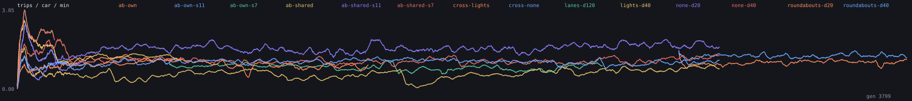

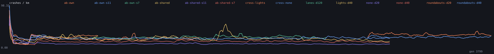

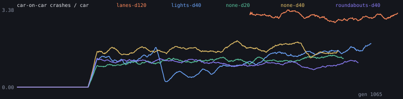

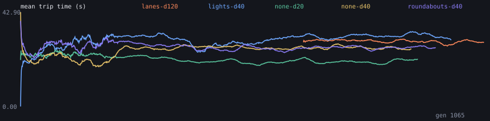

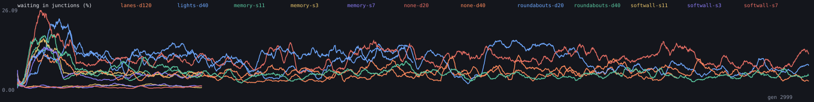

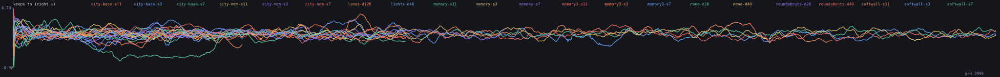

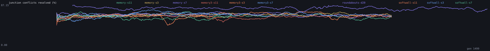

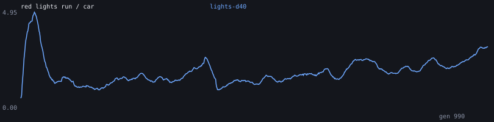

## Crossroads experiments

| | ab-own | ab-own-s11 | ab-own-s7 | ab-shared | ab-shared-s11 | ab-shared-s7 | cross-lights | cross-none | wide-s11 | wide-s3 | wide-s7 |
|---|---|---|---|---|---|---|---|---|---|---|---|
| generation | 699 | 699 | 699 | 699 | 699 | 699 | 3799 | 3799 | 699 | 699 | 699 |
| trips / car / min | 1.16 | 1.20 | 1.22 | 1.23 | 1.18 | 1.13 | 1.06 | 1.27 | 1.08 | 1.68 | 1.61 |
| crashes / km | 27.45 | 23.99 | 26.22 | 22.72 | 23.65 | 27.12 | 30.10 | 24.92 | 18.66 | 15.16 | 15.44 |
| car-on-car crashes / car | 3.07 | 2.80 | 3.28 | 2.82 | 2.73 | 2.90 | 3.64 | 3.45 | 1.54 | 2.60 | 2.48 |
| mean trip time (s) | 26.19 | 23.68 | 25.34 | 26.45 | 25.56 | 25.83 | 27.04 | 25.45 | 21.69 | 20.12 | 20.30 |
| waiting in junctions (%) | 2.00 | 3.90 | 2.09 | 1.84 | 3.45 | 2.74 | 3.42 | 2.04 | 0.33 | 3.17 | 4.18 |
| keeps to (right +) | 0.01 | -0.01 | 0.09 | 0.23 | -0.12 | 0.15 | 0.05 | 0.05 | 0.00 | -0.06 | -0.09 |
| junction conflicts resolved (%) | 61.29 | 67.86 | 56.35 | 69.80 | 69.74 | 61.58 | 51.47 | 58.60 | 80.00 | 80.50 | 80.95 |
| red lights run / car | - | - | - | - | - | - | 1.18 | - | - | - | - |

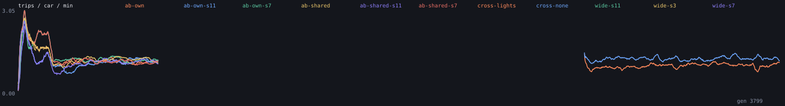

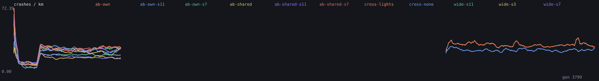

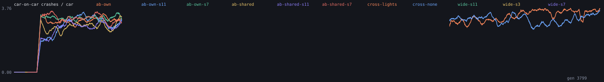

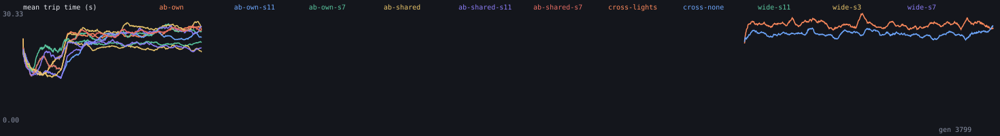

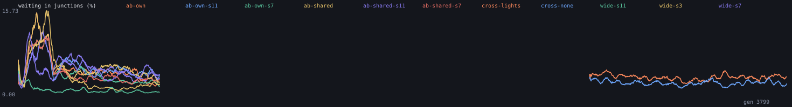

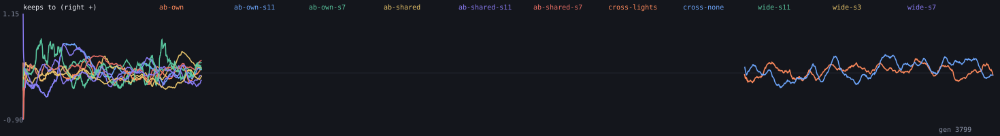

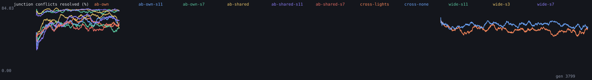

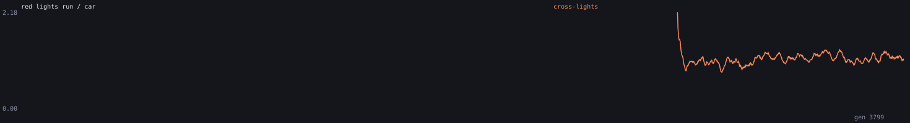

## Ecosystems

No fitness function. Each column is the mean over a run's latest city day (144 rows, one per ten city minutes).

| | eco-lights | eco-none | eco-none-s7 | eco-peds |
|---|---|---|---|---|
| day | 40.0 | 40.0 | 40.0 | 20.0 |
| cars | 40.97 | 70.13 | 73.08 | 52.47 |
| species | 4.46 | 4.45 | 5.43 | 5.23 |
| paid trips / hour | 25.25 | 36.63 | 36.67 | 36.04 |
| deaths / hour | 5.50 | 11.83 | 11.17 | 12.17 |
| deepest lineage (generations) | 35.57 | 96.31 | 93.26 | 19.49 |
| mean cargo gene | 0.02 | 0.02 | 0.02 | 0.02 |
| mean engine gene | 0.14 | 0.03 | 0.01 | 0.03 |
| mean length gene | 0.03 | 0.02 | 0.02 | 0.02 |
| mean sensor range gene | 0.08 | 0.02 | 0.14 | 0.15 |
| mean jam-avoidance gene | 0.87 | 0.37 | 0.84 | 0.42 |
| pedestrians hit per 100 crossings | - | - | - | 21.19 |
| mean paid trip time (s) | 63.07 | 30.91 | 32.32 | 27.15 |

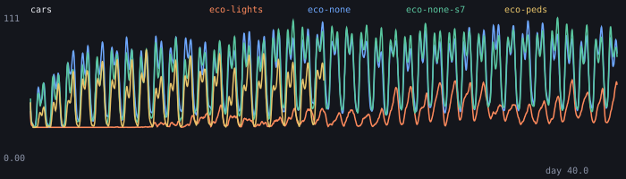

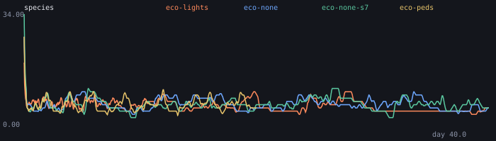

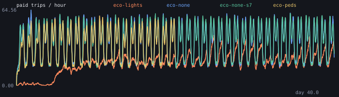

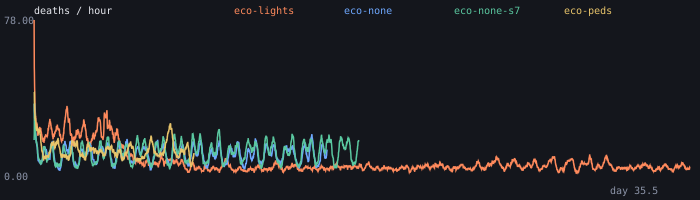

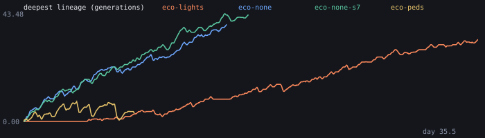

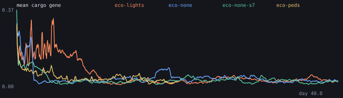

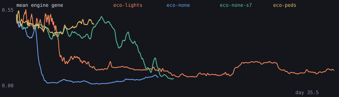

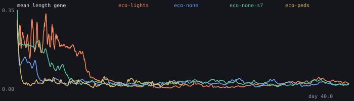

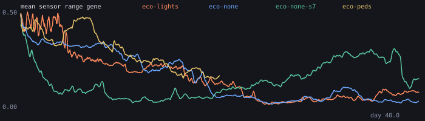

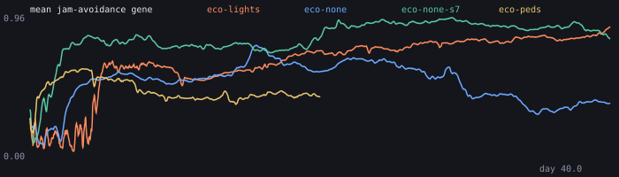

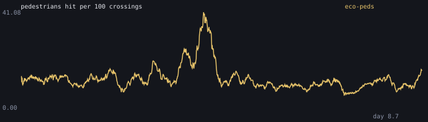

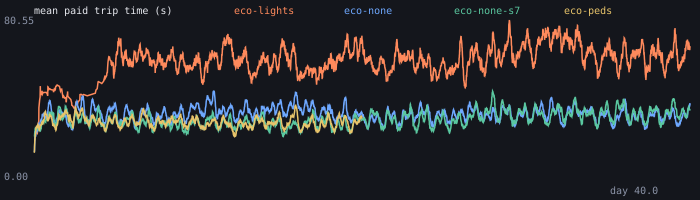

