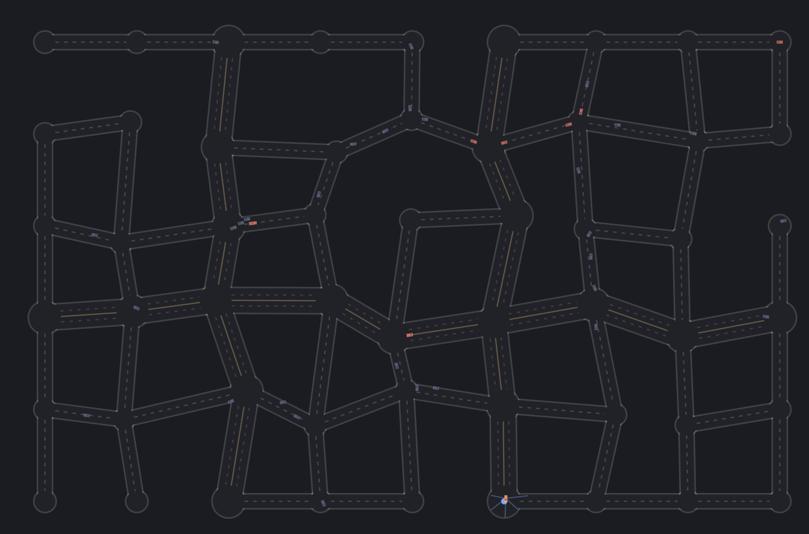
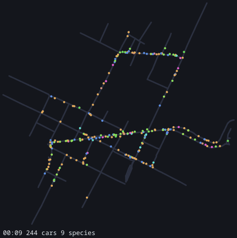
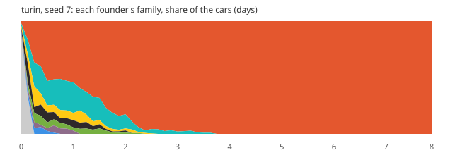

# Gridlock

A 2D traffic simulator in plain JavaScript with no traffic laws in the code.

[Generation mode](https://marcozorn.github.io/gridlock/) · [Economy mode](https://marcozorn.github.io/gridlock/eco.html) · [Turin](https://marcozorn.github.io/gridlock/eco.html?map=turin) · [Barcelona](https://marcozorn.github.io/gridlock/eco.html?map=barcelona) · [Manhattan](https://marcozorn.github.io/gridlock/eco.html?map=manhattan) · [Venice](https://marcozorn.github.io/gridlock/eco.html?map=venice) · [Findings](https://marcozorn.github.io/gridlock/findings.html) · [Replay the tape](https://marcozorn.github.io/gridlock/replay.html) · [Notebook](docs/NOTEBOOK.md)



The road graph, car physics, collisions, and A* routes are written by hand. Driving is not: each car is controlled by a small neural network trained with NEAT (using the engine from my `neat-from-scratch` repo). A car never sees the map or its coordinates. It gets 21 inputs: 5 rays fanned across the front (distance to walls, distance to the nearest car, and closing speed), its own speed, the angle to a point 35 units ahead on its A* path, offset from the road center, distance and sharpness of the next turn, and the traffic light state.

There are two modes:
- **Generations (`index.html`):** 120 cars drive across 6 rotating procedural cities. Score is distance driven along the route plus completed trips, minus crash damage, and the top drivers breed.
- **Economy (`eco.html`):** No fitness function. Each car has a wallet: passengers and freight bring money in, while fuel, wear, and crashes take money out. If a car saves enough it spawns a mutated child; if it hits zero it goes bankrupt and disappears. The car body evolves too (size, engine, brakes, sight range, ray count, cargo space). Demand follows a 24-hour cycle, you can load real street networks from OpenStreetMap (or type any city in the page), and you can toggle city policies like congestion charges, speed cameras, insurance, basic income, licences, or credit.



### What came out

Every experiment is logged in [`docs/NOTEBOOK.md`](docs/NOTEBOOK.md) (written by the agent as it ran them), including failed hypotheses. Because early 3-seed runs kept fooling me, major claims are tested across 20 paired seeds with 95% confidence intervals and a prediction written down before the run (see the [Findings](https://marcozorn.github.io/gridlock/findings.html) and [Replay the tape](https://marcozorn.github.io/gridlock/replay.html) pages, and the agent's longer [research summary](docs/SUMMARY.md)).

- **Driving:** Evolved drivers generalize to unseen maps and actually crash less on real OSM streets than on the procedural grids they trained on. They queue behind slower cars, but right of way at junctions never evolved. Adding 0.2s of reaction delay roughly quadruples crashes. In fog they speed up instead of slowing down, because they read the end of their shortened sight range as open road.
- **Economy:** Without subsidies, small and cheap cars win, and a single founder's family usually ends up owning almost the whole fleet. Across 20 Turin seeds, a congestion charge cuts crashes per car by 24% and trip times by 29%, at the cost of 18% fewer fares—and the same tradeoff holds with evolution frozen or with hand-written drivers, so it is an economic effect rather than an evolutionary one. Insurance increases fares by 34% and crashes per car by 87% because reckless drivers stop going broke. A 30-unit credit overdraft raises fares by 28% and crashes by 25%.
- **Streets & negative results:** Making Barcelona two-way increases fares by 18% with no change in crashes. Closing 5% of road segments at random disconnects about half of a real one-way city, while a grid stays connected. None of the real maps showed a Braess paradox. On a ring road there are no phantom traffic jams, giving cars a turn-signal output did not produce a signalling language, and there is no kin selection.



### Running it

No dependencies or build step.

```bash
python3 -m http.server   # browser UI at http://localhost:8000
node test.mjs            # headless checks
node headless.mjs        # CLI runner (see docs/NOTEBOOK.md for flags)
```

MIT.
