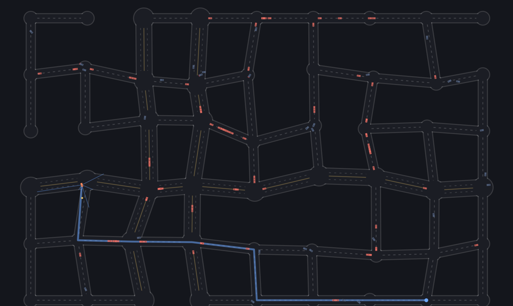
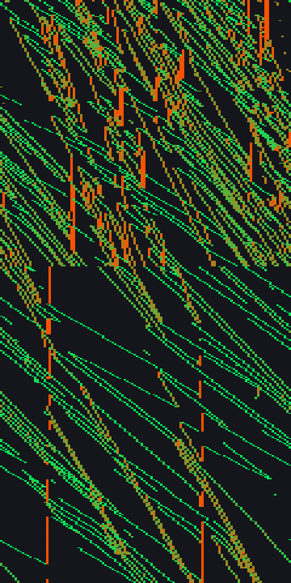
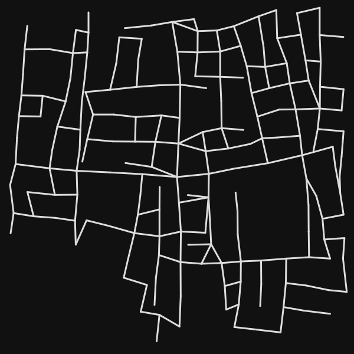
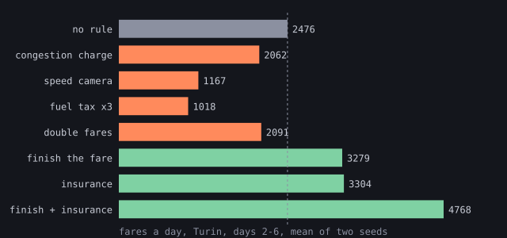
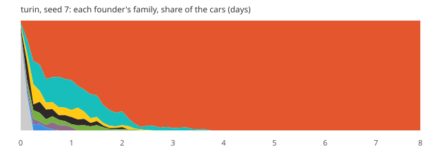

# Gridlock

A city where traffic evolves. There are no traffic laws anywhere in this code.

**[Run it in your browser](https://marcozorn.github.io/gridlock/)** ·
[the city with no fitness function](https://marcozorn.github.io/gridlock/eco.html) ·
[on Turin's streets](https://marcozorn.github.io/gridlock/eco.html?map=turin) ·
[on Barcelona's](https://marcozorn.github.io/gridlock/eco.html?map=barcelona) ·
[on Manhattan's](https://marcozorn.github.io/gridlock/eco.html?map=manhattan)


Every car is a NEAT brain. The roads, the physics, collisions and route finding
are written by hand; how to drive the route is not. The question this project
is building towards is whether, once everyone shares the streets, drivers invent
yielding, queueing and lane discipline on their own, or split into species like
couriers and trucks, or just gridlock.

The answers so far: a side of the road, yes, when there is no fitness
function and enough traffic, and which side is chance. Queueing, yes: they
follow the car in front and almost never overtake it. Yielding, no, because
in these cities it does not pay; priced high enough it starts to, in drivers
that already know how to drive. Couriers and trucks, only when freight pays
three times as much, in half the cities, and side by side only for a while:
the one city that split ended up all vans. And gridlock, only when crashes are
made to stay in the road, because these drivers crash their way through a
queue rather than wait in it.

It grew out of [neat-from-scratch](docs/neat.md), whose NEAT engine it still
runs on, and borrows its later ideas from
[primordial](https://github.com/MarcoZorn/primordial). No libraries, no build
step: serve the folder and open it.

- `index.html`: the generation-based city. Ghosts or traffic, density, no
  signals / traffic lights / roundabouts, heatmaps, any car's senses and brain.
- `eco.html`: the city with no fitness function. Wallets, births, deaths, two
  markets, evolved bodies, a road editor, fast-forward by the day.
- `LIVE.md`: tables and charts from the long headless runs.
- URL options: `?seed=7`, `?size=small|medium|large`, `?control=none|lights|roundabouts`,
  on the eco page the rules `?charge=1&camera=1&boom=1&finish=1&insure=1`,
  `?map=crossroads|turin|barcelona|manhattan`, and on the generation page `?traffic=1&density=20`.

```
python3 -m http.server                     # then http://localhost:8000
node test.mjs                              # headless checks, including "does evolution work"
node headless.mjs --run runs/x --gens 3000 --control lights --density 40
node headless.mjs --run runs/x2 --map crossroads --from runs/x/state.json --gens 4000
node headless.mjs --eco --run runs/e --days 40 --founders docs/trained.json [--pedestrians 40] [--map turin]
#   any run: --body k=v,... and --econ k=v,... override the car's and the economy's constants,
#   --no-sharing (with --from) turns NEAT fitness sharing off for an older population
node report.mjs                            # LIVE.md from every run's telemetry
node tools/sidechart.mjs out.svg runs/e1 runs/e2   # which side of the road an economy keeps to
FROM=2 TO=6 node tools/ecocmp.mjs e1 e2   # economy runs side by side: the source of most tables here
node tools/fuzz.mjs 7                      # a crash hunt over maps, rules and pedestrians
node tools/osm.mjs extract.json maps/name.json "Place"   # an OpenStreetMap extract as a map
```

## What it found, so far

### How they drive

- **Drivers learn to drive a city they have never seen.** After 300
  generations the evolved champion out-drove my hand-written controller on
  twelve unseen cities, and the shipped drivers do exactly as well in
  cities they never saw as in the six they were raised in (1.49 trips per
  car against 1.46, the same crash rate). The Python cars lose a lap on
  unseen tracks; these lose nothing, presumably because they steer by the
  route, which every city has. Raised in one city instead of six, they do
  as well in unseen ones (1.64 trips per car against 1.58, three seeds).
  On real streets, which they never saw either, they do better: per 1000
  units driven they crash 2.8 times on Turin, 1.4 on Barcelona and 1.3 on
  Manhattan, against 3.5 on the generated grids. And the other way round:
  raised on Manhattan alone, they drive generated grids as well as drivers
  raised on them (1.63 trips per car against 1.58, three seeds).
- **They drive by the route, but learn by the traffic.** Blindfolded to
  other cars, grown drivers barely notice; raised blind, they come out a
  quarter worse. Their position on the road and the route's direction are
  what they steer by; the inputs meant for waiting at a junction go unused.
- **Junction manners plateau early.** Drivers raised on a crossroads learn
  to avoid about ten more points of crossing conflicts than at first contact
  (roughly 52% to 63%), then stop improving. Junction crashes are under 5%
  of the damage a driver takes, but making every other kind of damage free
  did not help either: drivers learned to dodge, not to wait.
- **A memory helps, a little, and only early.** Brains with a memory wait in
  junctions about twice as much and start out resolving more conflicts, but
  longer runs and more memory channels do not climb past the same plateau,
  and in the full city it makes no difference at all.
- **Right of way does not pay here, until a junction crash costs thirty.**
  A hand-written yield rule costs evolved drivers 7% of their trips and
  saves no crashes. Priced at thirty times an ordinary crash, trained
  drivers learn to avoid junction conflicts (seven points more resolved,
  in two populations), at a price: in cities they have not seen they get
  lost in junctions far more often. A fresh population priced that way from
  the start mostly learns to drive worse.
- **Right of way did not evolve beyond that.** Not in a whole city, not in an arena that
  is nothing but one crossroads, not with crashes priced three or six times
  higher, not with better eyesight, and not when both cars pay for a
  crossing crash (that cut collisions 8%, but did not make anyone yield). About 60% of junction conflicts end
  without a collision, the same as for drivers that have never met traffic.
- **Light timing matters, if it is evolved.** A designed green wave did
  nothing; searching each city's light offsets gave 11-27% more trips on
  traffic the search never saw.
- **Lights teach easing off.** Drivers raised under traffic lights approach
  a red at little more than half the speed of a green, by lifting off the
  throttle rather than braking; drivers raised without signals ignore them.
- **In a crowded city the danger is the queue, not the crossing.** In the
  economy on Turin and Barcelona over 80% of crashes are car-on-car, and
  over 80% of those happen between junctions, in the traffic, not at the
  crossings.

### What evolves on its own

- **Without a fitness function, a side of the road evolves.** In the
  generation city which side cars keep to is inherited (autocorrelation
  0.71) but never locks in, even with 120 cars on the road. In the economy,
  once there are about a hundred cars, within four days usually three in
  four to nine in ten keep to one side. Which side is chance: one Turin run
  drives on the left, its twin on the right.
- **With no fitness function, the cheapest car wins, unless freight pays.**
  Every forty-day economy bred small, underpowered, short-sighted cars. With
  freight paying triple, half the cities evolved trucks; one held trucks and
  couriers side by side for a while, then converged on vans.
- **Cars and pedestrians cycle.** Once both populations can replace
  themselves they oscillate like predator and prey.

### Rules and prices

- **Fines teach, and cost.** Raising the price of a red light cuts
  red-running and car-on-car crashes within a hundred generations, and the
  city moves a third as many people.
- **One-way streets do not pay here.** Barcelona's Eixample and Midtown
  Manhattan with their real arrows carry a sixth to a fifth fewer fares than
  the same streets two-way, and are no safer: a fare across the block has to
  go round it.
- **A congestion charge prices cars out, it does not teach detours.** After
  two weeks the city moves nearly as many people (7% fewer) with 40% fewer
  cars, faster and safer; the gene for avoiding busy roads never moves.
- **A speed limit is obeyed, and costs a third of the fares.** Drivers
  settle a third slower; the fines while they learn crash the fleet, and
  once it has regrown, trips take 40% longer for 13% fewer crashes.
- **A city of drivers on the edge of bankruptcy loses passengers with
  them.** Of 507 picked up in six hours, 89 vanished with a car that went
  broke on the way and 41 with one that got lost. Doubling fares, once the
  bigger fleet has grown in, gets 70% of them there instead of 60%, at
  slower trips and more crashes.
- **Two rules about going out of business nearly double the city's fares.**
  Let a broke taxi finish its ride, and pool the cost of crashes: 4768
  fares a day against 2476, more than any change to the drivers did.
- **Traffic lights killed Manhattan's economy, and two rules revived it.**
  Under lights it never left the immigrant floor in twelve days; with
  finishing the fare and insurance it carried 4000-4500 fares a day (two
  seeds), though still 7-16% fewer than the same rules without lights.
- **Where the speed cameras go hardly matters, only how many.** A search
  over which of Turin's 342 roads get a 35 camera (tools/limits.mjs) settled
  on 68. On three unseen seeds, last of two days: no cameras 6633 fares and
  102005 crashes, evolved 5707 and 73285, the same 68 at random 5318 and
  70413, everywhere 1890 and 13740. Searching for fares alone overfits: it
  gained on its seed and lost 14% on the others.
- **Insure drivers and they crash twice as often, and move a third more
  people.** Not because they learn recklessness: the reckless ones simply
  stop going broke, and speed is what passengers pay for.

### Evolving them

- **Fitness sharing costs here.** Raised without it, drivers made 35% more
  trips in cities they had never seen (six seeds), and switching it off late
  in two long runs helped too. It is now off.
- **Two bugs mattered more than any tuning.** A four-second "lost" rule that
  killed every car waiting at a red light, and a stagnation rule that culled
  species for drawing hard cities.

## What the drivers actually look at

Twenty-one inputs go into every brain. Which ones matter? The shipped
drivers (`docs/trained.json`), in twelve cities they never saw, with one
group of inputs at a time held at a neutral value (clear road, no car,
centred, cruising, nothing ahead):

| silenced | trips per car | crashes per 1000 units driven |
|---|---|---|
| nothing | 1.48 | 3.60 |
| how sharp the next turn is | 1.63 | 3.56 |
| distance to other cars | 1.56 | 4.09 |
| distance to the junction | 1.44 | 3.45 |
| how fast the gap to a car is closing | 1.44 | 3.65 |
| distance to the walls | 1.23 | 5.83 |
| heading error to the route | 0.68 | 6.26 |
| own speed | 0.61 | 5.20 |
| sideways position in the road | 0.38 | 13.65 |

They drive by the route and the road: where they are across it, which way
the route goes and how fast they are going. Walls matter a little. Other
cars barely: blind to them, the drivers make more trips and only 14% more
crashes, so what that sense mostly does is slow them down. Closing speed and
the distance to the next junction, inputs added for the very behaviours the
project hoped for (braking for a stopped car, waiting at a junction), are
not used at all, which is the right-of-way plateau seen from the inside. And
the turn input does harm: without it they make 10% more trips at the same
crash rate. Raised without it from the start, though (300 generations, three
seeds, tested in the same unseen cities), drivers come out the same as with
it: 1.63 trips per car against 1.58, 3.41 crashes per 1000 units against
3.62, split both ways by seed. It is not needed, and the harm is a habit of
this one population, not something the input does to everyone.

So is the sense of other cars useless too? I expected drivers raised blind
to them from the start to come out the same. They do not, in any seed (300
generations, the last 100 with traffic, then the same unseen cities):

| raised | trips per car, six seeds | crashes per 1000 units |
|---|---|---|
| seeing other cars | 1.39 / 1.71 / 1.64 / 1.47 / 2.00 / 1.80 | 3.35 on average |
| blind to them | 1.25 / 1.24 / 1.12 / 1.43 / 1.14 / 1.16 | 4.52 on average |

A quarter fewer trips and a third more crashes, every seed. Blindfolding a grown
driver costs it almost nothing, but growing one blind costs a lot: the sense
matters while a population learns to drive in traffic, and what it learns
then (a speed, a line, a way of taking corners that leaves room) keeps
working once the sense is gone. The same three sighted populations,
blindfolded only for the test: 1.38 / 1.73 / 1.75 trips per car, 4.44 / 3.85
/ 3.68 crashes, as many trips as with their eyes open and 10% more crashes.
It is not that old drivers have learned to do without: at 300 generations as
at 1025, the sense is something to learn with, not something to drive by.
Raised blind to the walls instead, three seeds: 1.36 / 1.14 / 1.14 trips per
car and 4.10 / 4.43 / 4.80 crashes, about as far behind as the drivers
raised blind to other cars. Both senses earn their keep while a population
learns.

Do they queue? On the same road, going the same way, a car that catches up
with another either follows it or gets past. With the shipped drivers in
unseen cities, overtakes (two cars swapping order on a road) per 1000 units
driven: 0.10 with 40 cars at once, 0.28 with 120 and with 480. Crashes over
the same distance are 3.5, 6.5 and 14.3, so a car is twenty to fifty times
more likely to hit another than to pass it, and 23-30% of same-road pairs
are following within 25 units. They queue, and when the queue stops they
run into it.

`node tools/ablate.mjs turn` (or any other group) repeats a row. On the
generation page "Blind to cars" and "Blind to walls" do it live, and
evolution carries on with the sense gone.

## The city that cannot gridlock

Real traffic has a fundamental diagram: as cars are added, flow rises, peaks
at a critical density, and then falls, because past that point every new car
slows everyone else by more than it adds. That fall is gridlock. Here are the
shipped drivers in two unseen small cities (about 80 roads) with more and
more cars on the road at once:

| cars at once | flow (distance per tick, all cars) | mean speed | trips a minute | crashes per 1000 units | cars being towed |
|---|---|---|---|---|---|
| 10 | 5.3 | 35.4 | 17 | 2.2 | 15% |
| 40 | 18.6 | 30.3 | 59 | 3.5 | 21% |
| 120 | 43.4 | 24.2 | 130 | 6.5 | 30% |
| 480 | 101.1 | 16.4 | 260 | 14.3 | 44% |
| 1440 | 181.0 | 11.7 | 326 | 25.3 | 55% |

No peak, even at eighteen cars a road. Speed falls, crashes climb, but flow
keeps rising. My first explanation was the last column: a crashed car is
towed, and while it is towed it is a ghost that nothing can hit. At 1440 cars
more than half are ghosts at any moment, so a jam dissolves into crashes and
the crashes clear the road. Testing that, with the tow cut from 120 ticks to
10 (`TOW=10`):

| cars at once, short tow | flow | mean speed | trips a minute | cars being towed |
|---|---|---|---|---|
| 40 | 21.2 | 38.0 | 68 | 2% |
| 120 | 44.7 | 32.1 | 135 | 4% |
| 480 | 83.8 | 25.0 | 196 | 7% |
| 1440 | 141.8 | 20.5 | 202 | 10% |

Part of it, then: trips a minute now level off at about two hundred instead
of climbing past three hundred. But flow still never turns down. A car that
has just been put back is also untouchable for a grace period, and every
crash takes a car out of the queue it was in, however briefly; the city has
a ceiling but no collapse.

So make crashes stay. With `BODY.wrecks` a crashed car is no ghost: it sits
where it crashed, solid, until it is towed (`WRECKS=1`). With the usual
two-second tow that lowers the ceiling (125 trips a minute at 1440 cars
instead of 326) and still never turns it down. With wrecks that block the
road for ten seconds (`WRECKS=1 TOW=600`), it finally happens:

| cars at once, wrecks stay 10 s | mean speed | trips a minute | cars wrecked |
|---|---|---|---|
| 40 | 13.6 | 21.6 | 57% |
| 120 | 7.8 | 29.5 | 69% |
| 240 | 5.2 | 24.7 | 75% |
| 480 | 3.7 | 25.8 | 80% |
| 1440 | 2.4 | 21.3 | 88% |

Trips peak at about 120 cars and fall after it: more cars, fewer people
delivered. On the generation page, "Wrecks stay" switches this on: load the
trained drivers, turn traffic up and watch it lock.

 That is gridlock, and what it took was crashes that leave
something in the road long enough for the queue behind to reach the junction
before. These drivers, raised where a crash is a fine and a short tow, crash
their way through traffic rather than queue in it, and only stop being able
to once crashing stops clearing the road.

Which raises the question this project started with. If crashing through is
why right of way never evolved, drivers raised with wrecks in the road should
learn to wait. The shipped drivers, 300 more generations with `wrecks=1`
(the normal two-second tow) and without, 40 cars at once:

| | waiting in junctions, first 50 gens | last 100 gens | trips per car, last 100 |
|---|---|---|---|
| no wrecks | 7.6% | 7.6% | 1.03 |
| wrecks | 7.7% | 9.7% | 0.84 |

They do wait more, a quarter more, where the control does not move at all.
It is small, one run each, and both runs drift down in trips (the shipped
drivers were raised under older settings), so it is a hint, not a result.
From scratch with today's settings (400 generations, the last 200 in traffic,
three seeds each), the hint mostly goes: waiting over the last 50 generations
5.0% with wrecks against 4.3% without, one seed of three the other way, and a
fifth fewer trips. My reading: a wreck costs the cars behind it, not the one
that crashed, and selection only ever counts what a driver's own choices
cost that driver. The jam is somebody else's problem.

So make it theirs: with `wreckBlame`, a wreck is charged for every car that
runs into it, at that car's speed. Same three seeds: waiting 4.1%, 4.2%, 5.3%
(4.5% on average, against 5.0% for wrecks alone and 4.3% for none), trips the
same as with wrecks alone. Paying for the jam you cause does not teach
waiting either. Whatever holds right of way back, it is not who gets the
bill.

Then does waiting pay at all? A rule written by hand and bolted onto the
shipped drivers: near a junction, if a ray to either side sees a car closing
in, brake hard. Three unseen cities, 40 cars at once:

| | fitness | trips per car | crashes per car | rule in force |
|---|---|---|---|---|
| drivers as evolved | 150 | 1.49 | 5.96 | |
| with the yield rule | 143 | 1.38 | 5.96 | 1.9% of the time |
| with it from further out | 142 | 1.35 | 5.90 | 2.6% of the time |

Yielding costs trips and saves no crashes, so fitness falls. Evolution never
found right of way because, in this city, there is nothing in it to find:
junction collisions are a few percent of all crashes, and a driver that
stops for one of them loses more time than the crash would have cost. Every
experiment above that tried to make drivers wait was pushing against a
behaviour that does not pay.

Not even in the crossroads arena, where the junction is the whole map. The
same rule on the drivers raised there (`POP=runs/cross-none/state.json
MAP=crossroads node tools/yieldrule.mjs rule`): fitness 80 with or without,
a tenth fewer trips, 1% fewer crashes. The caveat is the rule itself: brake
when a side ray sees a car closing in near a junction is crude, and a better
one might pay where this one does not. It uses only inputs the drivers
already have, though, so it is at least one thing they could evolve, and it
is not worth evolving.

How expensive would a junction crash have to be? With the price of crashes
inside a junction multiplied (`JPRICE=10 node tools/yieldrule.mjs rule`),
the rule loses fitness at three times (135 against 140), breaks even at ten
(120 against 121) and pays at thirty (105 against 102). The earlier attempts
priced every crash three or six times higher; a junction crash needs to cost
about thirty times an ordinary one before stopping for it is worth it.

So, with `BODY.junctionPrice` at 30, the shipped drivers for 300 more
generations, against the same 300 without:

| last 100 generations | conflicts ending without a crash | waiting | trips per car | crashes per km |
|---|---|---|---|---|
| normal prices | 79.4% | 7.6% | 1.03 | 14.6 |
| junction crashes x30 | 87.0% | 6.4% | 1.09 | 11.0 |
| another population (generation 3000), normal prices | 78.3% | 2.6% | 1.13 | 12.3 |
| the same, junction crashes x30 | 85.3% | 4.4% | 1.04 | 11.0 |

It works, in both populations: seven or eight more points of crossing
conflicts end without a collision, crashes per km fall, and trips hold or
fall a little. Waiting is the inconsistent part: in the first population it
jumped to 10% in the first fifty generations and then fell below the
control's, so they learned to get out of each other's way without stopping;
in the second it went up, from 2.6% to 4.4%.

From scratch it is a different story (400 generations, three seeds each,
last 50): conflicts resolved 87.4% at thirty times against 85.0% at normal
prices, waiting 5.5% against 4.3%, but a third fewer trips (1.21 against
1.81) and more crashes per km (10.2 against 7.9). A price that harsh from
the first generation gets in the way of learning to drive at all. On drivers
that already can, it buys some junction manners; on a fresh population it
mostly buys caution everywhere. Ramping it in slowly over the traffic
generations, the way crash damage itself is ramped in, makes no difference
(86.8% resolved, 1.24 trips per car, 10.0 crashes per km). What made the
price work was not when it rose in a run but how much driving the population
already knew: a thousand generations or more of it, in both cases where it
worked. And it has a cost the training cities did not show. In
unseen cities, the junction-priced populations get lost two to five times as
often as their controls (0.12 against 0.06 and 0.20 against 0.04 times per
1000 units), nearly half the time inside a junction, and the second one makes
29% fewer trips there (0.82 per car against 1.15). Hesitating in a junction
avoids crashes and, overdone, runs out the clock that decides a car is lost.
That last part is my reading. In the economy, where a crash is paid in cash, the same price
(`--body junctionPrice=30` on Turin) is not a lesson but a bankruptcy: the
fleet falls to 39 and 58 cars against about 250, and fares by 70%.
(The conflict and
car-on-car counters are no use here: a wreck in a junction counts as an
unresolved conflict, and touching one counts as a collision every tick.)
(`node tools/fundamental.mjs 480` for any row.)

## Phantom jams

On a real ring road with nothing in the way, drivers still make jams: one
brakes a little, the one behind brakes more, and a stop-and-go wave runs
backwards round the ring (Sugiyama's 2008 experiment, filmed with real
cars). The shipped drivers on a one-way ring of 32 junctions
(`node tools/ring.mjs 90`), speed by position across, time running down,
red stopped and green fast:



No phantom jams. Cars stop, 8 to 11% of the time at every density from 10
cars to 90, but the red marks are vertical: a car stopped in one place to
deliver a fare or after a crash, with the traffic flowing round it. The
backward-drifting bands that make a phantom jam never form. Their stopping
is at places, not caused by the car in front, which fits everything else
they do: they follow, but they do not react to the car ahead by braking
for it.

## Can they learn to signal?

If right of way is about knowing what the other car will do, maybe they
need to tell each other. With `--signal` every car gets one more output, an
indicator it shows (anywhere from -1 to 1), and one more input, the
indicator of the nearest car its rays can see. Nothing says what a signal
means. Three seeds each way, 400 generations, the last 200 in traffic:

| | conflicts resolved | waiting | trips per car | crashes per km |
|---|---|---|---|---|
| no signals | 84.9 / 82.6 / 87.4% | 3.7 / 4.2 / 5.1% | 1.77 / 1.84 / 1.83 | 7.7 / 8.1 / 7.9 |
| signals | 84.9 / 85.7 / 85.1% | 1.8 / 6.7 / 6.3% | 1.88 / 1.75 / 1.64 | 7.4 / 8.4 / 8.6 |

No language, so far. The indicators are used, every level of them, but the
mutual information between the signal a car sees and whether it brakes is
0.001 to 0.002 bits: the signal tells the car that sees it next to nothing.
Two hundred generations of traffic may be too short for a meaning to
settle, so one population ran to generation 1000, 800 of them in traffic:
still 0.0014 bits. A car brakes 27% of the time when the car it sees shows a
low signal and 31% when it shows a high one. Signalling theory says why:
a signal gets a meaning only when the one who reads it gains by acting on
it, and in this city stopping for another car does not pay (see the yield
rule above). The test of that is to make it pay: the same population,
continued for 400 generations under thirty-times junction prices, where
avoiding conflicts does pay. That failed too: 0.0001 bits, a car braking
27-30% of the time whatever it sees. Whatever a language would need here,
a reason to listen was not enough.

## What is coded and what is evolved

| coded | evolved |
|---|---|
| the road graph, lanes, junctions | speed |
| car physics and collisions | steering along the route |
| A* route from origin to destination | when to brake for a corner |
| the spatial hash for "who is near me" | what to do when someone is in the way |
| traffic lights and roundabouts, when switched on | whether to respect them |
| the economy: fares, fuel, wear, damage (week 3) | the body: size, engine, brakes, sensors, cargo room |
| | how much to let traffic change the route |

A car senses, and nothing more:

- five rays, each reporting distance to a wall, distance to a car, and how fast
  that car is closing
- its own speed
- the heading error to a point 35 units further along its route
- how far it is from the centreline of the road it should be on
- distance to the next junction, and how sharply the route turns there
- the state of the light at that junction, if there is one

It never sees its position, the map, or other cars as anything but ray hits.

## Devlog

### Week 1: streets

**The city.** A jittered grid, so no corner is exactly 90 degrees. One or two
rows and columns become arterials with two lanes each way. Then side streets
are knocked out at random, but only if the city stays connected; that is where
dead ends come from, nobody places them. Roads are baked into a grid mask once
(the same trick as the drawn tracks in neat-from-scratch), so "am I on tarmac"
is a single array read and hundreds of rays a frame are cheap.

**Routes.** A* with straight-line distance as the heuristic, which is admissible
on a road map, so the first path found is the shortest. The test checks it
against Bellman-Ford on every seed. It is a linear scan of the open set, not a
heap: at fifty junctions that is faster to read and fast enough to run.

**Fitness.** Distance driven along the route, a bonus per delivered trip, and a
penalty for crash damage. Every car in a generation drives the same chain of
fares, so a better score means better driving, not an easier route. The city
rotates every generation so nobody can memorise one.

**What broke, in order:**

1. *Nothing learned.* A hand-written controller crashed at exactly the same
   tick whatever its settings, which meant a bug, not a hard problem. Arriving
   at a destination at full speed and being handed a new trip that turns
   sharply straight away is unsurvivable. Taxis stop to drop off, so now you
   have to: a fare is delivered only below 40 units/s inside the junction, and
   the final leg reads as the sharpest turn there is.
2. *Next trip starts with a U-turn.* A* happily routed back the way you came.
   Leaving a junction by the road you entered is now banned unless it is the
   only way out.
3. *Corner cutting.* Steering at the next junction means the target flips to
   the one after while you are still on the approach, so the obvious move cuts
   the corner into the kerb. The target is now a point a fixed distance down
   the route (pure pursuit).
4. *The corner cliff.* With crash meaning death, every early brain died at
   the first corner whether it braked or not. The landscape was flat exactly
   where braking had to be discovered. Now a crash tows you back onto the road
   and costs damage instead.
5. *Crashing as a strategy.* A fixed cost per crash had no good setting: high,
   and everyone scored zero; low, and smashing through corners beat braking.
   Damage now scales with impact speed squared, so braking from 110 to 80
   already pays, and full braking is reachable one small step at a time.
6. *Some seeds never started.* Full damage cost from generation zero priced
   every early brain at almost nothing. It is now phased in over the first
   hundred generations.

**Result.** After 300 generations the evolved champion was scored on twelve
cities it had never seen, against my own hand-written controller on the same
fares: 4.4 trips per minute against 4.3. It crashes more than mine and makes up
for it in speed. Four seeds out of four learn.

### Week 2: traffic

Everyone drives at once now. Each car has its own fares from its own corner of
town, cars collide (two discs per car, front and back, so neighbours in
adjacent lanes do not touch), and a crashed car is a ghost while it is towed
and for a moment after, so it is not dropped on top of whoever is passing.
The population drives in waves, and the wave size is the density control.

The city gets instruments: trips per car-minute, mean trip time, crashes per
km (a world unit is 0.4 m, so a car is 4 m), share of time stopped in
junctions, and crash and congestion heatmaps that build up over every
generation that drives that city. Click any car to see its route, its rays and
every input to its network, live.

Junctions can be left alone, run by two-phase traffic lights, or turned into
roundabouts, all on the same population. A light is an input to the brain and
a fine for running it, not a wall: it is a convention, and whether it is worth
respecting is for the population to find out. Roundabouts are a solid island
in every big junction; the route is bent round it the short way, so two cars
with different exits can be sent round in opposite directions, and nothing in
the code decides which way traffic should flow.

**What broke:**

1. *Traffic from scratch learns nothing.* A city full of random drivers is
   pure noise. Drivers learn alone first, as ghosts, and the streets fill up
   later: traffic is a switch on the same population. (Months of fixes
   later this no longer holds: with the current code, 300 generations in
   traffic from the very first came out about as good in unseen cities as
   200 alone and 100 in traffic, 1.60 trips per car against 1.67 over six
   seeds, 3.69 crashes per 1000 units against 3.35. Whatever made the first generations pure
   noise was fixed along the way, probably the shared crash damage below.
   The switch stays, because a generation without traffic is much
   cheaper to run.)
2. *Shared crash damage.* Two cars in a collision both paid in full, so a car
   rear-ended at a standstill paid as much as the one that hit it. Selection
   was punishing the careful driver for someone else's mistake. Now each car
   pays for its own speed towards the other.
3. *Harsh mutation.* In a shared city a broken mutant is everyone's problem.
   Gentler weight mutation (half the weights, a third of the step) nearly
   doubled how far drivers got.
4. *The centreline bias.* The steering target sat on the centreline, so the
   coded part of every car pulled it to the middle of the road and lane
   discipline would have had to fight the route itself. The target now keeps
   the car's own line.
5. *The four-second rule.* The worst one, and found late: a
   car that made no route progress for four seconds was declared lost. A red
   light lasts eight. Stopping at a red, or waiting in a queue, was death, and
   evolution had faithfully selected for drivers that never stop. Every
   traffic-light result up to then was measuring that bug. Lost now means
   moving without getting anywhere; standing still is waiting, and only
   counts as stuck after thirty seconds. Fixing it also roughly quadrupled how
   well plain ghost drivers learned, because a car that slowed down for a hard
   corner had been dying too. All long runs were restarted.
6. *Runs that would not stop.* The headless runner ignored SIGTERM: Node
   delivers signals on the event loop, and a simulation loop never yields to
   it. It now yields once a generation.

**Three thousand generations.** With every bug above fixed, four
populations ran 3000 generations each in traffic, one seed per junction
control plus a quieter city. Averages over the last hundred:

| | no signals, 40 at once | no signals, 20 at once | traffic lights | roundabouts |
|---|---|---|---|---|
| trips per car-minute | 1.24 | 1.67 | 0.84 | 1.05 |
| crashes per km | 12.3 | 7.8 | 14.4 | 21.8 |
| car-on-car crashes per car | 1.6 | 1.1 | 1.3 | 1.2 |
| mean trip | 26 s | 19 s | 29 s | 27 s |
| red lights run per car | | | 2.9 | |

Leaving junctions alone moves the most people. Lights cut collisions
between cars a little and throughput by a third; roundabouts trade
throughput for kerb strikes on the islands. Halving the density does more
for safety than any junction control. One caveat: the shipped drivers raised
without signals score better under lights (1.4 trips a minute) than the
lights-raised ones (0.6), and run 6.5 reds each against 2.6. They are not
better drivers, they just never learned that red means anything.

On a real map roundabouts are worse still. The shipped drivers on Turin
for five generations: 0.83 trips a minute and 7.6 crashes per km without
roundabouts, 0.45 and 22.6 with them. In the economy the city never gets
going: 34 to 206 fares a day over six days (four seeds) against about 2400
with nothing at the junctions, never more than 53 cars, whether the
founders are the shipped drivers or ones raised 300 more generations with
roundabouts on the generated cities. A roundabout here is an island in the
middle of every junction of three roads or more, and Turin's are close
together and irregular. It is not islands crowding each other: only 3 of
Turin's 49 sit within a car's length of another, and leaving those three
out changes nothing (0.45 trips a minute, 21.6 crashes per km). Why they
hurt this much I have not found.


**The price of a red light.** With the four-second bug fixed, drivers under
lights still ran about 2.4 reds each per generation. That turned out to be
rational: the fine was cheaper than the wait. Starting from the same
lights-trained checkpoint, 100 generations at three fine levels:

| fine (damage-equivalent) | reds run / car | waiting in junctions | trips / car | car-on-car crashes, 10 gens |
|---|---|---|---|---|
| 0.2 | 2.44 | 6.4% | 0.68 | 1858 |
| 0.6 | 0.97 | 12.1% | 0.36 | |
| 1.5 | 0.73 | 12.4% | 0.27 | 681 |

Fines work on behaviour within a hundred generations, and collisions between
cars fall by almost two thirds. The price is throughput: a city that waits at
its lights moves a third as many people. Crashes per km actually rose, but only
because the km fell faster; I suspected cars that stop being rear-ended by cars
that do not, and the collision mix says otherwise (rear-ending a stopped car is
16% of collisions at the low fine and 19% at the high one).

**A green wave.** If the lights matter, their timing should too. Three
schemes for the same lights-raised drivers in three unseen cities: each
light's own random offset (the default), every light switching at once, and
a green wave, east-west roads turning green just as a car at 40 units a
second arrives from the junction before:

| lights | trips per car | crashes per 1000 units | reds run per car | waiting |
|---|---|---|---|---|
| random offsets | 0.66 | 5.75 | 2.69 | 9.7% |
| all together | 0.67 | 5.63 | 2.61 | 9.6% |
| green wave | 0.67 | 5.63 | 2.66 | 9.5% |

Nothing. My first thought was that drivers who run two or three reds a
generation are not really governed by the lights, so their timing cannot
matter. So I raised the high-fine population again (100 generations from the
same checkpoint at a fine of 1.5) and tested it the same way:

| fine 1.5 | trips per car | crashes per 1000 units | reds run per car | waiting |
|---|---|---|---|---|
| random offsets | 0.40 | 9.49 | 0.86 | 12.3% |
| all together | 0.40 | 9.55 | 0.85 | 10.9% |
| green wave | 0.41 | 9.69 | 0.85 | 12.1% |

They run a third as many reds, and the timing still does nothing. Not the red
running, then. A wave helps a car that drives straight along an avenue at a
steady speed; these routes cross a jittered grid a few blocks at a time and
turn at most junctions, and the wave only runs one way. That is my guess at
why, not something I have tested.

Then I let the timings evolve instead of designing them. A plain (1+1)
search over the offsets of every light in one city, sixty tries, keeping
any change that did not cost trips, with the lights-raised drivers fixed;
then the evolved timings and the original random ones, each on four
generations of traffic the search never saw (`node tools/lightsopt.mjs 91`):

| city | random offsets | evolved offsets |
|---|---|---|
| 77 | 340 trips | 376 (+10.6%) |
| 91 | 280 | 356 (+27.1%) |
| 101 | 292 | 344 (+17.8%) |

So timing does matter, a lot, just not in any pattern I knew to try. The
green wave assumed cars going straight at an even speed; whatever the search
found fits how these drivers actually move.

**The crossroads.** Junction conflicts are diluted in a whole city, so I
built an arena that is nothing but the question: one junction, four arms, a
ring road joining their ends so there are no dead ends, and every fare
routed through the middle. The no-signals population from generation 2800
was moved in, once with lights and once without, and ran a thousand
generations each:

| | first 100 generations | last 100 |
|---|---|---|
| no signals: conflicts resolved | 60% | 59% |
| no signals: car-on-car crashes / car | 3.1 | 3.5 |
| lights: conflicts resolved | 58% | 52% |
| lights: car-on-car crashes / car | 2.9 | 3.6 |

Nothing. Trips went up a little and the waiting went down: the drivers got
pushier, not more polite. Making crashes three or six times as expensive
from the same start only made everyone slower. Right of way did not evolve
here, under any price I tried.

My next suspect was perception: five thin rays fifty degrees apart, and a car
seventy units away spans eight degrees, so two cars closing on a junction
from different arms mostly fall between each other's rays. So I tried seeing
cars by sector instead, each of the five car inputs reporting the nearest car
anywhere in its slice, and raised two populations from scratch on the
crossroads, identical but for that. After 550 generations in traffic the
thin rays resolved 67% of conflicts and the sectors 61%, with more crashes.
Seeing the other car was not what was missing. Dropped.

The last suspect was who pays. Each car is charged for its own speed towards
the other, which is right for a rear-end, but in a junction it means the car
that pulls out in front of crossing traffic pays almost nothing when it is
hit side-on: entering was free. So: an option where a crossing collision
inside a junction costs both cars the full closing speed, and the same
from-scratch crossroads protocol on three seeds, 550 generations in traffic,
last 150 compared:

| seed | conflicts resolved, own speed / shared | car-on-car crashes per car |
|---|---|---|
| 3 | 61% / 72% | 3.16 / 2.82 |
| 7 | 59% / 60% | 3.24 / 2.96 |
| 11 | 70% / 70% | 2.86 / 2.77 |

The first seed looked like a breakthrough and the next two did not repeat
it. What did repeat is a small drop in collisions, 8% on average, in all
three. Shared blame makes drivers a little more careful, not polite; it is
`--shared-crossing`, off by default.

What finally explained all of it was counting. In the crossroads arena, over
the last 150 generations of a run, there were 168,404 crashes. A third were
between cars, and of those, 7.9% were crossing collisions inside the
junction. Right of way governs less than 3% of the damage a driver takes,
even in an arena built around one junction. The rest is kerbs, head-ons on
the arms and rear-ends. Evolution spends its effort where the damage is, and
the damage is not at the junction. For yielding to evolve, everything else
would have to be mostly solved first, and these drivers are still hitting
walls.

Two last runs put a number on what does evolve. Raised from scratch on the
crossroads, three seeds each, junction conflicts resolved at first contact
with traffic and over the last 150 generations:

| seed | narrow roads | wide roads (two lanes each way) |
|---|---|---|
| 3 | 52% to 61% | 79% to 80% |
| 7 | 54% to 59% | 76% to 81% |
| 11 | 51% to 70% | 78% to 79% |

So there is a learned part, about ten points on narrow roads, gained early
and then flat; the population moved in from the city had already learned it,
which is why that run looked flat from the start. Wide roads start far higher
simply because there is room to miss, and cut crashes per km from about 26 to
16, but junction crashes stay at 3 to 4.5% of all the damage, so the pressure
to do better there stays small. Even with two lanes each way, no side of the
road was chosen.

That explanation made a prediction I could test: make kerb strikes free (a
crash into a wall still costs the tow, but no damage) and collisions with
other cars become the only damage there is, so junction manners should
improve. Same three seeds, narrow crossroads, last 150 generations:

| seed | conflicts resolved, normal / free kerbs | car-on-car crashes per car | trips per car-minute |
|---|---|---|---|
| 3 | 61% / 69% | 3.16 / 2.02 | 0.96 / 1.52 |
| 7 | 59% / 61% | 3.24 / 1.46 | 1.00 / 1.49 |
| 11 | 70% / 63% | 2.86 / 1.88 | 1.04 / 1.56 |

The prediction failed. Junction manners stayed where they were, 64% against
63%. What changed was how drivers avoid each other: with the kerb free, they
swerve into it, collisions between cars fall by 40% and throughput rises by
half. So the share of the damage is not the whole story either. When a
collision is the only thing that hurts, these drivers learn to dodge, not to
wait. A feed-forward brain with no memory, seeing five slices of the world,
finds dodging easy and taking turns hard, and I think that is the honest
place to leave it until the brains can remember.

So I gave them a memory: one extra output whose value comes back as an extra
input on the next tick (`--memory`). One number of state is enough, in
principle, to mean "I am waiting for that car". Same protocol, three seeds:

| seed | conflicts resolved, plain / memory | time waiting in junctions |
|---|---|---|
| 3 | 61% / 67% | 2.6% / 4.7% |
| 7 | 59% / 69% | 2.1% / 4.7% |
| 11 | 70% / 64% | 3.9% / 5.9% |

Brains with a memory wait more in every seed, and resolve more conflicts in
two of three (67% against 63% on average). Part of that is there from the
first contact with traffic (63 to 69% against 51 to 54%), so some of what
the memory buys is inertia, smoother and more cautious driving, rather than
learned turn-taking. It is the first change that moved waiting in the right
direction on every seed, so I pulled on it: the same three seeds run twice as
long, and three more with three memory channels instead of one.

| conflicts resolved | traffic gens 400-550 | last 150 of 1050 |
|---|---|---|
| no memory | 63% | (ran to 550) |
| one channel | 67% | 63% |
| three channels | 65% | 64% |

Longer training did not build on it, and more memory did not add to it. The
memory buys a small early edge and a habit of waiting, and the plateau is
still there. Whatever taking turns needs, it is more than a scratchpad.

And in the whole city, where junctions are a small part of the job, the
memory makes no difference at all: three seeds each, 400 generations in
traffic, mean fitness 112 without and 105 with, junction conflicts resolved
about 80% either way, the seeds split both directions.

**Which side of the road?** Nothing in the code prefers a side, and over
thousands of generations no permanent convention appears: the average lateral
offset of moving cars hovers near zero. But it is not noise. In a run with all
120 cars on the road at once, the side the population keeps to in one
generation predicts the next (autocorrelation 0.71 at lag 1, 0.53 at lag 6,
against zero for the same numbers shuffled), and leanings last for a hundred
generations or more before drifting the other way: one stretch of 133
generations kept a clear lean. Keeping to a side is inherited and shared, which
is what a convention is made of; it just never gets locked in.

In the economy it does. Measured on two-way roads outside junctions, as a
share of the cars on the right half of the road (relative to where they are
going), after four to six days from the same founders:

| economy | on the right half |
|---|---|
| founders, first hours | 43-49% |
| Turin, seeds 7 and 11 | 2% / 87% |
| Barcelona two-way, seeds 7 and 11 | 75% / 88% |
| Barcelona one-way (few two-way roads left) | 51% / 32% |
| generated grid, 40 days, four runs (thin traffic) | 23-62% |

Turin seed 7 is a left-hand city, 98% of its cars on the left, and its twin
a right-hand one. What does it take? Four days each from the same founders,
three seeds, share of cars on the right half:

| city | cars | on the right half |
|---|---|---|
| small grid | 44-71 | 25% / 41% / 61% |
| Turin, 40% demand | about 100 | 21% / 88% / 85% |
| Turin, full demand | 190-232 | 17% / 83% / 54% |
| large grid | 273-368 | 90% / 32% / 25% |

My first guess was crowding, and between a hundred cars and three hundred
it makes no difference. The line is lower down: a small grid with fifty or
seventy cars leans but does not settle, and neither do the 40-day runs on it
(23-62%); a hundred cars on Turin settle every time. A grid is no obstacle
either, the large one settles like the real maps. A convention needs enough
traffic to meet often, and not very much more than that. Is it a phase
transition, an abrupt change at some critical number of cars, like a magnet
ordering below its Curie point? Turning Turin's demand down to find out
(no freight, four days, two seeds, the share of cars on the majority side
over day four): 28-29 cars, 64% and 67%; 47-49 cars, 54% and 62%; 74-82
cars, 73% and 72%; about 100 cars, 79-88% as above. A smooth rise rather
than a jump, at least at these sizes; a sharp transition would need far
bigger cities to show. The freight
experiment below agrees without being asked: on day six the three cities that
had evolved trucks or vans, with 87 to 98 cars, kept to a side at 75-86%;
the three that stayed small, with 51 to 70, at 58%, 61% and 77%.

Hour by hour, three seeds on Turin (`node tools/sidechart.mjs`, from the
`sideAll` / `sideRight` counts every telemetry row now carries; the eco page
shows the same number live):


Why the economy settles it in fifteen generations when the generation city,
with 120 cars on the road, has not in thousands, I do not know yet. One
difference is that a child here is born into the same traffic its parent
just survived, and one city of cars evolves continuously; in the generation
city every car is scored against a fresh shuffle of everyone else.

Another is fitness sharing. NEAT divides each species' fitness by its size so
that new ideas get time to pay off, which also means a minority lineage
driving on the other side is protected. The economy has nothing like it. So I
took the dense generation run (120 cars on the road, generation 2500) on for
1000 more generations with sharing (`--no-sharing`) off and on:

| from generation 2500 | mean lateral offset, per 100 generations | trips per car |
|---|---|---|
| sharing on | -0.00 0.02 0.04 -0.05 -0.05 -0.02 0.09 -0.01 0.11 -0.02 | 0.72 |
| sharing off | 0.02 0.15 0.17 0.07 -0.11 0.15 0.17 0.19 0.20 0.17 | 0.85 |

With sharing the population never leans by more than a tenth; without it,
it keeps to the right for most of a thousand generations, though at half
the strength the economies reach (0.35 to 0.43). One run each, so a hint,
not an answer. The surprise is the other column: without sharing the city
moved 18% more trips per car, with as many crashes (21.5 against 22.7 per
km over the last 500 generations).

And the code can not impose it. With `BODY.lane` the
steering target sits in the middle of the right half of every two-way road,
and one of the two Barcelona runs evolved to drive on the left anyway, 88% of
it, against its own target.

### Week 3: no fitness function

`EcoWorld` takes the score away. Every car has a wallet. Passengers pay by
distance and tip for a quick ride; freight pays by distance and load, needs
cargo room, and does not care how long it takes. Fuel goes with mass and
engine, upkeep with sensors and size and with the odometer, so every car wears
out, and crash damage with mass and impact speed. A car that saves enough has
a child, a mutated copy of its brain and its body; a car that goes broke is
gone. Species are labels only, clustered on brain distance plus body distance.

The body is a second genome: length, width, engine, brakes, sensor range,
three or five rays, cargo room. Physics is derived from it, so nothing is
free: room for freight makes you heavy, a big engine burns, long sensors cost
upkeep.

**What broke:**

1. *Random brains never get going.* A car that cannot finish a trip never
   earns and never breeds, so nothing is ever selected. The founders are
   drivers evolved the old way in the generation city; from then on, only the
   economy.
2. *A full city froze.* With no scarcity, every car got rich, the population
   hit the cap, and births and deaths stopped. Two fixes: wear, so every car
   eventually costs more to run than it earns, and finite demand, with a
   morning and an evening rush, so the more cars chase the same fares the less
   each earns.
3. *No trucks, ever.* With freight paid as a bonus on every trip, small fast
   cars always won. Separate markets fixed half of it. The other half: a
   truck is many mutations away from a stock car, and every step in between
   earns nothing extra. Half the founders now get random bodies, so the
   options exist and the economy picks.


**What came out:** a city whose population follows the clock, from about 24
cars at night to 60-70 in the evening rush. In the runs with vans, they rise
to about twenty during business hours and collapse to one or two at night,
every day, while small fast taxis own the evening. Lineages were close
to thirty generations deep within ten city days. Bodies shrink over the days: short, light
cars are cheaper to run.

**Forty days.** Three ecosystems ran forty city days each (two seeds without
signals, one with traffic lights and lights-trained founders):

| | no signals, seed 3 | no signals, seed 7 | lights |
|---|---|---|---|
| cars | 70 | 73 | 41 |
| paid trips / hour | 37 | 37 | 25 |
| mean paid trip | 31 s | 32 s | 63 s |
| deepest lineage | 96 generations | 93 | 36 |
| engine gene (started 0.47) | 0.03 | 0.01 | 0.14 |
| sensor range gene (started 0.43) | 0.02 | 0.14 | 0.08 |
| jam-avoidance gene (started 0) | 0.37 | 0.84 | 0.87 |

Every one of them bred the cheapest car it could: the engine gene went to the
floor, sensors got short, bodies small, cargo room nil. In this economy a fare
pays the same whether you took it fast or slowly, give or take the tip, while
fuel and upkeep are paid every second, so a frugal crawler outlives a quick
taxi. Minding traffic when routing rose in two runs out of three and drifted
back in the third, so I would not call it a law. The lights city carried 40%
fewer cars and took twice as long per trip, and its lineages turned over a
third as often.

The ecosystem page can load the first of these cities as it was on day 40
("Load a 40-day-old city"), lineages ninety-six generations deep and all.

### Week 4: your city, long runs

- **Editor.** On the ecosystem page, click a road to close it (it becomes a
  roadblock for routing, so nobody on it is dropped into the void), drag from
  one junction to another to build one. Junctions grow aprons, lights and
  islands to match, and anyone whose route ran through a closure is re-routed
  from their next junction.
- **Bigger cities, and growing ones.** Small (9 x 6 junctions), medium
  (13 x 9) or large (18 x 12), with an arterial for roughly every five streets.
  On the ecosystem page the city can also grow mid-run, a row of blocks at a
  time to the east or south: the old edge becomes the inside of town, the
  arterials carry on, and because fare demand scales with the number of roads,
  every expansion is a boom until the population catches up. Growth is part of
  the save, replayed in order with any roads built by hand.
- **Closing a main road.** From one five-day-old ecosystem, five more days
  twice: untouched, and with the east-west arterial (eight roads) closed.
  Paid trips per hour stayed at 37 either way, because what limits a city
  like this is demand, not road space; trips just took about a fifth longer
  (30 to 32 seconds against 24 to 29). The gene for minding traffic did not
  move in five days. The city routed round the closure the way A* does, and
  the population had no reason to change.
- **Fast-forward.** A Web Worker runs a full city day (86,400 ticks) in about
  twelve seconds while the page keeps drawing, then hands the world back.
- **Save, load, share, replay.** Generation runs and ecosystems save to
  JSON; the city is rebuilt from its seed, so a population of 120 is about a
  megabyte. Seed, size, map and junction control live in the URL. A save
  stores the random state from the start of its generation, so loading one
  replays that generation exactly, and "Replay generation" is just that: the
  same fares, the same drivers, the same crash, as many times as you like.
- **Long runs.** `headless.mjs` runs either world for thousands of
  generations or dozens of city days, checkpointing atomically, and
  `report.mjs` turns the telemetry into `LIVE.md`.
- **Family tree.** The ecosystem keeps the ancestry of everyone alive (and
  forgets lineages as they die out), and draws it: every birth a line from
  parent to child, across by time, up by generation. Within a city day or two
  it usually shows the same thing: everyone alive descends from one founder.
- **Night.** The ecosystem's 24-minute day now gets dark: a wash from
  evening to dawn and soft headlights, so the quiet small hours, when demand
  and the population drop, are visible at a glance.
- **Brake lights.** Cars show red at the back while their brain is braking,
  which turned up a small fact worth measuring: over a minute of traffic
  the trained drivers brake 10% of the time they are moving, coast 32% and
  accelerate 58%, and they brake no more when approaching a junction (9.6%)
  than anywhere else. Their speed control is mostly easing off, and it does
  not know about junctions, which is the right-of-way story above seen from
  the driver's seat. Drivers raised under traffic lights are different, just
  not in the way the brake lights would suggest: they brake no more on a red
  either, but they come up to one at 16 units/s against 28 on a green,
  easing off the throttle (0.14 against 0.22). The drivers raised without
  signals approach a red at 45 and a green at 40: the light means nothing to
  them. So a light does teach a junction-aware habit; it is easing off, not
  stopping.
- **Director.** A toggle on both pages that, every few seconds, cuts to
  whichever car has the most traffic around it and follows it, brain and
  senses on screen. Left alone, it is the quickest way to see what drivers
  actually do when they meet.
- **Drawing big cities.** The roads are rendered once into an offscreen
  canvas and only redrawn when the view or the map changes; a large city went
  from 40 frames a second to the display's full rate.
- **Speed.** Evaluating a network through a `Map` was 38% of a traffic run.
  Compiling each genome to typed arrays, same arithmetic in the same order,
  made runs 37% faster with bit-identical results. Sphere-tracing rays
  through a distance field sounded like the next win and was 40% slower:
  roads are narrow, so a ray's clearance is set by the kerb beside it, not
  the wall ahead, and it ends up taking smaller steps than a plain march.
  Reverted.
  After that, `Math.tanh` itself was a fifth of the time. A Padé
  approximant, within 1e-4 of it and clamped at ±4.97, runs the networks
  1.8 times as fast, and since it is nothing but multiplication and
  division it gives the same bits in every browser, which `Math.tanh` does
  not promise. Trained drivers drive the same within the noise (over ten
  generations, trips and crashes within 4%).

**Stagnation in a rotating world.** Working on the Python
[cars](https://github.com/MarcoZorn/cars) project in parallel turned up a
general point: when every generation races a different map, a species' best
score is compared across maps, and a run of hard maps looks exactly like
stagnation. Here NEAT's default (cull a species after 18 generations without
a new best) was doing just that. Over five seeds and 300 generations, mean
fitness at full crash price was 182 with the default, 212 with stagnation
counted over 60 generations (ten trips round the six cities), and 219 with no
culling at all. It is 60 now.

**Is the fitness just noise?** Traffic-mode fitness plateaus, so I checked
whether selection was simply blind: the same 120 genomes scored twice on
different random fares and neighbours correlate at 0.86 as ghosts and 0.78 in
traffic. The evaluation is sound; the plateau is the task.

**Mutation size, two projects, opposite answers.** In the Python cars
project a bigger weight step (0.6 against 0.35) measurably helped drivers
generalise to unseen tracks. Here the same question, three seeds and 300
generations in the rotating cities, gave the opposite: mean fitness 213 with
the gentle step (0.15), 210 at 0.3, 189 at 0.6. A car with eight inputs on an
empty loop can afford big jumps; a city driver with twenty-one inputs, routes,
junctions and other cars has more to break with each one. There is no right
mutation size, only a right one for the task.

Ray count went the same way. In cars, a ring of 16 rays instead of 8 was the
biggest gain that project ever measured, nearly a lap more on unseen tracks.
Here, 9 rays instead of 5 (`GRIDLOCK_RAYS=9`, 300 generations, three seeds,
tested in unseen cities) came out worse: over six seeds 1.32 trips per car
against 1.67, five seeds of six worse. A car alone on a track drives by
its rays, so more of them is more to drive by. These drivers steer by the
route and their place on the road (see "What the drivers actually look
at"), so twelve more inputs are mostly twelve more things to learn to ignore.

Then fewer should be better? Three rays against five, seeds 1-3: 1.80 trips
per car against 1.58, every seed better, a clean win. Seeds 4-6: 1.44 against
1.76, every seed worse. All six together: 1.62 against 1.67, nothing. Three
seeds can show a 14% difference that is not there, which is a warning for
every three-seed result on this page. So the ones from the same night were
re-run on seeds 4-6: sharing, nine rays and raising drivers blind all held
(the numbers in their sections are now six-seed ones), and traffic from the
start stayed a draw.

Population size is not the bottleneck either. For the same compute, 120
drivers for 300 generations ended at a mean of 213 and 240 drivers for 150
generations at 119; and 240 drivers for the full 300 generations, twice the
compute, ended at 210. What these drivers need is more generations, not more
of them per generation. (Still true with fitness sharing off, the new default:
over three seeds, tested in unseen cities, 120 drivers for 300 generations
made 1.58 trips per car, 240 for 150 made 1.39.)

The steering target's distance down the route is a coded choice worth
checking too: at 25 units ahead the drivers did worse (mean 184 over three
seeds), at 35, the value everything here was raised on, 213, and at 55, 225,
which is inside the noise. It stays at 35.

**Fitness sharing costs here.** NEAT shares a species' fitness among its
members so that a new structure gets a few generations to pay off before a
bigger species crowds it out. Two long runs, each branched at its last
checkpoint with sharing on and off (`--no-sharing`), same cities:

| | best fitness | mean fitness | trips per car | crashes per km |
|---|---|---|---|---|
| 40 cars, 800 gens, sharing on | 368 | 122 | 1.13 | 12.4 |
| 40 cars, 800 gens, sharing off | 419 | 148 | 1.34 | 10.2 |
| 120 cars, 1000 gens, sharing on | 273 | 79 | 0.72 | 22.7 |
| 120 cars, 1000 gens, sharing off | 305 | 86 | 0.85 | 21.5 |

Better on every count, and not only on average: the best driver of each
generation is 12-14% fitter too. By generation 2500 these populations are
not inventing new structure, they are polishing weights, and protecting
minorities only spends offspring on the lineages that are behind. So is it only
for the start of a run? No. From scratch, 300 generations, three seeds:

| from scratch | mean fitness | best | trips per car | crashes per km |
|---|---|---|---|---|
| sharing on | 226 / 255 / 169 | 719 / 742 / 607 | 2.00 | 4.9 |
| sharing off | 291 / 401 / 288 | 740 / 822 / 727 | 2.71 | 3.1 |

Half as fit again on average, every seed. But that is fitness in the six
cities they were raised in, which could just as well be a population that has
specialised harder. So the same six populations, as they were, in twelve
cities none of them had seen, with traffic:

| unseen cities | trips per car | crashes per 1000 units driven |
|---|---|---|
| sharing on, seeds 1-3 | 2.06 / 1.75 / 0.94 | 4.01 / 3.80 / 6.08 |
| sharing off, seeds 1-3 | 1.99 / 2.09 / 2.05 | 3.75 / 3.46 / 3.88 |
| sharing on, seeds 4-6 | 1.67 / 2.11 / 1.49 | 4.23 / 3.06 / 4.45 |
| sharing off, seeds 4-6 | 2.47 / 2.68 / 2.26 | 3.18 / 2.91 / 3.48 |

It holds: over six seeds, 2.26 trips per car without sharing against 1.67
with it, and 3.44 crashes per 1000 units against 4.27. Five seeds of six are
better without, and the sixth is a tie. One check went
the other way: a population raised for 1025 generations without sharing came
out at 1.35 trips per car in the unseen cities against 1.48 for the drivers
the site ships (`docs/trained.json`), at the same crash rate. One run each,
and those were raised under older settings (stagnation 18 among them), so it
is not a clean comparison, but it is a reason not to oversell this. In neat-from-scratch, on tracks
easy enough to solve in a few generations, it made no difference either way;
in this city it is a handicap from the first generation to the three
thousandth. New populations here now evolve without it (checkpoints saved
before keep the setting they had, so the long runs carry on as they were).

### Extensions

**Route choice.** A body gene, `jam`, sets how much a driver lets current
traffic push its route away from the shortest one (each road costs its length
times one plus `jam` times how full it is). A* is still the coded part; how
much to mind traffic is evolved.

**Braess's paradox, inconclusive.** I added single shortcuts to a city one at
a time and ran a day with each, against the same day without. Six of eight
shortcuts made trips slower and rarer, which looked like Braess until I re-ran
the control with only the random stream changed: the controls alone span 785
to 1018 trips and 24.9 to 27.3 seconds a trip. Every shortcut's effect is
inside that. In a living population the churn swamps it; a proper test needs
a fixed population on a network built for it.

**Pedestrians.** A second population, run inside the ecosystem: people who
need to get across the road. Each one waits at a kerb with a tiny NEAT brain
that sees the nearest car coming from each side (distance and closing speed)
and how long it has waited, and decides when to step out. Crossing feeds it,
waiting starves it, being hit kills it, and enough crossings buys a child. The
cars see people through the same rays that see other cars, so no brain had to
change shape, and hitting someone costs the driver a fine on top of the
crash.

The first version ran fifteen city days and nothing evolved: about one
crossing in eight ended in a hit, the whole time, and the crowd sat at its
floor living on immigrants. The reason was arithmetic, not behaviour. A
pedestrian needed about eight crossings to afford a child, and at those odds
only a third live that long, so the crowd never replaced itself and there was
nothing for selection to accumulate. Make children cheaper and the crowd fills
the city within a day, and the hit rate halves, from about 12 to about 6 per
hundred crossings, in that same first day. Caution was always easy to evolve;
it just needed a population that survives long enough to evolve it.

That version, though, starved the cars: a full crowd crossing fourteen
thousand times a day meant so many fines that no car lived long enough to
have children. With a smaller crowd and a smaller fine the two populations
finally live together, and they do what predator and prey do. Over twenty
days, every two days:

| day | 0 | 2 | 4 | 6 | 8 | 10 | 12 | 14 | 16 | 18 |
|---|---|---|---|---|---|---|---|---|---|---|
| cars | 30 | 41 | 49 | 47 | 44 | 51 | 51 | 50 | 49 | 50 |
| people | 55 | 49 | 27 | 43 | 49 | 36 | 30 | 35 | 35 | 35 |
| hit per 100 crossings | 12 | 14 | 21 | 16 | 15 | 18 | 20 | 17 | 17 | 17 |

The cars multiply, crossings get deadlier, the crowd thins; with fewer people
around fewer are hit, the crowd recovers, and round it goes, damping towards
about fifty cars and thirty-five people.

**Real streets.** `tools/osm.mjs` turns an OpenStreetMap extract (Overpass
JSON) into a road graph: every way node becomes a junction, points closer than
5 m are welded together, lanes come from the `lanes` tag or the road class,
and only the largest connected piece is kept. On an imported map a node that
is only a bend in the road gets an apron as big as the bend is sharp, so a
curving street is not strung with beads. `eco.html?map=turin` runs the
ecosystem on the main streets of central Turin, and `eco.html?map=barcelona`
on Barcelona's Eixample, chamfered corners and all, and `?map=manhattan` on
Midtown Manhattan. Or any other: on the eco page, type a place under "Any
city" (or open `eco.html?place=Lisbon Baixa`) and the page finds it with
OpenStreetMap's geocoder, fetches about a square kilometre of its streets
from an Overpass server, converts them in the browser with the same code as
`tools/osm.mjs` (`src/osm.js`), and starts an economy there. The public map
servers are often busy, so it tries four in turn; a shared link keeps the
place. A map past four times the size of a small city keeps
the economy of a city four times the size, so a real map never asks a
browser to draw a thousand cars.


**A grown city.** Not drawn and not mapped: `node tools/lsystem.mjs 7 >
maps/grown.json` grows streets by a branching rule in the spirit of an
L-system. Four roads leave a central square; each grows a block at a time,
mostly straight, now and then sprouting a side street at about a right
angle, and stops at the edge, before crossing another street, or on
reaching a junction near its end, which closes a block. Seed 7 gives 185
junctions and 239 two-way streets, most junctions three-way, like an old
town.



Its economy (`--map grown`, or [on the eco page](https://marcozorn.github.io/gridlock/eco.html?map=grown)), four seeds, days two to six, against Turin.
Demand grows with the amount of road, and the grown city has three
quarters of Turin's (a scale of 3.03 against 4), so fares are also given
per unit of demand:

| | fares a day | per unit of demand | cars | crashes per car a day | trip |
|---|---|---|---|---|---|
| Turin | 2363-2588 | 591-647 | 206-242 | 179-206 | 57-60 s |
| grown | 2007-2187 | 662-722 | 188-211 | 159-173 | 48-52 s |

For the demand it has, the grown city carries a tenth more, with quicker
trips and fewer crashes per car, from drivers raised on generated grids.
Its streets are long and fairly straight (133 units on average against
Turin's 53, whose streets are cut by every bend), closer to the grids the
drivers learned on; that would be my guess at why, not tested. The roadmap
also asks for the grown city to be evolved after it is grown; that part is
not done.

Map data © [OpenStreetMap](https://www.openstreetmap.org/copyright) contributors, ODbL.

**One-way streets.** Most of these streets are one-way: 184 of the 196
Eixample ways in the extract, 110 of Turin's 128. The importer keeps the
arrows (an edge `[a, b, lanes, 1]` runs from a to b only), A* never follows
one backwards, and the renderer draws a chevron on them instead of a centre
line. The catch is the edge of the map. A one-way street that runs out of
the extract is a trap: cars go in and the way back is somewhere outside.
Keeping only the piece of the network where every junction can reach every
other cost Turin 60% of its junctions. So instead the importer opens a
one-way road to two-way traffic wherever it joins that piece to a street
that cannot get back, a layer at a time, until every street is in: all
junctions kept, 98 of Turin's 342 roads one-way and 420 of Barcelona's 643.
Nothing in the drivers changed, and the crash table below barely moved.

The editor can do it too. In "Edit roads" a click on a street makes it
one-way, a second click turns it round, a third closes it and a fourth opens
it both ways again. A direction that would leave some junction with no way
back is skipped (the same check as the importer's), the change goes into the
city's edit log so a save replays it, and anyone whose route now runs against
an arrow is re-routed at the next junction.

Do they help? Real cities make streets one-way to remove conflicts at
crossings and to fit more cars through. The same founders on the Eixample
with and without its arrows, four days, two seeds, days two to four:

| Barcelona | trips a day | mean trip | crashes per car per day |
|---|---|---|---|
| one-way | 2199 / 2284 | 58 s / 49 s | 140 / 139 |
| two-way | 2567 / 2792 | 47 s / 48 s | 159 / 129 |

And again on Midtown Manhattan (`?map=manhattan`, 136 of its 149 ways
one-way in the extract), same settings:

| Manhattan | trips a day | mean trip | crashes per car per day |
|---|---|---|---|
| one-way | 2014 / 1981 | 53 s / 57 s | 128 / 123 |
| two-way | 2540 / 2557 | 48 s / 51 s | 135 / 124 |

With its arrows Barcelona moves about a sixth fewer fares and Manhattan a
fifth, and neither is meaningfully safer for it: what the arrows add is distance, a fare across the block now goes
round it. I guessed this was because the cars had no lane discipline, so a
two-way street cost them nothing a one-way street could give back. That was
wrong. The two-way populations had evolved a side of the road by then (75%
and 88% of cars on the right half, see "Which side of the road?"), and with
the steering pulled to the right half of every two-way road (`--body
lane=1`) the one-way city still moved 18% fewer fares (2139 and 2062 a day,
against 2499 and 2632). Nor is it that drivers get lost
more often among one-way streets: counted per 100 trips, getting lost was
more common one-way on Turin (17 against 12) and Manhattan (37 against 31)
but less common on Barcelona (19 against 28). One seed each, so no pattern
worth the name, and a reminder of how often these drivers get lost at all. Where they get lost is the more interesting
part: in a junction, two times in three on Turin and three in four on
Manhattan, and only rarely off their route. A third of those are facing
away from where they should be going, turned round in the apron; the rest
are pointing the right way and crawling at about 10 units a second. I
suspected the progress count, which stalls while a car crosses the second
half of an apron, and let it count there; the lost count did not move. So
these really are cars that cannot find their way through a junction in four
seconds, which, along with the right-of-way results, says junctions are
where these drivers are weakest. Giving them ten seconds instead of four
(`--body lostTicks=600`) does not change what the city delivers either: 2374
and 2553 fares a day against 2588 and 2363.

**The rules side by side.** Every rule tried on the economy below, on the
same Turin with the same founders, two seeds each, days two to six (means of
the two). Unless a section says otherwise, each economy experiment on this
page is `node headless.mjs --eco --run runs/<name> --seed 7` (and `--seed
11`) `--days 6 --founders docs/trained.json --map turin` plus the flags it
names, compared with `FROM=2 TO=6 node tools/ecocmp.mjs`:

| rule | cars | fares a day | mean trip | crashes per car per day |
|---|---|---|---|---|
| none | 224 | 2476 | 58 s | 197 |
| congestion charge | 122 | 2062 | 40 s | 160 |
| speed camera | 96 | 1167 | 65 s | 136 |
| fuel tax x3 | 58 | 1018 | 40 s | 135 |
| double fares | 358 | 2091 | 66 s | 243 |
| finish the fare | 286 | 3279 | 69 s | 241 |
| insurance | 324 | 3304 | 38 s | 377 |
| finish the fare and insurance | 470 | 4768 | 55 s | 390 |



Every rule that costs drivers money shrinks the fleet and the fares with it.
Every rule that keeps marginal drivers in business grows the fleet; the
fares follow straight away when the rule also stops passengers being lost
on the way, and only later when it just pays more (double fares: fewer fares
in these first days, a fifth more than no rule by day 15). Finishing the
fare stops them going down with a bankrupt car, and is 42% ahead by day 15.
Insurance does it differently: in six hours of each city at day 15, 71-72%
of passengers delivered against 61-65%, but not by fewer bankruptcies
(94-98 passengers lost that way, against 85-101). What goes is getting
lost, 2-7 passengers against 29-30: insured drivers are fast, and presumably a fast
car is rarely one crawling round a junction until it is declared lost.

Since the two work on different losses, they should add up, and they do
better than that: both together nearly double the fares of no rule at all
(4768 a day against 2476), where each alone adds a third. The fleet fills
the city to its ceiling, trips take as long as with no rule, and crashes
per car double as with insurance alone. It holds: on days 11 to 15, 4812
and 4697 fares a day against 2737 and 2745 with no rule, at the 480-car
ceiling, with trips a little quicker than with no rule (49-51 s against
55-61). Two rules about who goes out of
business, and when, did more for this city than any change to the drivers
I tried.

They also make it emptier. In every economy a car with no fare waiting
drives somewhere for nothing, and those empty trips are 28-38% of all trips
in a normal Turin (55-63% at night), against about three in five under
insurance (61%) or both rules (59%): more cars than there are fares to
share. On the small generated grid it is two thirds from day two (65%) and
creeps up to three quarters by day forty (74%) as the fleet slowly grows.
The brains cannot tell whether they are carrying anyone, so an empty
car drives exactly like a full one. That input does not exist yet. Would it
be worth having? Faking it with a coded rule, a throttle cap for cars with
nobody aboard, on the day-15 Turin cities for six hours: fares barely move
(304 to 333 in every setting), but with a hard cap (0.2) fewer cars die
(258 against 294, 295 against 310) and the fleet ends a little bigger.
Something for selection to find, then, but not much. The sections below
have the details and the longer runs.

**A congestion charge.** London and Stockholm charge drivers for using
busy streets. Here (`--econ congestion=0.1`) every car pays, each second, 0.1
times how full the road it is on is: about as much as its upkeep on a road
with a car every thirty units, more in a real jam. Turin, four days, two
seeds, days two to four:

| Turin | cars | trips a day | mean trip | crashes per car per day | `jam` gene |
|---|---|---|---|---|---|
| no charge | 232 / 190 | 2584 / 2219 | 56 s / 58 s | 185 / 204 | 0.04 |
| charge | 126 / 89 | 2041 / 1611 | 43 s / 40 s | 139 / 158 | 0.04 |

Nobody learned to drive round the traffic: the `jam` gene, which makes a
driver's routes avoid full roads, did not move. What the charge did was the
thing real ones are for, only more so. It priced out almost half the cars,
the ones left make their trips a quarter faster, crash a quarter less, and
each earns half as many fares again (16 a day against 11). The city as a
whole moved a quarter fewer people, because a fare still waiting when the
queue is full goes to another firm.

Four days is not long for a gene to move, so I ran all four on to day 15.
The `jam` gene still sat at 0.04-0.08 in every run, charged or not. But the
charged cities caught up: on day 15 they moved 2691 and 2398 fares with 176
and 158 cars, against 2781 and 2726 with 287 and 285 uncharged. Nearly the
same service from 40% fewer cars. The eco page has it as a button, saved with the city
([try it on Turin](https://marcozorn.github.io/gridlock/eco.html?map=turin&charge=1)).

Why does nobody learn to avoid the charge? Because it does not pay to. I took
both charged cities at day 15 and ran each for six hours with every car's
`jam` gene forced to the top, and again forced to zero: the same number of
trips either way (329 against 326, 313 against 318), as long, and cash that
came out better with avoidance in one city and worse in the other. So there
is nothing for selection to find. My first guess was the one-way streets,
where a detour costs about as much in distance as it saves in charge. But
the same test on two-way Barcelona, charged for four days, came out the same
(309 trips against 320, 313 against 305, cash again split). A route is picked
once, at the start of a trip, from a picture of the traffic that is out of
date within seconds, and a trip lasts half a minute; that may be why
foresight is worth so little here.

So I tested it, with `ECON.replan`: every car plans the rest of its trip
again at every junction, on the traffic as it is right then. Same probe, four
cities: still nothing, trips and cash split both ways. Not stale information,
then. What about the arithmetic? With the traffic of a charged Turin, a
fully avoiding driver's route is 8% longer than the shortest and only a
little emptier (mean load 0.18 against 0.24), so it saves about a quarter of
a unit of charge per trip and pays about a third of one in fuel, upkeep and
lost tips. Avoiding traffic roughly breaks even, which is why nothing
selects for it.

That predicts a big enough charge should change it. At five times the
charge (0.5) the six-hour probe tilts the right way (avoiders lost less cash
in three cities of four), and living under it for six more days:

| jam gene, day by day under a charge of 0.5 | |
|---|---|
| Turin, seed 7 | 0.05 0.06 0.10 0.12 0.15 0.20 |
| Turin, seed 11 | 0.05 0.05 0.02 0.03 0.04 0.05 |
| Barcelona two-way, seed 7 | 0.06 0.07 0.12 0.13 0.14 0.09 |
| Barcelona two-way, seed 11 | 0.23 0.21 0.15 0.16 0.15 0.12 |

One climb in four, and a gene that mutates as gently as this one drifts by
about that much on its own in 25 generations. Even a charge that bankrupts
most of the city puts only a faint pull on route choice. My reading: driving round the
jam is a strategy for a city where jams are local; in these ones, the
traffic is everywhere the fares are.

**A speed camera.** `--econ speedLimit=35` fines every car, each second it
is over 35, in proportion to how far over (0.3 a second at double). Moving
cars on Turin had been doing 41 to 46. Does a city whose passengers tip for
speed decide the fines are worth paying? Four days, two seeds:

| Turin, days 2-4 | cars | trips a day | mean trip | crashes per car per day | speed when moving |
|---|---|---|---|---|---|
| no camera | 232 / 190 | 2584 / 2219 | 56 s / 58 s | 185 / 204 | 43 / 44 |
| limit 35 | 101 / 69 | 1343 / 870 | 61 s / 61 s | 152 / 108 | 30 / 30 |
| no camera, days 9-12 | 266 / 277 | 2730 / 2716 | 53 s / 62 s | 203 / 201 | |
| limit 35, days 9-12 | 161 / 231 | 1686 / 2038 | 76 s / 86 s | 171 / 180 | |

They obey, and overdo it: cars settle at 30, comfortably under the limit,
and brake less (9% of the time against 13%). At first it seemed to cost a
trip almost nothing, 7% longer for driving a third slower. What it costs
first is the city: the share of driving time over the limit falls from 45%
on the first day to 27% on the fourth, and the fines paid while it falls
drive the fleet down to the immigrant floor of 25 cars before it regrows.
Run on to day 12, the fleets come most of the way back, and then the price
shows up where I expected it in the first place: with as many cars on the
road again, trips take 40% longer than without the camera, and the city
moves 30% fewer fares for 13% fewer crashes per car.

**Police that learn.** Cameras that stay put are a fixed hazard; police
move to where the speeders are. With `tools/police.mjs`, 68 cameras at 35
(the number the search above settled on) either stay on 68 random roads or
patrol: every city hour they move to the 68 roads with the most speeding in
the hour before. Turin, four seeds, day six:

| Turin, day six | cars | fares | speeding, s per car | fined, s per car | crashes per car |
|---|---|---|---|---|---|
| no cameras | 208-257 | 2386-2673 | 483-521 | 0 | 176-207 |
| 68 that stay put | 213-235 | 2333-2565 | 455-500 | 79-100 | 187-222 |
| 68 that patrol | 104-129 | 1459-1667 | 375-498 | 244-338 | 124-170 |

Cameras that stay put catch about a fifth of the speeding and change
little. Patrolling ones catch two thirds of it, every day, and the fines
crush the city: 26 to 42 cars on day one, and still half the fleet and
three fifths of the fares on day six. Speeding per car does fall faster
under the patrol, to 53-91% of day one's by day six against 76-83% with no
cameras, so the drivers are giving ground. But there is no chase, as far
as these numbers show: the cameras catch the same two thirds from the first
day to the last, so the speeding never moves somewhere they are not. My
reading: a driver cannot see a camera or remember a road, so it has nothing
to evade with, and all evolution can do is drive slower everywhere, while
bankruptcy does most of the work. A Red Queen needs the prey to be
able to run.

**What it takes to evolve a truck.** Every economy so far bred small cars
with no cargo room: freight pays by the load, but a big hull costs fuel,
upkeep and top speed on every trip, loaded or not. With freight paying three
times as much and three times as plentiful (`--econ
freightRate=0.012,freightDemand=0.75`), six days, six seeds, the cargo gene
of every car at the end:

| seed | cars | cargo gene 0-0.2 / 0.2-0.4 / 0.4-0.6 / 0.6-0.8 / 0.8-1 | mean cargo, days 1 to 6 |
|---|---|---|---|
| 7 | 120 | 10 / 0 / 0 / 12 / 98 | 0.14 0.08 0.06 0.50 0.72 0.79 |
| 13 | 120 | 0 / 0 / 0 / 30 / 90 | 0.68 0.85 0.86 0.84 0.84 0.84 |
| 9 | 45 | 0 / 3 / 25 / 17 / 0 | 0.27 0.33 0.42 0.50 0.55 0.54 |
| 3 | 60 | 60 / 0 / 0 / 0 / 0 | 0.11 0.04 0.01 0.02 0.04 0.03 |
| 5 | 27 | 27 / 0 / 0 / 0 / 0 | 0.15 0.06 0.10 0.04 0.01 0.05 |
| 11 | 45 | 45 / 0 / 0 / 0 / 0 | 0.08 0.03 0.03 0.02 0.01 0.02 |

Trucks, in half the cities. In one of them, seed 7, the split the project
was hoping for: 110 trucks and 10 small couriers living side by side on the
same streets. Seed 13 went all trucks, seed 9 settled on vans, and three
cities never left small cars. I first read this as founder luck, since
seed 13 started at a mean cargo of 0.68 on day one. Seed 7 says otherwise:
it was down to 0.06 on day three, a small-car city like the rest, and then
trucks took over in three days from almost nothing. And the split did not
last: run on to day 15, the couriers were gone and the whole fleet had
converged on vans (cargo 0.4 to 0.8, the mean drifting down from 0.79 to
0.63). At normal freight prices, in both seeds tried, nobody ever carried
freight at all, and at double prices (same six seeds) only seed 13 did,
settling on vans; it starts with roomy founders either way (a mean cargo of
0.62 on day one here), so for that city the founders do matter. The
threshold is somewhere between twice and three times today's freight rate,
and above it, whether a city finds trucks is part luck of the founders and
part luck of the first few days.

Run on to day 15, the three cargo cities do not agree on an answer. Seeds 7
and 9 converge on vans from opposite sides, mean cargo 0.79 falling to 0.63
and 0.54 rising to 0.61; seed 13 stays a city of heavy trucks at 0.84. All
three are at the 120-car ceiling. There is a good van here, and a city that
went all trucks early can stay that way, but nothing came back to small cars
once freight was being carried. The eco page has the triple rate as a
"Freight boom" button ([try it](https://marcozorn.github.io/gridlock/eco.html?boom=1&seed=13)). The truck cities are also the big ones
(120 cars, the ceiling, against 27 to 60), because freight is money the
small-car cities leave on the table.

Turin finds trucks at normal freight prices after all, by the back door:
when crashes stop costing the driver. Freight's share of the fares carried
in days two to six, four seeds each (the same runs as the rules below):

| Turin | freight share, by seed | cargo gene, day six |
|---|---|---|
| no rule | 0 / 0 / 0 / 0% | 0.03-0.05 |
| insurance, flat | 0 / 10.1 / 8.9 / 0% | 0.03-0.13 |
| insurance, rated by own claims | 0 / 0 / 0.7 / 0% | 0.02-0.03 |
| insurance paying a tenth again | 0.1 / 17.2 / 14.4 / 16.4% | 0.10-0.48 |
| insurance paying half again | 10.4 / 16.9 / 14.3 / 16.7% | 0.13-0.53 |
| crashes charged at a fixed mass | 0 / 0 / 0 / 0% | 0.02-0.04 |
| crashes free (`crashCost=0`) | 0 / 11.7 / 10.6 / 6.9% | 0.04-0.11 |

A crash costs in proportion to the car's mass, and a truck is heavy, so my
first guess was that crash prices keep trucks out. Wrong: charging every
crash as if the car weighed the city's average (`crashMass=0.82`) leaves
freight at zero in all four seeds. Taking the cost away altogether brings it
in three. What the freight cities share is size: free crashes double the
fleet (446-459 cars against 206-242), and the fraud cities sit at the
480-car ceiling. So I guessed: with twice the cars after the same
passengers, a car often finds no passenger waiting, and then freight is the
only work there is. The first half holds. Of the times a car looks for a
job, it finds none waiting 19-30% of the time with no rule, 55-65% under
flat insurance and 67-71% with crashes free. But halving the passengers
instead (`--econ demand=0.5`, crashes priced as usual, freight as plentiful
as before) raises that to 32-44% with 116-135 cars, and no car carries
freight in any of the four seeds; the cargo gene ends at 0.01-0.03. Even
two flat-insurance seeds at 63-65% carried none. Idle cars are not enough;
whatever else cheap crashes give, perhaps letting a clumsy half-truck live
long enough to become a van, is still a guess.

**A fuel tax.** Fuel costs three times as much (`--econ fuelTax=3`), Turin,
six days, two seeds, days two to six:

| Turin | cars | trips a day | mean trip | engine gene | length gene |
|---|---|---|---|---|---|
| no tax | 242 / 206 | 2588 / 2363 | 57 s / 58 s | 0.50 / 0.40 | 0.03 / 0.03 |
| fuel x3 | 55 / 62 | 967 / 1069 | 40 s / 41 s | 0.47 / 0.41 | 0.02 / 0.03 |

The fleet loses three quarters of its cars and the city 60% of its fares,
and the cars do not change to meet it: the engine gene stays where it was,
and the length gene was already at its floor. An economy that has bred the
cheapest car its genome allows has nothing left to give a fuel tax but
bankruptcies. Trips get faster, as under the congestion charge, but only
because the streets empty: after two weeks the charge still moved 93% of the
fares, this tax moves 40% of them after six days.

A fuel price that follows demand instead (`--econ fuelMarket=220`): fuel
costs its price times the cars on the road over 220, the average fleet with
no rule, so it is dear when the city is crowded and cheap when it is empty.
Turin, four seeds, days two to six, against no rule (tools/policies.mjs):
fares +0%, crashes +1%, trip time -1%, Gini 0.35, none of them moving the
same way in more than two seeds. The average price came out at 0.91 to 1.01.
What it does do is damp the fleet a little: the number of cars swings less
through the day in all four seeds (standard deviation 50-65 against 60-78),
and the busiest moment holds fewer cars in three of them (294-379 against
315-388). Fuel tripled loses three quarters of the city; fuel that tracks
the crowd costs it nothing and buys a slightly steadier fleet.

**Double fares.** Every tax above shrank the city, so what does money do?
Passenger fares doubled (`--econ passengerRate=0.024`), Turin, six days, two
seeds, days two to six:

| Turin | cars | trips a day | mean trip | crashes per car per day | engine gene |
|---|---|---|---|---|---|
| normal fares | 242 / 206 | 2588 / 2363 | 57 s / 58 s | 188 / 206 | 0.50 / 0.40 |
| double fares | 357 / 360 | 2046 / 2136 | 70 s / 63 s | 236 / 250 | 0.40 / 0.36 |

Half as many cars again, and fewer people moved: trips slower, more
crashes, 15% fewer fares. I wrote that up as a tragedy of the commons, cars
on thin margins crowding the same streets for the same passengers. Then I
ran it on to day 15 (days 11 to 15 against the 15-day runs at normal fares,
same seeds):

| Turin, days 11-15 | cars | trips a day | mean trip | crashes per car per day |
|---|---|---|---|---|
| normal fares | 279 / 285 | 2737 / 2745 | 55 s / 61 s | 208 / 206 |
| double fares | 480 / 480 | 3211 / 3553 | 69 s / 67 s | 246 / 240 |
| double fares and a congestion charge | 209 / 214 | 1973 / 1985 | 42 s / 43 s | 184 / 209 |

The early slump was the fleet growing into the city. Once it fills it (480
is the ceiling for a map this size), double fares move a fifth more people
than normal ones. My first reading was that with so many cars, fewer
waiting passengers give up and go to another firm. Measured, the queue is
almost never full in either city, so nobody is turned away. The difference
is what happens after the pick-up. Six hours of each city at day 15:

| Turin, day 15 | passengers picked up | delivered |
|---|---|---|
| normal fares | 507 / 510 | 313 / 305 (62% / 60%) |
| double fares | 511 / 510 | 361 / 353 (71% / 69%) |

The same passengers are picked up either way, and in the normal city four
in ten have not arrived by the end. Counting where they went, for seed 7:
89 vanished with a car that went broke on the way, 41 with one that got
lost and was fetched, and the rest were still in a car when the six hours
ended. At double fares those two losses fall to 39 and 15. A city of
drivers on the edge of bankruptcy loses its passengers with them.

So let a taxi that runs out of money finish the ride it is on:
`ECON.finishFare`, a car with a fare aboard cannot go out of business until
it delivers. Six hours of the same day-15 cities: 76% of passengers
delivered instead of 60-62%, none lost to a bankrupt car. Six whole days on
Turin from the founders, two seeds, days two to six:

| Turin | cars | trips a day | mean trip | length gene |
|---|---|---|---|---|
| as it is | 242 / 206 | 2588 / 2363 | 57 s / 58 s | 0.03 / 0.03 |
| finish the fare | 278 / 293 | 3249 / 3309 | 71 s / 67 s | 0.13 / 0.07 |
| as it is, days 11-15 | 279 / 285 | 2737 / 2745 | 55 s / 61 s | |
| finish the fare, days 11-15 | 480 / 480 | 3887 / 3891 | 99 s / 107 s | |

A third more people moved, by one rule about when a business may fail, and
by day 15, with the fleet at the 480-car ceiling, 42% more, though each trip
now takes nearly twice as long. (Days 7 to 15 of these runs also had the
towing change below.)
The cars also stay a little longer and heavier, a softer edge to go broke
on being a softer pressure to be minimal. It stays off by default because
every economy number in this README was measured without it, but it is the
single biggest lever on the city found so far. The eco page has it as
"Finish the fare" ([try it on Turin](https://marcozorn.github.io/gridlock/eco.html?map=turin&finish=1)). Under the same rule a car fetched as lost keeps its fare
too, and is dropped somewhere new still bound for where it was going rather
than handed a fresh one; that adds another 4% of deliveries (407 and 404 in
six hours, against 389 and 390). Richer drivers fail mid-trip less often, so
more of the same passengers get there. Slower trips and more
crashes, but more people moved. Add the congestion charge and it keeps the
streets fast and the fleet half the size, and moves 28% fewer fares than
normal fares with no charge at all. In this city the charge buys speed and
safety, paid for in fares, and more money for drivers buys throughput, paid
for in time.

**Insurance.** Moral hazard, the economists' worry about insurance, says a
driver who does not pay for their own crashes will crash more. With
`--econ insurance=1` a crash costs the driver nothing, and every car pays a
flat premium instead (0.034 a second, what the average uninsured car spends
on crashes, so the city as a whole pays about the same). Turin, six days,
two seeds, days two to six:

| Turin | cars | trips a day | mean trip | crashes per car per day | car-on-car |
|---|---|---|---|---|---|
| uninsured | 242 / 206 | 2588 / 2363 | 57 s / 58 s | 188 / 206 | 42% / 43% |
| insured | 303 / 344 | 3362 / 3245 | 39 s / 38 s | 374 / 380 | 28% / 28% |

Twice the crashes, and more of them into walls, presumably the crashes of
drivers who take corners too fast. But also a third more fares, delivered in two thirds
of the time, because passengers tip for speed and nothing now charges for
it. And it is not learned. Crashes per car per ten minutes on day one were
already 2.19 and 2.37 against 1.05 and 1.25, and rose over the following
days no faster than the uninsured ones did. The hazard here is not drivers
becoming careless, it is careless drivers no longer going out of business:
the founders who crash a lot survive their first day instead of dying in it. Run on to day 15, it stays that way: the insured cities sit at 2.6
to 2.7 crashes per car per ten minutes from day three to day fifteen, the
uninsured ones at 1.3 to 1.5, neither drifting. Two weeks without a reason
to be careful bred no extra carelessness.

It is worse news for anyone on foot. With pedestrians crossing (`--pedestrians
40`), days two to four, two seeds:

| Turin with pedestrians | cars | people | crossings | hit per 100 crossings |
|---|---|---|---|---|
| uninsured | 138 / 132 | 30 / 28 | 7092 / 6543 | 29.5 / 29.9 |
| insured | 351 / 313 | 20 / 20 | 1294 / 1485 | 124.7 / 97.8 |

Hitting someone still costs the driver a fine, insured or not. But two and a
half times the cars, crashing twice as easily, make the road all but
impossible to cross: a fifth as many crossings, and about as many people
hit as cross. (One of these runs found a bug on the way: on a real map a
pedestrian could fail to find a road with room to cross and end up with no
road at all, which crashed the run. Fixed.) The eco page has it as
"Insurance" ([try it on Turin](https://marcozorn.github.io/gridlock/eco.html?map=turin&insure=1)).

Real insurers do not charge everyone the same: they price by the driver's
record. With `--econ insurance=1,rated=1` each car pays the premium times its
own claims per second over the city's, starting from an hour at the average
so a newcomer pays the flat rate. Turin, four seeds, days two to six, against
no insurance (tools/policies.mjs):

| Turin | fares a day | crashes per car | trip |
|---|---|---|---|
| flat premium | +35% (4/4) | +94% (4/4) | -35% (4/4) |
| rated premium | +25% (4/4) | +52% (4/4) | -23% (4/4) |

Pricing the record takes back about half the extra crashes and keeps about
seven tenths of the extra fares. It sits between the two because it is the two
mixed: a crash still costs nothing on the day, but a careless driver pays for
it slowly, and the worst of them still go broke, only later.

Then insurance fraud: a claim worth more than the repair. With
`--econ insurance=1,payout=0.5` every crash also pays the driver half its
cost in cash, so crashing turns a profit. Turin, four seeds, days two to six:

| Turin | fares a day | crashes per car | trip |
|---|---|---|---|
| flat premium, paying half again | +80% (4/4) | +135% (4/4) | +40% (3/4) |
| rated premium, paying half again | +77% (4/4) | +139% (4/4) | +47% (3/4) |

No one has to learn to crash on purpose, because nothing gets the chance to
learn. Within two or three city hours, with walls taking 80-96%
of the crashes against 56-58% uninsured, the city is full at its ceiling of
480 cars, and from then on almost no car dies and almost none is born: 9 to 34
births in days two to six, against 5300 to 6100 with no rule. Evolution stops
at generation 6 to 9 (16 to 23 with no rule) and the same cars drive on,
crashing at the same rate each day, averaging 6200 to 11300 in cash by day
six. The extra fares come only from the extra cars. Rating the premium does
not help: a crash pays half its cost back at once, and the premium never
catches up.

A tenth again (`payout=0.1`) is barely better: fares +81% and crashes per
car +123% (4/4 each), the city full at 480 by day one, 350 to 420 births in
days two to six against 9200 to 9600 under plain flat insurance, and
evolution stalled at generation 5 or 6 against 30 to 34. Crashes per car do
creep up, 9-17% from day one to day six, but plain flat insurance creeps up
as much (10-21%) and here almost no one is born to be selected: the cars
crash more as they age, not because crashers win. Paying for crashes does
not breed fraudsters; it ends breeding.

**Who gets rich?** Across the cars alive at day 15 in four Turin cities
(200 to 300 each), the correlation between how fast a car earns and each of
its genes, or the size of its brain:

| | engine | brakes | sensor range | length | width | cargo | brain nodes | generation |
|---|---|---|---|---|---|---|---|---|
| correlation with earnings per hour | 0.06 to 0.11 | -0.06 to 0.07 | -0.06 to 0.11 | -0.10 to 0.02 | -0.15 to -0.06 | -0.10 to 0.03 | -0.11 to 0.14 | -0.25 to -0.12 |

Nothing much. A bigger engine helps a little and a wider car costs a
little, in every city, and that is all a body tells you; brain size tells
you nothing. Among the cars on the road at any one time, which one gets rich
is, as far as these numbers can tell, mostly circumstance: the fares it
happened to be given and the traffic it met.
Selection still works, it just works on averages over lifetimes and
lineages, not through any one trait that makes a car obviously richer than
its neighbour.

The species are another matter. They are labels from brain similarity, but
bodies are inherited down the same lineages, so species come to differ in
body too. Turin at day 15, the three species with 15 cars or more:

| species | cars | earns per hour | engine | sensor range | rays |
|---|---|---|---|---|---|
| 44 | 88 | 9.16 | 0.63 | 0.09 | 0.64 |
| 40 | 80 | 8.49 | 0.31 | 0.20 | 0.71 |
| 45 | 38 | 7.23 | 0.34 | 0.20 | 0.84 |

A powerful, short-sighted kind of car and a slower, longer-sighted one,
sharing the city, the powerful one a little ahead. Not on its way to
winning, though: from day 6 to day 15 species 44 grew from 36 cars to about
150 and was shrinking again by the end (132), while 40 fell to 27 and came
back to 86, and 45 grew from about ten to 42. They take turns, which is
what you would see if each kind does best while it is the rarer one; that
is a reading, not something measured. In the freight city at
day 15 the three big species are all vans, and one of them sees twice as
far as the others (sensor range 0.76 against 0.38 and 0.40) and earns the
same. Two ways to make the same living.

**A loophole, found later.** Measuring inequality (a Gini coefficient of the
cars' cash, now in every telemetry row) showed a city under "finish the
fare" with a mean wallet of -128: of 480 cars, 177 were in debt, the worst
by 3596. A car with a fare aboard could not go out of business, and some
kept getting lost, being towed with the fare still aboard, and never
delivering, so they never died. The rule now gives a ride's grace, not
forever: a broke car may finish a fare it has had for less than three
times the trip's expected length, and only while less than 20 in debt.
With that, the debt is gone (the worst car at -18) and the gains hold, or
shrink a little for Manhattan under lights. Days two to six, Turin: finish
the fare 3442 and 3509 fares a day
(against 3249 and 3309 with the loophole, 2588 and 2363 with no rule); both
rules 4715 and 4623; Manhattan under lights with both rules 3700 and 3767,
and without lights 4779 and 4776, so on Manhattan the lights cost 22% once
the rules are fair. The tables above were measured with the loophole and
are left as they were. Inequality otherwise barely moves with the rules:
Gini 0.35 with none, 0.35 with the congestion charge or imitation, 0.37
with insurance.

**Is wealth inherited?** Every car's earnings per city hour over its life,
ranked against the cars born in the same quarter-day, and paired with its
parent's (`node tools/mobility.mjs turin 7`, four days, two seeds, with and
without imitation, 2666 to 3224 pairs each). Only the comfortable breed: no
parent sat below the 60th percentile of its own cohort. But the child of a
rich car does no better than anyone: the rank correlation between parent and
child is 0.00 to 0.01 in all four runs, and children of the poorest fifth of
parents reach the top fifth 14 to 19% of the time, about the 20% of pure
chance (children of the richest fifth: 22 to 24%). Imitation does not change
it. Measured across all ages at once the correlation came out negative
(-0.08 to -0.16), but that was the economy changing over the days, not the
families: early parents and late children earn in different cities.

**How long do rich families stay rich?** A family is everyone descended
from one founder or immigrant (`DAYS=8 node tools/dynasty.mjs turin 7`,
Turin and Manhattan, seeds 7 and 11). The five families that earned most on
day 1 are the only ones left: they already hold 81 to 100% of the fares and
83 to 100% of the cars that day, and the city narrows to a single family by
day 3 (Manhattan s7), 5 (Turin s7) or 6 (Manhattan s11); Turin s11 still has
two on day 8. Where there were rivals to compare with, the winning families
earned less per car than the rest (0.26 to 0.85 times): rich families stay
rich by being many, not by driving better, as the missing inheritance of
earnings says they must.

**Do unions spread?** With `ECON.union` set, a car with a union card
refuses passenger fares that pay less than the floor and drives on empty
instead. Half the newcomers carry a card, a child keeps its parent's, one in
twenty switches (`FLOOR=12 node tools/unions.mjs turin 7`, six days, two
seeds). The median fare is about 18. At floors of 4 and 6 a card refuses
almost nothing and its share drifts anywhere from 15 to 73%. At 12 (a fifth
of fares refused) the card falls to 3 to 8% by day 6; at 18 and 24 (half
and three quarters) it is gone within half a day to a day, held at 1 to 7%
only by the children who switch. Nobody benefits from a refused fare but the
car behind, so refusing loses.

**Does it ever stop inventing?** Counting species in the four 40-day
economies' telemetry: new species founded in each five days, after the
first burst.

| economy | new species per 5 days, days 5-40 | species ever | alive at the end | longest-lived |
|---|---|---|---|---|
| eco-mature | 3 0 19 10 15 9 13 | 129 | 6 | 13.1 days |
| eco-none | 2 16 9 12 12 14 6 | 122 | 5 | 9.0 days |
| eco-none-s7 | 13 15 10 15 9 13 14 | 157 | 5 | 13.6 days |
| eco-lights | 134 26 27 10 12 0 5 | 741 | 5 | 15.5 days |

(eco-lights is the economy that never got going, refounded by immigrants
again and again.) The others found two species a day to the end, hold six at a time on
average (between 2 and 11, with no upward trend), and none lasts more than
a fortnight:
steady turnover, not growing diversity. By the usual test of
open-endedness, more and more kinds of thing over time, this is not it. It
is a world with room for about six ways of making a living, and a
constant churn of lineages taking turns at them.

Species here are labels with one job: a child's brain is crossed only with
a car of its own species. They are drawn by brain and body distance
together. Drawn by body alone (`--econ speciesBy=1`), so that cars in the
same kind of vehicle breed together whatever they drive like, or by brain
alone (`speciesBy=2`), Turin, four seeds, days two to six against both
(tools/policies.mjs): fares -2% and -1%, crashes +3% and +2%, trips +2% and
+1%, none of it in all four seeds. Species alive at a time: 5.2-6.3 by body,
5.8-7.6 by brain, 4.3-8.3 by both. The spread of every body gene among the
cars alive on day six stays where it was (cargo, the gene a truck would need,
0.03-0.06 under all three). There is no body niche to keep apart: no car in
any of these eight runs, or the four without the rule, carried freight. Who
counts as kin changes nothing when every car does the same job.

**In plain words.** `node tools/explain.mjs <run>` writes an account of
one economy run from its telemetry alone, every number computed from day
two against the last day. For the untouched Turin economy, seed 7:

> Over 6 days the city went from 183 cars carrying 2,306 fares on day two
> to 257 carrying 2,627 on the last day (up 14%). Each car crashed 182
> times a day at first and 194 by the end (up 7%); 41% of the last day's
> crashes were with another car. A trip took 54 s on day two and 57 s on
> the last. On the last day 1,589 cars were born and 1,540 went broke,
> with no immigrants needed; the deepest family line reached generation
> 23. Wealth was moderately unequal, a Gini of 0.35 (0.35 on day two).
> Evolution changed the cars' bodies most towards narrower (-0.19),
> shorter sight (-0.10), fewer rays (-0.09), on a 0-1 scale. Moving cars
> kept to the right 83% of the time on the last day. 9 species were alive
> at the end.

**Every rule at once.** The rules below, side by side, each against the
same untouched economy, Turin, days two to six, four seeds (3, 5, 7, 11).
Each cell is the mean change, and how many of the four seeds moved that
way (`node tools/policies.mjs`, straight from the runs' telemetry):

| rule | fares a day | crashes per car | trip | Gini |
|---|---|---|---|---|
| basic income, a quarter | +7% (4/4) | +10% (3/4) | +21% (4/4) | 0.32 |
| basic income, a half | -3% (1/4) | +12% (4/4) | +41% (4/4) | 0.27 |
| minimum fare 20 | -4% (3/4) | +10% (4/4) | +7% (4/4) | 0.35 |
| child starts with 26 | -14% (4/4) | +5% (3/4) | +1% (2/4) | 0.30 |
| child starts with 5 | -73% (4/4) | -49% (4/4) | -32% (4/4) | 0.49 |
| reputation by crashes, 1.5x | -11% (3/4) | -6% (3/4) | +5% (4/4) | 0.35 |
| reputation by damage, 1.5x | -27% (4/4) | -14% (4/4) | +11% (4/4) | 0.34 |
| congestion charge, all day | -17% (4/4) | -20% (4/4) | -28% (4/4) | 0.35 |
| congestion charge, rush hours | -9% (4/4) | -6% (4/4) | -11% (4/4) | 0.35 |
| mates chosen by earnings | +2% (2/4) | +8% (4/4) | -6% (4/4) | 0.35 |
| genes swapped in a fifth of car crashes | -23% (4/4) | -3% (2/4) | -10% (4/4) | 0.35 |
| genes swapped in every car crash | -46% (4/4) | -14% (4/4) | -15% (4/4) | 0.34 |
| surge pricing, x1 | -2% (2/4) | +18% (4/4) | +2% (2/4) | 0.37 |
| surge pricing, x3 | -13% (4/4) | +26% (4/4) | +4% (3/4) | 0.44 |
| first bankruptcy forgiven | -0% (2/4) | +9% (3/4) | +2% (3/4) | 0.35 |
| credit of 10 | +18% (4/4) | +23% (4/4) | +10% (4/4) | 0.48 |
| credit of 30 | +26% (4/4) | +29% (4/4) | +20% (4/4) | 0.63 |
| credit of 30, 10% an hour | +27% (4/4) | +28% (4/4) | +13% (4/4) | 0.62 |
| credit of 30, doubling hourly | +21% (4/4) | +24% (4/4) | +8% (4/4) | 0.54 |
| licence, 1000 units | -40% (4/4) | -18% (4/4) | -13% (4/4) | 0.37 |
| crashes charged at a fixed mass | -1% (2/4) | +7% (4/4) | -1% (2/4) | 0.35 |
| crashes free | +51% (4/4) | +102% (4/4) | -28% (4/4) | 0.48 |
| owners, a quarter from each child | +1% (3/4) | +6% (4/4) | -3% (2/4) | 0.35 |
| owners, half from each child | -13% (3/4) | -6% (4/4) | -11% (4/4) | 0.37 |
| species by body alone | -2% (1/4) | +3% (3/4) | +2% (3/4) | 0.35 |
| species by brain alone | -1% (2/4) | +2% (3/4) | +1% (2/4) | 0.35 |
| money printed, as much as basic income pays | +7% (3/4) | +22% (4/4) | +32% (4/4) | 0.35 |
| basic income voted, from none | +0% (2/4) | +3% (3/4) | -0% (2/4) | 0.35 |
| basic income voted, from a quarter | -43% (3/4) | -16% (3/4) | +10% (3/4) | 0.31 |
| reviews, fares by clean rides | -1% (2/4) | -9% (4/4) | -5% (4/4) | 0.33 |
| fuel price follows the fleet | +0% (1/4) | +1% (2/4) | -1% (2/4) | 0.35 |
| insurance, flat | +35% (4/4) | +94% (4/4) | -35% (4/4) | 0.39 |
| insurance, rated by own claims | +25% (4/4) | +52% (4/4) | -23% (4/4) | 0.37 |
| insurance paying a tenth again, flat | +81% (4/4) | +123% (4/4) | -3% (3/4) | 0.38 |
| insurance paying half again, flat | +80% (4/4) | +135% (4/4) | +40% (3/4) | 0.33 |
| insurance paying half again, rated | +77% (4/4) | +139% (4/4) | +47% (3/4) | 0.28 |
| no rule | 2481 | 195 | 59 s | 0.35 |

Where fewer than four seeds agree, treat the rule as doing nothing to
that column. With four seeds some of the two-seed readings above change:
the quarter basic income raises fares in all four (+7%; only credit, below,
raises them more) and slows every
trip by a fifth; the minimum fare raises crashes a tenth and slows
trips a little in all four; forgiving debt raises crashes in three of
four and does nothing else. Three rules make the city safer and
faster in every seed, the all-day congestion charge most, then the
licence and the rush-hour charge, and all three cost fares in every seed.
Every rule that lowers inequality slows the trips down or shrinks the
city.

**Credit.** `--econ credit=30` lets a car run 30 into debt before it
counts as broke (a car starts with 14). In the table above: fares up a
fifth to a quarter in all four seeds, the most of any rule, and crashes up
as much, trips slower. The Gini jumps to 0.48 and 0.63, because it counts
a car in debt as owning nothing, and with credit presumably many are in
debt at any moment (not counted). Credit keeps more cars on the road, and they carry more fares,
badly; it is the forgiveness rule again without the limit of one.

Counted now (a rerun of the same four seeds, identical fare for fare, with
the share in debt logged): 41-44% of the cars are in debt at any moment,
days two to six. Then interest (`--econ credit=30,interest=0.1`): a debt
grows by a tenth every city hour, or doubles (`interest=1`). Turin, four
seeds, against no rule:

| credit of 30 | fares a day | crashes per car | trip | Gini | in debt | deaths a day |
|---|---|---|---|---|---|---|
| no interest | +26% (4/4) | +29% (4/4) | +20% (4/4) | 0.63 | 41-44% | 578-708 |
| 10% an hour | +27% (4/4) | +28% (4/4) | +13% (4/4) | 0.62 | 40% | 728-807 |
| doubling hourly | +21% (4/4) | +24% (4/4) | +8% (4/4) | 0.54 | 29-31% | 905-988 |

Interest works the way a lender would hope and not much more: debt that
doubles every hour pushes a car through its limit sooner, so about half
again as many cars go broke a day and fewer sit in debt; credit's extra
crashes shrink by a sixth and its slower trips by three fifths. But the cheapest money in the
city, credit at no interest, still beats none at all, and even the dearest
credit keeps most of its extra fares. A tenth an hour hardly bites, only
on trip time.

**Forgiving debt.** `--econ forgive=1` wipes a car's debt the first time
it goes broke; the second time is final. Turin, days two to six, two
seeds: fares 2355 and 2634 against 2588 and 2363 (one up, one down), the
same Gini (0.35), the same bankruptcies a day (1343 and 1459 against 1494
and 1370). One thing moves in both seeds: crashes per car a day, 215 and
233 against 188 and 206, a seventh more. A second chance makes the
careless a little more common, and changes nothing else.

**Driving licences.** `--econ licence=1000`: a newborn car carries no
passengers until it has driven 1000 units without a crash (freight it may
carry). Turin, days two to six, two seeds:

| licence | cars | fares a day | crashes per car | trip |
|---|---|---|---|---|
| none | 242, 206 | 2588, 2363 | 188, 206 | 57-58 s |
| 300 units | 172, 206 | 2073, 2373 | 187, 198 | 57-58 s |
| 1000 units | 166, 126 | 1941, 1499 | 161, 184 | 51-54 s |

A short test does nothing much. A long one does lower crashes, by a
tenth or so in both seeds, and makes trips a little quicker, but costs a
quarter to a third of the fares and a fifth to two fifths of the fleet,
probably because newborns earn nothing while they try (not measured). The same trade as every safety rule so
far: a little safer, a lot poorer.

**Two platforms, and ecology's prediction.** A share of the passengers
book through a second platform, B; each platform keeps its own commission;
a car drives for its parent's platform, and one child in twenty switches
(`B=0.7 CA=0.1 CB=0.4 node tools/platforms.mjs turin 7`). Ecology's ideal
free distribution says animals spread over patches in proportion to the
food in each, so drivers should spread in proportion to what each platform
pays out, passenger share times one minus commission. Share of the cars on
B, mean of the last three days, Turin:

| B books, commissions A / B | predicted | seed 7 | seed 11 |
|---|---|---|---|
| half, 10% / 30% | 44% | 44% | 41% |
| 70%, 10% / 40% | 61% | 50% | 58% |

Close, with no driver ever choosing anything: the cars on the poorer
platform simply have fewer children. Where it falls short it falls towards
50%, which looked like the switching children pulling both ways equally.
It was: with one child in a hundred switching instead of one in twenty
(`SWITCH=0.01`), the second setup settles at 59% and 62% against the 61%
predicted. The share swings with the time of day, too, about 50% at
midday and about 70% at midnight in both seeds (why, I have not looked),
but the mean sits where ecology puts it.

**Boom and bust.** A tourist season: passenger demand doubles for day
three only (`node tools/season.mjs turin 7`). Against the same economy
without it, cars at the end of the season's second half-day, fares carried
in the season, and bankruptcies in the half-day after it ends:

| economy | cars | fares in the season | bankruptcies after |
|---|---|---|---|
| Turin, seed 7 | 436 vs 204 | 4022 vs 2588 | 832 vs 551 |
| Turin, seed 11 | 336 vs 190 | 3339 vs 2430 | 665 vs 550 |
| Manhattan, seed 7 | 480 vs 191 | 3960 vs 2041 | 2132 vs 1314 |
| Manhattan, seed 11 | 480 vs 206 | 3850 vs 2068 | 2717 vs 1278 |

(480 is the population ceiling.) The cars breed into the boom as fast as
they can, more than doubling, and Manhattan nearly doubles its fares. Then
the tourists leave and the extra cars go broke: a fifth to twice as many
bankruptcies as usual in the next half-day. Three of the four fleets are
back to their usual size by the half-day after that; Manhattan seed 7
stays at the ceiling for another day before it falls. Nothing in a car can
see the season ending.

**A football match.** On day three from 17:00 to 19:00, half of all new
fares go to one junction, the stadium, the one nearest the middle of the
map (`SHARE=0.5 node tools/match.mjs turin 7`). Against the same city with
no match, four seeds, Turin:

| Turin | fares, 17-19 | fares, 19-20 | fares, 20-24 | crashes, 20-24 | most cars standing near the stadium |
|---|---|---|---|---|---|
| seed 3 | -18% | -34% | -4% | -14% | 22 vs 9 |
| seed 5 | -11% | -19% | -0% | -7% | 17 vs 10 |
| seed 7 | -16% | -35% | +7% | -15% | 17 vs 6 |
| seed 11 | -17% | -23% | -5% | -18% | 27 vs 16 |

The match costs a sixth of the fares while it lasts, and the worst hour is
the one after the final whistle, a fifth to a third of the fares gone: the
cars that carried the crowd in are now all in one place, 1.7 to 2.8 times
as many of them standing still around the stadium at the peak, and each
has to pick up its next fare from there. By 20:00 the city is back to
within 5-7% of normal. The evening after is calmer too, 7-18% fewer crashes
in all four, mostly because there are fewer cars to crash: presumably the lost hour
sends some broke, so at 20:00 the fleet is 12-17% smaller than without the
match and through the evening 7-12% smaller. Per car the evening is only
0-8% safer.

**An airport.** All day, every day, a tenth of new fares go to one
junction, the one farthest from the middle of the map, paid by distance
like any other, so they are the long ones (`SHARE=0.1 node
tools/airport.mjs turin 7`). Turin, four seeds, against the same city
without it:

| Turin | fares, day one | fares, days 2-6 | fares, day six | crashes per car, day six |
|---|---|---|---|---|
| seed 3 | -23% | -7% | +6% | +18% |
| seed 5 | -45% | -12% | -11% | -8% |
| seed 7 | -32% | -19% | -13% | +10% |
| seed 11 | -29% | -0% | -3% | +5% |

Fewer fares, as there must be when one in ten is a long haul to the edge,
and the first day hardest, a quarter to almost half fewer (why the first
day more than the rest, I have not measured). By day six two seeds are
back within a few percent. Mean trips and the Gini do not move clearly
(trips 57-64 s against 57-61, Gini 0.37-0.40 against 0.36-0.40). The tool
also counts the money (identical fares in a rerun): an average fare pays
21.7-22.3 with the airport against 20.1-20.5 without, 7-11% more, so the
city earns close to what it did over days 2-6 (+8%, 0%, -3%, -13% by seed)
on fewer fares. The long haul pays for its length, and no more than that.

**A mass extinction.** On the morning of day three, four cars in five go
broke at once (`node tools/extinction.mjs turin 7`). Species and cars
before, three hours after and twelve hours after, against the same
economy untouched:

| economy | extinction: species, cars | untouched |
|---|---|---|
| Turin, seed 7 | 5, 192 -> 10, 131 -> 10, 301 | 5, 192 -> 6, 124 -> 8, 303 |
| Turin, seed 11 | 9, 190 -> 8, 84 -> 8, 218 | 9, 190 -> 9, 126 -> 8, 238 |
| Manhattan, seed 7 | 8, 191 -> 4, 88 -> 4, 412 | 8, 191 -> 7, 172 -> 7, 428 |
| Manhattan, seed 11 | 6, 189 -> 4, 68 -> 4, 395 | 6, 189 -> 4, 158 -> 4, 433 |

The cars come back fast: three to six city hours to the untouched size,
born to the survivors and to immigrants. The species do
whatever they like. Turin seed 7 has a real radiation, five species to
ten within three hours, and keeps them; Manhattan seed 7 loses half its
species for good; the other two end where they would have anyway. One
radiation in four is not a law. Which lineages happen to survive decides
it, as it may have for the mammals.

**Group selection.** Selection here acts on cars. What if it acted on
whole cities? Four Turin economies run side by side (`node tools/groups.mjs
turin`), and at the end of each day the one that carried the fewest fares
is thrown away and replaced by a copy of the one that carried the most,
with fresh random numbers. Without the copying these are the four cities
of the policy table (the tool counts a few fares a day fewer than the
telemetry, missing those in the tick a telemetry row is written, 1440
against 1443 on day one). Fares a day, all four cities together:

| | day 2 | day 3 | day 4 | day 5 | day 6 | days 2-6 |
|---|---|---|---|---|---|---|
| four separate cities | 8635 | 9410 | 9949 | 10146 | 10193 | 48333 |
| worst replaced by best, daily | 8594 | 9712 | 9727 | 10240 | 10706 | 48979 |

A little more, 1.3% over five days and 5% on the last, from one run, so
it may be luck. The copied city is not always good for long: the day-two
winner, city 0 (seed 3), was the one replaced on day five. My reading, not
measured: a city's fares on one day say little about the next, so there is
little for selection between cities to grip, and what makes a city carry
more is mostly what its cars do, which selection already acts on directly.

**Brain drain.** What if the best drivers leave? At the end of every day
the tenth of the cars that earned most per hour of life (14 to 27 of them)
leave Turin for good (`node tools/drain.mjs turin 7`). Fares over days two
to six against the same city keeping them: -1%, +3%, -5%, +5% (seeds 3, 5,
7, 11), and on day six +0% to +5% in all four. Losing a tenth of the top
every day costs nothing, which fits what social mobility found above: a
car's earnings are not passed to its children, and they do not even last
from one hour to the next. Among the cars alive through two consecutive
city hours of day three, how much a car earned in one hour against the
next has a rank correlation of -0.14 to -0.19 (four seeds), and of the top
tenth in one hour only 4-8% are in the top tenth the next, below the 10%
of chance: a fare pays only at the drop-off, so a good hour is mostly one
in which a long fare happened to end. Few cars last long enough to be
anything else; of those alive at dawn on day three, 4-8% are alive a day
later. The leavers are the cars whose fares happened to pay that day, and
the city loses only that.

**Migrants.** Thirty cars from a six-day Turin economy dropped into a
six-day Manhattan economy, each with a newcomer's cash, beside thirty of
Manhattan's own dropped in the same way; and the other way round
(`node tools/migrate.mjs nyc-base-s7 inh-base-s7`). A day later, the cars
their families number, and what the thirty earned an hour while they
lived:

| into | from | migrants' family, earned | natives' family, earned |
|---|---|---|---|
| Manhattan s7 | Turin s7 | 11, 3.9 | 96, 5.2 |
| Manhattan s11 | Turin s11 | 0, 3.3 | 86, 7.8 |
| Manhattan s11 | Turin s7 | 28, 3.6 | 95, 6.8 |
| Turin s7 | Manhattan s7 | 44, 4.3 | 51, 3.7 |
| Turin s11 | Manhattan s11 | 76, 5.0 | 60, 5.5 |
| Turin s7 | Manhattan s11 | 15, 2.9 | 34, 4.9 |

Turin's drivers fail in Manhattan every time, a third or less of the
natives' families, once none at all. Manhattan's drivers in Turin do about
as well as the locals, once better, once worse. The natives were dropped
in beside them with the same cash, so it is not the competition: it is the
drivers. And not their driving, as far as crashes and trips go: in
Manhattan the migrants crash as often (3.1 to 3.3 an hour against 3.1 to
3.7) and finish nearly as many trips (0.8 to 0.9 an hour against 0.8 to
1.0). What they lack is paid work. Counting only fares delivered, pooled
over the thirty: in seed 7 the migrants carry about as many an hour (0.26
against 0.29) but on shorter routes, so 15% less a fare (37 against 44);
in seed 11 they carry half as many (0.24 against 0.45) at much the same
price. None of either group carries freight. They drive as much, and earn
less of it as fares; why one seed shows it in the price and the other in
the count, I do not know.

**One family takes the city.** How long do rich families stay rich?
Count everyone descended from each founding car (or immigrant) as one
family, and follow them day by day (`DAYS=8 node tools/dynasty.mjs turin
7`). Families still earning anything, by day:

| economy | days 1 to 8 |
|---|---|
| Turin, seed 7 | 8 6 4 2 1 1 1 1 |
| Turin, seed 11 | 14 9 7 4 3 3 2 2 |
| Manhattan, seed 7 | 7 3 1 1 1 1 1 1 |
| Manhattan, seed 11 | 6 4 3 2 2 1 1 1 |



(`SVG=docs/families.svg`, Turin seed 7, a share every eighth of a day.)
The question answers itself: in three of the four, within three to six
days every car in the city descends from a single founder (the fourth is
down to two by day eight), and the richest families of day one
are the only families left. It is the coalescence that population
genetics predicts for any finite population, every line but one dying
out, here sped up by the churn of a thousand-odd bankruptcies a day.
Being rich does not last for a car (wealth is not inherited, above), but
being numerous does, and one family ends up being everyone. Within that
family, going by the mobility result above, which branch is richest on any
day should be close to chance (not measured here).

**No kin selection.** Do relatives go easier on each other? Every crash
between two cars over days two to five, against how often relatives are
within 40 units of each other anyway (`node tools/kin.mjs turin 7`). Kin
here are parent and child, or siblings:

| economy | crashes | between kin | kin among near pairs | same species / near pairs |
|---|---|---|---|---|
| Turin, seed 7 | 55458 | 1.7% | 1.2% | 60.8% / 60.8% |
| Turin, seed 11 | 53149 | 1.5% | 1.3% | 24.1% / 23.3% |
| Manhattan, seed 7 | 46042 | 1.4% | 1.2% | 43.5% / 44.3% |
| Manhattan, seed 11 | 44351 | 1.5% | 1.3% | 39.6% / 38.3% |

If anything relatives crash into each other a little more than chance, in
all four. Nothing in a driver can tell a relative from a stranger, so
there is nothing for kin selection to act on. The small excess may be two
cars with nearly the same brain making the same mistake together (a guess).

**Genes passed in a crash.** Bacteria swap genes sideways, cell to cell,
not only parent to child. Here the contact is a crash: with `--econ
hgt=1`, every time two cars touch, each connection both brains have takes
the other's weight half the time, in the living brains, so both drive the
new way at once and their children inherit it. Turin, four seeds, days
two to six, against no rule (tools/policies.mjs):

| genes swapped | fares a day | crashes per car | trip | cars | swaps a day |
|---|---|---|---|---|---|
| never | - | - | - | 206-242 | 0 |
| at a fifth of contacts | -23% (4/4) | -3% (2/4) | -10% (4/4) | 144-183 | 1978-2620 |
| at every contact | -46% (4/4) | -14% (4/4) | -15% (4/4) | 64-127 | 3327-6840 |

It is all cost. Each swap is one crash: a car that hits another is pulled
apart from it at once, and allowing a car at most one swap a second changes
not a single fare. A working brain with half its shared weights taken from
a stranger's presumably mostly stops working (not measured car by car):
the fleet shrinks by an eighth to over two thirds, and fares with it. Crossover does the same mixing between two parents chosen by
earnings and of the same species, and is used in only three births in ten;
a crash chooses neither. Species counts do not move (5.3-7.5 against
4.3-8.3).

**How much should a child get?** A parent pays for its child's starting
cash. Turin, days two to six, two seeds each
(`--econ childCash=26,childCost=29`):

| child starts with | cars | fares a day | Gini |
|---|---|---|---|
| 5 | 40, 41 | 633, 609 | 0.48, 0.50 |
| 13 (default) | 242, 206 | 2588, 2363 | 0.35, 0.35 |
| 26 | 199, 190 | 2219, 2089 | 0.30, 0.30 |

Too little and the economy never takes off: a newborn with 5 goes broke
before its first fare, and the city sits near the immigrant floor, unequal
because the few survivors hold everything. Twice the default makes the
city fairer and smaller: each child costs its parent 29 instead of 16, so
fewer are born, and 12-14% fewer fares are carried. The default
sits between the two, and a generous start buys equality with output.

**Owners and fleets.** With `--econ owner=0.5` a child pays half of every
fare to its parent for as long as the parent is alive: a car that breeds
becomes the owner of a fleet. Turin, four seeds, days two to six, against
no rule (tools/policies.mjs), and the cars alive on day six:

| child pays the parent | fares a day | crashes per car | trip | Gini | cars whose parent is alive | most children of one car | generations |
|---|---|---|---|---|---|---|---|
| nothing | - | - | - | 0.35 | 59-69% | 3-7 | 16-23 |
| a quarter | +1% (3/4) | +6% (4/4) | -3% (2/4) | 0.35 | 81-86% | 13-17 | 11-17 |
| a half | -13% (3/4) | -6% (4/4) | -11% (4/4) | 0.37 | 96-98% | 19-49 | 7-9 |

Rent keeps owners on the road (presumably by keeping them out of
bankruptcy; not measured car by car): at half nearly every car's parent is
still driving, and the biggest owner has 19 to 49 children at once. But it does
not make the rich richer: the richest tenth of the cars holds 22-25% of the
cash under all three, and the Gini barely moves. What it slows is
evolution. Births a day hardly change (1221-1556 at half against
1325-1516), but they come from the same long-lived owners, so the city
reaches generation 7 to 9 in six days instead of 16 to 23, and at half it
carries 13% fewer fares. A world of landlords is not more unequal here,
only older.

**A basic income.** `--econ basic=0.25` takes a quarter of every fare and
pays it back, every tick, in equal shares to every car on the road. Turin,
days two to six, two seeds each:

| share of fares shared out | fares a day | trip | crashes per car | Gini |
|---|---|---|---|---|
| none | 2588, 2363 | 57-58 s | 188, 206 | 0.35, 0.35 |
| a quarter | 2664, 2630 | 70-73 s | 221, 227 | 0.32, 0.32 |
| a half | 1999, 2569 | 80-86 s | 196, 234 | 0.27, 0.27 |

A quarter shared out costs nothing in fares (a few percent more, in both
seeds) and lowers the Gini. The price is paid by the passengers: trips take
a quarter longer, and the drivers crash more. A car that keeps only three
quarters of its fare has less reason to hurry or to be careful, and the
slow and the reckless no longer go broke for it. Shared out by half, one
seed loses a fifth of its fares and every trip is half as long again.

Then let the drivers choose. With `--econ vote=0.05` the cars vote every
city hour, and each votes its pocket: a car that has earned less per second
than the average voter gains from a basic income, so it votes for more; the
others vote for less. The share moves five points toward the majority, from
0 to at most 90%. Only cars an hour old or more vote. Turin, four seeds:

Started from none, it stays at none. In days two to six only 43-44% of the
voters, on average, earn below the average (37-51% in any one hour): a few
cars that are failing pull the mean down, so most cars sit above it, and
the median voter is richer than the mean. The tax flickers in the first
day, in two seeds up to 20-25%, and is gone for good by hour 17.

Started from a quarter, it splits:

| Turin, from a quarter | day 1 | day 2 | day 3 | day 4 | day 5 | day 6 |
|---|---|---|---|---|---|---|
| seed 3, share | 0.67 | 0.90 | 0.90 | 0.90 | 0.56 | 0.22 |
| seed 3, cars | 126 | 59 | 41 | 25 | 44 | 165 |
| seed 11, share | 0.63 | 0.90 | 0.90 | 0.87 | 0.90 | 0.88 |
| seed 11, cars | 113 | 58 | 35 | 24 | 25 | 24 |

In two seeds the majority voted it to zero within 29-33 hours, after which
the city ran as if there had never been one. In the other two the
majority voted it up, to the ceiling of 90% by day two, and the city
collapsed: a car keeping a tenth of its fares cannot save enough to breed,
so by day four every car is an immigrant (generation 0) at the floor of 24
cars, and fares fall to a tenth of normal or less. Seed 3 voted its way out on day
five and recovered to 165 cars by day six; seed 11 was still there at the
end. Across the four seeds, days two to six (tools/policies.mjs): fares
-43% (3/4). A vote by self-interest has two stable outcomes here, no tax and
the most tax allowed, and which one a city lands in depends on the first
day.

**A central bank.** A basic income moves money from the cars that earn to
all of them. What if it came from nowhere? With `--econ print=0.0369` every
car is paid 0.0369 a second by nobody, what the quarter basic income paid
each car on average. Turin, four seeds, days two to six, against no rule
(tools/policies.mjs):

| Turin | fares a day | crashes per car | trip | Gini | cars | cash per car | bankrupt a day |
|---|---|---|---|---|---|---|---|
| no rule | - | - | - | 0.35 | 206-242 | 13 | 1324-1494 |
| basic income, a quarter | +7% (4/4) | +10% (3/4) | +21% (4/4) | 0.32 | 242-252 | 14-15 | 837-851 |
| money printed, as much | +7% (3/4) | +22% (4/4) | +32% (4/4) | 0.35 | 337-401 | 14-16 | 1267-1417 |

The same fares either way, but printed money becomes cars, not wealth. Cash
per car stays where it was, 14-16; what grows is the fleet, by two fifths
to three quarters, presumably because a car breeds once it has saved
enough and printing lets every car save (not measured car by car). Taxing
the fares keeps the fleet small and keeps cars alive (two fifths fewer
bankruptcies); printing has as many as no rule at all, in a city that much
fuller, with trips a third slower and a fifth more crashes per car, and
does nothing for equality. Inflation here is in the number of cars.

**A minimum fare.** `--econ minFare=20` raises every passenger fare below
20 to 20 (the mean fare is about 20). Turin, days two to six, two seeds:

| floor | mean fare | cars | fares a day | Gini |
|---|---|---|---|---|
| none | 20.4, 20.5 | 242, 206 | 2588, 2363 | 0.35, 0.35 |
| 10 | 19.9, 20.5 | 211, 261 | 2234, 2660 | 0.34, 0.35 |
| 20 | 23.4, 23.6 | 255, 244 | 2329, 2408 | 0.35, 0.35 |

A floor of 10 touches almost no fare. A floor of 20 pays 15% more per
fare, and none of it shows: the same fares a day, the same Gini, a few
more cars. Fares here are limited by passengers, not by drivers, so extra
money per fare only feeds more cars into the same queue, and they share
the same work. (With four seeds, in "Every rule at once" below, it is not
quite nothing: crashes up a tenth and trips 7% slower in all four. Presumably more
cars in the same queue get in each other's way.)

**A rush-hour toll.** The congestion charge only in the rush hours, when
demand is above average, about five city hours a day (`--econ
congestion=0.1,peakToll=1`). Turin, days two to six, two seeds:

| charge | cars | fares a day | trip | crashes per car |
|---|---|---|---|---|
| none | 242, 206 | 2588, 2363 | 57-58 s | 188, 206 |
| all day | 138, 105 | 2217, 1854 | 40-41 s | 153, 163 |
| rush hours only | 165, 186 | 2178, 2337 | 51-53 s | 182, 194 |

In between, as you would hope: the all-day charge halves the fleet and
makes trips fast but costs up to a fifth of the fares; the rush-hour charge
keeps more of the fares (one seed lost 16%, the other 1%) and still takes
a few seconds off every trip. Most of the speed of the all-day charge it
does not get: 51-53 s against 40-41. With two seeds that disagree this
much, the honest reading is "somewhere in between, closer to no charge".

**Surge pricing.** With `--econ surge=1` a passenger fare pays 1 plus how
full the queue of waiting passengers was when the car took the job: double
when the queue is full, as in a rush hour with too few cars. A full queue
turns new passengers away to another firm, now counted. Turin, four seeds,
days two to six (a rerun of no rule, identical fare for fare, gives the
baseline count):

| Turin | turned away | in the rush hours | cars | picked up a day | delivered a day | cars broke a day | crashes per car |
|---|---|---|---|---|---|---|---|
| no surge | 7-15% | 17-33% | 206-242 | 3392-3720 | 2363-2588 | 1324-1494 | |
| surge x1 | 5-8% | 12-21% | 269-291 | 3658-3795 | 2347-2562 | 2091-2154 | +18% (4/4) |
| surge x3 | 4-7% | 9-18% | 312-362 | 3699-3835 | 2008-2379 | 2748-3206 | +26% (4/4) |

It does what surge pricing promises, mostly: the money brings a quarter to
three quarters more cars, and in three seeds of four fewer passengers are
turned away, in the rush hours 12-20% instead of 29-33% at x1 (the fourth,
seed 7, turned few away to begin with and stays at 7-8%). And it changes
nothing passengers want. Even with no surge, three in ten of the passengers
picked up are never delivered: about three in four of those go down with
a car that goes broke on the way, the rest when a car that got lost is
towed and handed a new fare (Turin seed 7, days 2-3: 7104 picked up, 4871
delivered, 1618 lost with a bankrupt car, 596 to a tow);
surge makes the fleet bigger and the churn faster (40% to 130% more
bankruptcies a day), so the extra pickups are lost the same way, and at x3
13% fewer passengers arrive (4/4). More money per fare bought more drivers,
and worse ones.

**Reputation.** With `--econ reputation=1.5`, passengers refuse any car
that has crashed more than one and a half times as often as the average
car; it can still carry freight. Turin, days two to six, two seeds:

| passengers refuse | fares a day | crashes per car a day | Gini |
|---|---|---|---|
| nobody | 2588, 2363 | 188, 206 | 0.35, 0.35 |
| over 3x the average | 2477, 2617 | 190, 230 | 0.35, 0.34 |
| over 1.5x the average | 1752, 2512 | 162, 219 | 0.34, 0.35 |

It does not make anyone drive better. Crashes per car stay where they
were, up in one seed and down in the other, and the stricter rule cost one
seed a third of its fares. A car's crash count does not say whose fault a
crash was: the one hit in a pile-up is shunned as much as the one that
caused it, so passengers punish bad luck nearly as often as bad driving,
and evolution has little to select on.
(Four seeds, in "Every rule at once": crashes down 6% in three of the
four, fares down 11%. A little, at a price.)

Judging by damage instead (`reputationBy=1`) puts some blame back: damage
grows with the car's own speed at impact, so the car that ran into the
other carries more of it. Shunning cars with over 1.5 times the average
damage: crashes per car 178 and 184 a day (against 188 and 206), but fares
1928 and 1952 (against 2588 and 2363), and trips 66-67 s instead of 57-58.
A little safer, a lot poorer. My guess, not measured: the shunned cars
are the fast ones, and a fast driver that crashes now and then still
moves more people than a careful one.

Reviews, a star rating that sets the fare instead of a door that shuts
(`--econ reviews=1`): a passenger whose ride did not crash gives it five
stars, and a car's fare is the share of its rides that went cleanly over
the city's average share, every car starting from two good rides. Turin,
four seeds, days two to six, against no rule (tools/policies.mjs):

| Turin | fares a day | crashes per car | trip | Gini |
|---|---|---|---|---|
| reputation by crashes, 1.5x | -11% (3/4) | -6% (3/4) | +5% (4/4) | 0.35 |
| reviews | -1% (2/4) | -9% (4/4) | -5% (4/4) | 0.33 |

Safer than shunning, and free: the same fares, a little quicker, carried
by fewer cars (146-194 on average against 206-242). Here the passenger
judges only the ride they were on, so the car pays for its own crashes,
not for whoever it shared a road with. But the gain is front-loaded:
crashes per car are 1-28% below no rule on day one (15-28% in three seeds)
and within 3% of it in three seeds by day six. Rating rides gives a head start, not a lasting
change, at least within a week.

**Drunk drivers.** A share of the shipped drivers get random noise added
to their steering and throttle every tick, in three unseen cities with 60
cars (`SHARE=0.3 NOISE=2 node tools/drunk.mjs`). Crashes per 1000 units
driven:

| drunk share, noise | sober cars | drunk cars |
|---|---|---|
| none | 4.26 | - |
| 30%, 0.5 | 4.33 | 4.12 |
| 30%, 2 | 4.05 | 5.62 |
| 30%, 5 | 3.82 | 12.52 |
| 60%, 5 | 3.20 | 11.19 |

Noise of 0.5, a quarter of a control's full range, changes nothing: at
sixty decisions a second the car's own inertia averages it away. Heavier
noise makes the drunk cars crash three times as often, and the sober ones
less: the whole city slows down (distance per tick 26.3 sober, 21.1 with a
third of the cars very drunk), and slower traffic is safer traffic.
(A first version of this table only made the first of each city's two
waves of cars drunk; this one makes them all.)

**Road rage.** Now the noise comes from the road: a car that has just
crashed drives with noise of 2 on its steering and throttle for a while
(`RAGE=300 node tools/rage.mjs`, 300 ticks is five seconds), same three
cities. Does one crash lead to the next? The test is the first-crash rate,
crashes per 1000 units of cars that had not crashed yet, which a raging
car's own extra crashes cannot touch:

| rage after a crash | crashes per 1000 units | first crashes per 1000 units | distance driven raging |
|---|---|---|---|
| none | 4.26 | 3.46 | 0% |
| 1 s | 4.26 | 3.46 | 0% |
| 5 s | 4.80 | 3.36 | 29% |
| 15 s | 5.00 | 3.24 | 64% |

It does not spread. The raging cars crash more themselves, an eighth to a
sixth more crashes in all, but the cars that have not crashed yet crash a
little less, as the sober ones did beside the drunk. A second of rage
changes nothing at all, because a car that has just crashed spends longer
than that recovering before it drives again (my reading; the distance it
drives raging is nil).

**Fog.** `FOG=0.5` halves every car's sight. The drivers do not slow down;
they speed up. A ray reads its distance as a share of the car's range, so
in fog a wall 30 units off reads as the edge of sight, open road. Distance
per tick rises from 26.3 to 31.3 at half sight and 32.9 at a quarter, and
crashes per 1000 units stay where they were (4.26, 4.07, 4.27): more
crashes an hour, the same per mile. Unlike people, nothing in their senses
says the view is short, and none of them was ever raised in fog.

So raise some in it. The shipped population, 200 more generations with
sight halved (`--from docs/trained.json --body rayRange=60`), against 200
more at full sight, then both tested as above:

| raised | tested | crashes per 1000 units | distance per tick |
|---|---|---|---|
| clear | clear | 5.43 | 23.8 |
| clear | fog | 5.31 | 25.3 |
| fog | fog | 6.32 | 18.7 |
| fog | clear | 7.00 | 16.2 |

Raised in fog, they slow down, by a quarter, as the track cars did; and
they stay slow when the fog lifts, which says they learned to drive
slowly rather than to read the fog. They are not safer for it, per unit
driven, though over time they crash a little less (118 against 134 per
1000 ticks). One run each. Both populations also got worse at clear-day
driving than the shipped one (4.26, 26.3) in those 200 generations, and
so does a third run with fitness sharing off (6.30, 20.2; the shipped
population still carries its old settings, sharing on): their own mean
fitness falls from about 125-160 to 108 over the 200 generations in
every case. It is the drift already seen with wrecks above. Carrying on
from the shipped population under these settings loses ground, fog or
not, so the fair comparison is the fog run against its own control, as
in the table.

Why it loses ground: the same shipped drivers, re-scored for 100
generations without evolving at all (`node tools/frozen.mjs`), hold a mean
fitness of 144 to 147 throughout. Evolving, by blocks of 20 generations:

| | mean fitness | best |
|---|---|---|
| sharing on (as shipped) | 125 129 123 120 124 114 106 123 117 108 | 415 442 398 409 401 416 385 391 392 401 |
| sharing off | 161 144 140 148 149 151 121 71 94 108 | 451 468 465 474 468 500 460 350 370 413 |

With sharing on, the population sits about 20 below its frozen self from
the first block. Not because its children are mutants, since the run
without sharing has mutants too and holds level: more likely sharing
hands offspring to small, weak species, as it was found to do from
scratch. With sharing off it holds level with the frozen one for a
hundred generations, then collapses around generation 140 to half its
fitness, best drivers included, and only half recovers. One run; it looks
like one lineage taking over and then failing, which is the risk of no
sharing, but I have not traced it.

Looking for it turned up something else. The species count in these runs
flips every generation, 23, 6, 23, 6, and in older runs from scratch too.
The threshold that decides when two brains are different species is
nudged by 0.3 a generation towards eight species, and in these cities
0.3 is as big as the threshold itself: at 0.6 speciation finds 6
species, too few, so it drops to 0.3; at 0.3 it finds 23, too many, so
it goes back to 0.6, for ever. A step of 0.05 or 0.02 settles it at 0.45
or 0.34 with 6 to 12 species. Whether that helps the drivers, one run
each says nothing yet (mean fitness by 20 generations, 0.05: 131 144 117
117 108; 0.02: 127 129 148 147 135; 0.3: 125 129 123 120 124). So from
scratch, 600 generations, the last 400 in traffic, three seeds each, over
the last 100:

| step | mean fitness | best | trips | crashes per 1000 units |
|---|---|---|---|---|
| 0.3 | 168, 178, 178 | 537, 546, 559 | 212, 210, 224 | 8.4, 8.5, 7.6 |
| 0.02 | 210, 197, 180 | 617, 571, 585 | 230, 208, 223 | 7.2, 8.0, 8.4 |

Better in every seed, by 25%, 11% and 1% in mean fitness and by 5 to 15%
in the best driver, with the species count steady at 6 to 12 instead of
flipping between 3 and 70. New populations now use 0.02. The page's "Load trained drivers"
now loads one of them (seed 3, `docs/trained-v2.json`): in the
unseen-city test of the drunk drivers it crashes 3.38 times per 1000 units at 33.3 a tick,
against 4.26 at 26.3 for `docs/trained.json`, which stays for the tools
and the economy so the numbers here still reproduce. All six fresh runs,
0.3 or 0.02, beat the old file (3.4 to 4.2 crashes, 28.9 to 33.3 a tick):
much of the gain is today's settings in general, not the step alone. (The shipped
drivers keep their old settings, and every result above was measured with
0.3.)

**Slow reactions.** `DELAY=12` makes a car act on what it saw 12 ticks
ago. Every car delayed, same three cities:

| delay | crashes per 1000 units | distance per tick |
|---|---|---|
| none | 4.26 | 26.3 |
| 3 ticks (0.05 s) | 4.41 | 24.7 |
| 6 ticks (0.1 s) | 5.87 | 19.5 |
| 12 ticks (0.2 s) | 17.10 | 9.5 |
| 24 ticks (0.4 s) | 21.57 | 9.1 |

A fifth of a second, a quarter of a human's reaction time, quadruples the
crashes and halves the traffic. These drivers were raised with instant
reflexes and drive like it: closer and later than anyone who reacts in a
second could. With a third of the cars delayed by 0.2 s, they crash four
times as often (16.91) and the rest a little less (4.01), as with drunks.

**Snow.** From the second morning grip falls for every car: engine, brakes
and steering all bite at half (or 0.3) of their strength, and the economy
keeps breeding through a ten-day winter (`GRIP=0.5 DAYS=10 node
tools/snow.mjs turin 7`). Crashes per 1000 units against the same economy
in clear weather, on the first day of snow and the last (seed 7):

| city | grip 0.5, day 2 | day 10 | grip 0.3, day 2 | day 10 |
|---|---|---|---|---|
| Turin | 1.07x | 1.12x | 1.19x | 1.46x |
| Barcelona | 1.19x | 1.50x | 1.36x | 1.54x |
| Manhattan | 1.24x | 1.15x | 1.32x | 1.72x |

Caution does not evolve within a winter; the crash gap mostly widens. Cars
are slower in snow, but only as slow as weak engines make them, and no
slower as the days pass. What the economy does instead is make up the
fares (by day 10, 80-102% of clear weather at half grip, 68-84% at 0.3)
and live with the crashes, which cost a car cash but never its life.

**Lights on Manhattan.** Midtown runs on traffic lights, so I gave the
economy's Manhattan lights at every junction of three or more roads (60 of
them) and founders raised under lights. It never got going: twelve days on
the 24-car immigrant floor, 1 to 57 fares a day where the same map without
lights carries about 2000. On the generated grid an economy under lights
starts on the floor too, but is delivering 290 fares a day by day three. It
is not that these drivers cannot handle Manhattan's lights: in the
generation city, where no money changes hands, they cover it as well with
the lights as without (0.15 trips per 1000 units against 0.16, much the same
crash rate). So it is the money: Manhattan's long trips with a red light
every block cost more in time and running costs than the fare pays, and
nobody saves enough to have a child. Raising the fare tests that. At double
fares, still nothing (2 to 35 fares a day); at triple, the city gets going,
51 to 71 cars and 195 to 263 fares a day by days three and four, though it
slips back on day five. Under lights a Manhattan fare is worth between a
half and a third of what it costs to deliver. Turin, with 49 lights on shorter trips,
is in between: of two seeds, one was creeping back (271 fares a day by day
six) and the other still dead (10). A grid under lights recovers in days,
Turin sometimes, Manhattan never, which is consistent with a fare being
worth less the longer the trip and the more lights on it.

But money is not the only way out. With the two rules about going out of
business, finishing the fare and insurance, and nothing else changed (seed
7, five days), Manhattan under lights delivers 2747, 3974, 4008, 4045 and
4037 fares a day with a full fleet of 480 cars: twice what it carries
without lights or rules, from a city that without the rules never got off
the floor. My reading: the lights were not so much making trips
unprofitable as making the early days fatal, cars going broke with
passengers aboard before anyone could save enough for a child. Stop the
dying, and the economy the lights had killed carries twice the fares of the
same streets with no lights and no rules. Do the lights help, once the rules
keep everyone alive? No: the same rules without lights carry 4751-4825
fares a day from day two against 3974-4045 with them (seed 7), and
4694-4814 against 4294-4502 (seed 11), 7 to 16% more, and crash less (255
and 271 crashes per car per day against 295 and 302). On Manhattan, for
these drivers, the lights cost fares and buy no safety.

**Learning from the best.** Children normally drive like their parent.
With `--econ imitate=0.3`, three in ten instead copy the driving brain of
the most successful car on the road (earnings per hour), keeping their
parent's body: culture alongside genes. Turin, days two to six: 2690 and
2691 fares a day against 2588 and 2363, trips 53 s against 57-58, crashes
per car a little higher (209 and 214 against 188 and 206). A modest gain,
in both seeds.

Choosing whom to breed with is the genetic version of the same thing. A
child's brain is crossed with a mate's in three births in ten, the mate
picked at random from the solvent cars of the parent's species. With
`--econ choosy=1` the parent picks the best earner per hour of its species
instead. Turin, four seeds, days two to six, against no rule
(tools/policies.mjs): fares +2% (2 of 4 seeds), crashes per car +8% (4/4),
trips 6% quicker (4/4), Gini unchanged at 0.35. The same small trade as
copying the best driver: a little faster, a little rougher, hardly more
fares. Presumably the best earners are the fast ones, since passengers tip
for speed, and choosing them breeds speed, crashes included.

**How many roads can a city lose?** Close road segments at random, one at
a time, and measure what share of the city can still reach, and be reached
from, the rest, obeying the arrows (20 random orders each,
`node tools/percolation.mjs turin`):

| roads closed | 5% | 10% | 20% | 30% | 50% |
|---|---|---|---|---|---|
| generated grid | 99% | 99% | 92% | 73% | 33% |
| Turin | 53% | 24% | 10% | 6% | 3% |
| Barcelona | 56% | 19% | 6% | 3% | 2% |
| Manhattan | 59% | 20% | 6% | 3% | 2% |
| Turin, two-way | 80% | 60% | 25% | 13% | 5% |
| Barcelona, two-way | 94% | 81% | 35% | 13% | 4% |
| Manhattan, two-way | 93% | 79% | 34% | 11% | 4% |

The real maps are far more fragile than the grid: one segment in twenty
gone, and half of a one-way city can no longer get everywhere. Two things do
it, about equally. A real street is a chain of short segments (every bend
is a node), so closing any one of them closes the whole street; and a
one-way street closed is a direction lost, with no way round it the other
way. Take the arrows away and the same maps hold out about twice as long,
but still nowhere near as long as the grid, where every block has four ways
round it.

Which roads matter most? Close the busiest first instead, ranked by how
many of 300 random shortest routes use them (`TARGETED=1`):

| busiest closed first | 5% | 10% | 20% | 30% | 50% |
|---|---|---|---|---|---|
| generated grid | 100% | 98% | 98% | 52% | 27% |
| Turin | 54% | 32% | 17% | 16% | 6% |
| Barcelona | 42% | 32% | 18% | 7% | 3% |
| Manhattan | 74% | 70% | 14% | 5% | 3% |

Not the attack it is on most networks. Only Barcelona breaks faster at 5%;
Turin and Manhattan hold out better against it than against chance at 10%.
The busy roads are the avenues, and avenues have parallel avenues. What
breaks a real city is the quiet one-way side street that is the only way
out of its block, and no route count ranks it high.

**An earthquake.** That was the map alone. With an economy on it: on the
morning of day three a tenth of the roads close for good, at random, but
never one that would cut the city in two (`node tools/quake.mjs turin 7`).
Fares over days three to six against the same economy with no quake:

| map | seed 7 | seed 11 | last day, seeds 7 and 11 |
|---|---|---|---|
| grid (8 of 79 closed) | -4.2% | | -1.5% |
| Turin (34 of 342) | +7.8% | +2.4% | +11.3%, +5.9% |
| Barcelona (64 of 643) | -0.3% | +2.0% | +5.2%, +5.5% |
| Manhattan (54 of 541) | -9.3% | -2.8% | -19.3%, -10.4% |

Turin and Barcelona shrug it off, and by the last day carry a few percent
more than without it, in both seeds; Manhattan loses more each day. Two
seeds and a quake that changes everything after it make a few percent
noise, so I would not claim a Braess effect in Turin from this. Manhattan's
loss is clearer. Why, I can only guess: its long avenues are the routes, and closing a stretch of
one sends everyone the long way round; Turin's dense old grid of short
streets always has another.

**Evolutionary rescue?** Does new mutation help a city adapt to the
quake? `FREEZE=1` stops all mutation from the morning of day three, in both
runs (selection and crossover go on, on the brains already there). Fares
over days four to seven, quake against no quake, four seeds (7, 11, 13, 17):

| map | mutating | frozen |
|---|---|---|
| Manhattan | -9.3, -2.8, +2.4, -4.7% | -3.6, -1.5, -2.3, -3.6% |
| Turin | +7.8, +2.4, +0.2, +1.2% | +2.4, -0.9, +1.6, -1.0% |

No rescue: Manhattan loses about as much with mutation as without. What
the freeze shows instead: with no quake at all, the frozen economy carries
16 to 35% more fares than the mutating one in Manhattan and 14 to 17% more
in Turin, in every seed. From day three on, mutation in the economy costs
more than it finds. That is mutational load, the same thing
`tools/frozen.mjs` found in training.

A harder test: every junction switches to traffic lights on the morning
of day three, under drivers raised without them (`node tools/rescue.mjs
turin 7`). Fares a day, days four to eight:

| economy | no lights | lights from day 3 | lights from the start |
|---|---|---|---|
| Turin, seed 7 | 2588 ... 2702 | 305 139 120 96 25 | 8 4 13 4 5 |
| Turin, seed 11 | 2430 ... 2616 | 179 101 8 0 5 | 226 178 147 284 243 |
| grid, seed 7 | 883 ... 869 | 40 32 14 49 257 | 496 535 501 527 536 |
| grid, seed 11 | 868 ... 832 | 115 47 232 260 310 | 349 383 436 412 487 |

Turin never comes back: the fleet falls to the 24-car immigrant floor the
first day and stays there, as Manhattan did under lights. The grid comes
back slowly, to about half and two thirds of an economy that had lights
all along by day eight. Rescue happens only where an economy under
lights can live at all, and even there it takes days.

**Jams have a typical size.** If traffic organised itself to the edge of
criticality, jams would come in every size, as many of each as a power law
says. Every 10 s of days two to four, stopped cars within 25 units of each
other counted as one jam (`node tools/jams.mjs turin 7`):

| map | jams of 1, 2, 3, 4, 5... cars | largest |
|---|---|---|
| grid | 819, 160, 36, 7, 4, 2 | 6 |
| Turin | 3981, 859, 229, 92, 27, 7, 10, 4, 2 | 9 |
| Barcelona | 6442, 529, 57, 10, 1 | 5 |
| Manhattan | 6822, 717, 132, 26, 13, 1 | 6 |

Each size is two to twelve times rarer than the one before, and a jam of
ten cars never happened in two days: the counts fall off far faster than
a power law would let them. Jams here are a few cars at a
junction waiting their turn, and they clear before they grow. No
criticality, as with the phantom jams on the ring road.

**Not car-followers.** The Intelligent Driver Model is the standard
equation for how a driver speeds up and slows down behind another car:
speed, gap and closing speed in, acceleration out. Fitted to the shipped
drivers on roads in two unseen cities (`node tools/idm.mjs`, acceleration
averaged over a quarter second), with the whole mixed population on the
road it explains nothing, and neither does anything else: a straight line
through those three numbers plus four about the road ahead (bend,
distance to the junction, nearest wall, offset from the centre) explains
5%, and a nearest-neighbour predictor on all seven, 19%.

That turned out to be the mix, not the drivers. A hundred and twenty
different brains react to the same moment in a hundred and twenty ways.
Put sixty copies of one brain on the road (`ONE=1`) and it becomes
predictable:

| brain | IDM | straight line, car / road / both | nearest neighbours |
|---|---|---|---|
| 1 | 22% | 46% / 56% / 58% | 77% |
| 31 | 20% | 30% / 34% / 35% | 58% |
| 61 | -4% | 5% / 7% / 8% | 19% |
| 91 | 12% | 24% / 27% / 29% | 53% |

Each driver is mostly a function of what it sees, and the road ahead
says as much as the car ahead. The IDM catches a fraction of it, always
with a headway of zero: these drivers keep no time gap, they brake when
the car is there. Brain 61 is the odd one: half its moments are spent
within 40 units of a car ahead, in queues, where nothing
it sees predicts when it will move.

**Selfishness is cheap here.** Wardrop's equilibrium is where no driver
can find a faster route on their own; the system optimum is where total
travel time is lowest. The ratio of the two is the price of anarchy. On the
real graphs with textbook road delays (BPR: a road at capacity takes 15%
longer, at twice capacity 3.4 times as long) and 300 random fares, solved
both ways (`node tools/wardrop.mjs turin 7`). Demand is how full the
busiest road would be if everyone took the shortest path, 1 being its
capacity:

| busiest road | Turin s7 / s11 | Barcelona s7 | Manhattan s7 / s11 |
|---|---|---|---|
| selfish / optimum, at 3 | 1.015 / 1.016 | 1.008 | 1.014 / 1.015 |
| shortest path / optimum, at 3 | 1.089 / 1.050 | 1.287 | 1.227 / 1.228 |
| shortest path / optimum, at 6 | 1.206 / 1.188 | 2.041 | 1.520 / 1.597 |

Anarchy costs at most 1.6% in any of the three cities, peaking at moderate
load and falling back towards 1 as everything fills, as theory says it
should. What costs a lot is not selfishness but not looking: everyone on the
shortest path is up to twice as slow in Barcelona. That is how the evolved
drivers route, with a `jam` gene near zero. In the simulator itself, forcing
the gene to its top changed nothing (above), so the evolved city does not
seem to be loaded like this; where it sits on the table is not measured.

**No Braess road among the busiest.** Same model, at the selfish
equilibrium: close each of the busiest roads in turn, re-solve, and see
whether total time falls (`BRAESS=30 LOAD=3 node tools/wardrop.mjs turin 7`).
A closure that cuts some fare off from its destination is skipped.

| | busiest 30 at load 3, s7 | busiest 60 at load 1.5, s11 |
|---|---|---|
| Turin: tested, smallest cost | 17, +9.7% | 16, +2.4% |
| Barcelona | 6, +46% | 14, +0.65% |
| Manhattan | 8, +36% | 5, +4.0% |

Every closure made things worse. Most of the busiest roads cannot be closed
at all without stranding someone, which on these graphs (mostly one-way)
leaves few to test. A Braess road would more likely be a quiet shortcut than
a busy one; this only says it is not among the busiest.

So every road, then (`BRAESS=1000 LOAD=3`, seed 7):

| | roads | closable without stranding a fare | closing makes it worse by over 0.5% | best closure |
|---|---|---|---|---|
| Turin | 342 | 74 | 62 | -0.05% |
| Barcelona | 643 | 150 | 95 | -0.05% |
| Manhattan | 541 | 115 | 85 | -0.07% |

Not one. Six closures in all three cities save anything at all, the best a
fifteenth of a percent, likely within the solver's tolerance. Four roads in
five cannot be closed at all; of the rest most cost time and the others
change nothing. These street plans, at this load, have no Braess road.

**Barcelona's arrows, from scratch.** A planner genome: one gene per road,
two-way or one-way either way, searched (1+1) from a city with no arrows,
every candidate kept strongly connected (`node tools/oneway.mjs barcelona 7`,
1000 trips, 2000 tries). The model is the one above, per direction, with a
one-way road giving its direction the whole width as the sim does. Total
time on trips the search never saw, against no arrows:

| busiest road | real arrows s7 / s11 | evolved s7 / s11 | evolved one-ways |
|---|---|---|---|
| 0.5 | 1.31 / 1.34 | 1.00 / 1.00 | 2 |
| 2 | 2.12 / 2.46 | 0.96 / 0.97 | 27-31 |
| 4 | 6.55 / 6.95 | 0.71 / 0.88 | 59-62 |

Real Barcelona has 420 one-way roads of 643; evolution wants a few dozen,
and only under load. Where both agree a road is one-way, they pick the same
direction about half the time: a coin. In the sim itself (days two to five,
the trained founders), the real arrows cost 12-19% of fares against no
arrows, and the arrows evolved at load 2 cost 2-5%. Cut out of a city, a
one-way grid loses the parallel streets that make it work, and these
drivers take the shortest path without looking at traffic; what one-way
streets buy in real life, fewer conflicts at junctions, is not what the sim
charges for.

**Scaling.** Real cities produce more per head the bigger they are (urban
scaling, exponents above 1). Here, three grid sizes (79, 181 and 343 roads),
three seeds each, days two to four, fitted on a log scale: fares grow with
roads at an exponent of 0.84 and cars at 1.25. The fares exponent is mostly
built in, since demand is coded to grow with the road count up to four
times a small city's, and that ceiling bends it below 1. The car count is
not built in, and it is superlinear: a bigger city carries more cars per
road, so each car earns fewer fares. Bigger here means more crowded, not
more productive.

Zipf's law, the rank-size rule of city sizes and word frequencies, says the
second-biggest is half the biggest, the third a third, a slope of -1 on a
log scale. The species of four economies, averaged over their last two
days: Turin -1.04, the freight city -1.09, the 40-day grid -1.55, and a
finish-the-fare Turin -1.99, one species with 233 cars against 35. Close to
Zipf in two of four, but with four to six species in a city there are too
few points to call it a law.

**Where they crash.** The ecosystem page has the same heatmaps as the
generation page (H): crashes, or cars crawling at walking pace. On a real map
the crash layer is not a set of hot junctions but whole streets glowing, and
counting says the same. Over two days from the same founders (only nodes
where three or more roads meet count as junctions; one-way streets on):

| city | crashes into walls | car-on-car | of those, at a junction |
|---|---|---|---|
| grid (small) | 25% | 75% | 27% |
| Turin | 19% | 81% | 14% |
| Barcelona | 17% | 83% | 18% |


In the generation city with traffic on, the same trained drivers crash into
a kerb a little more often than into each other (57% walls over three
generations). On the real maps, with 150 to 160 cars on streets that funnel
them into a few long corridors, they mostly crash into the one in front. Nothing in
the economy pays a car to keep its distance except the repair bill, and the
repair bill is not enough.

So I made it bigger. Six days on Turin (before one-way streets) from the same founders, two seeds,
with the crash bill at its default and at three times that
(`node headless.mjs --eco --map turin --econ crashCost=27`):

| repair bill | cars, days 3-6 | trips a day | crashes per car per day | `brakes` gene |
|---|---|---|---|---|
| default | 222 / 232 | 2770 / 2954 | 197 / 201 | 0.56 / 0.45 |
| tripled | 112 / 164 | 1901 / 2492 | 161 / 144 | 0.63 / 0.50 |

Fewer crashes per car, a little more brake in the genes, but the city also
lost a third to a half of its cars, and fewer cars on the same streets crash
less whatever their brains are like. Comparing only stretches with the same
number of cars on the road, the difference goes away: one seed crashes less
than the default economy, the other more. A dearer repair bill buys a
smaller city, not a more careful one.

What does make them more careful is time. In the default economy, at the same
number of cars, a car crashes about a quarter less often in days four to six
than in the first two (1.36 and 1.26 crashes per car per ten minutes with
100-150 cars on the road, down to 1.01 and 0.99). Every crash is paid for in
cash, and the ones who pay least are the ones who get to have children.

Part of that is not care but size. Over the same days the cars shrink, in
every run: the length gene falls from about 0.17 to 0.02 and width and cargo
fall too, a footprint about a quarter smaller. To split the two, I took
three six-day Turin populations and ran each for half a day as evolved, and
again with every car stretched back to the founders' size, same brains:

| Turin, day 6 | crashes per car per ten minutes, as evolved | at the founders' size |
|---|---|---|
| seed 3 | 1.19 | 1.24 |
| seed 7 | 1.16 | 1.26 |
| seed 11 | 1.17 | 1.32 |

Size is worth about 8%, roughly a third of the fall (which was measured
before Turin had its one-way streets, these runs are after). The rest is the
driving. Measured on moving cars, the founders a few hours in against the
same three seeds at day six:

| Turin | speed | braking | a car ahead within 60 units | closing speed on it |
|---|---|---|---|---|
| founders | 46.3 | 10.9% of the time | 14% of the time | 0.25 |
| day six | 41.1 | 13.4% of the time | 24% of the time | 0.18 |

The later streets are busier, which alone would slow everyone down. But they
come up on the car in front about 30% more gently, and brake more often to do
it, which slower traffic explains less easily: closing speed is relative to
the car ahead, and that car is slower too. Nobody taught them to keep their
distance; if they learned it, the repair bill did.

## Files

| file | what is in it |
|---|---|
| `src/city.js` | road graph generation, the road mask, A* |
| `src/driver.js` | a car in the city: physics, sensors, route following, fitness |
| `src/spatial.js` | uniform-grid spatial hash |
| `src/cityworld.js` | trips, generations, evolution |
| `src/citysim.js` | the generation page |
| `src/ecoworld.js` | the economy: wallets, markets, births, deaths, species labels |
| `src/body.js` | the body genome and the physics it implies |
| `src/pedestrians.js` | people crossing the road, the second population |
| `src/ecosim.js`, `src/ffworker.js` | the ecosystem page and its fast-forward worker |
| `src/render.js` | drawing shared by both pages, pan/zoom, picking |
| `headless.mjs`, `src/waveworker.mjs`, `report.mjs` | long runs (traffic waves on worker threads) and `LIVE.md` |
| `tools/osm.mjs`, `maps/` | OpenStreetMap import; Turin, Barcelona, and the crossroads arenas |
| `src/genome.js`, `src/neat.js` | NEAT from neat-from-scratch, plus networks compiled to typed arrays and save/load |
| `test.mjs` | `node test.mjs`: everything above, checked headlessly |
| `track.html`, `src/track.js`, `src/car.js`, ... | the original single-track demo |

## Reading

- Stanley and Miikkulainen, [Evolving Neural Networks through Augmenting Topologies](https://nn.cs.utexas.edu/downloads/papers/stanley.ec02.pdf) (2002)
- Amit Patel, [Introduction to A*](https://www.redblobgames.com/pathfinding/a-star/introduction.html), Red Blob Games
- Craig Reynolds, [Steering Behaviors For Autonomous Characters](https://www.red3d.com/cwr/steer/) (1999), where pure pursuit comes from in games
- Dietrich Braess, [On a paradox of traffic planning](https://doi.org/10.1287/trsc.1050.0127) (1968, English translation 2005)
- [primordial](https://github.com/MarcoZorn/primordial), for "stay solvent" as the only rule

MIT.
