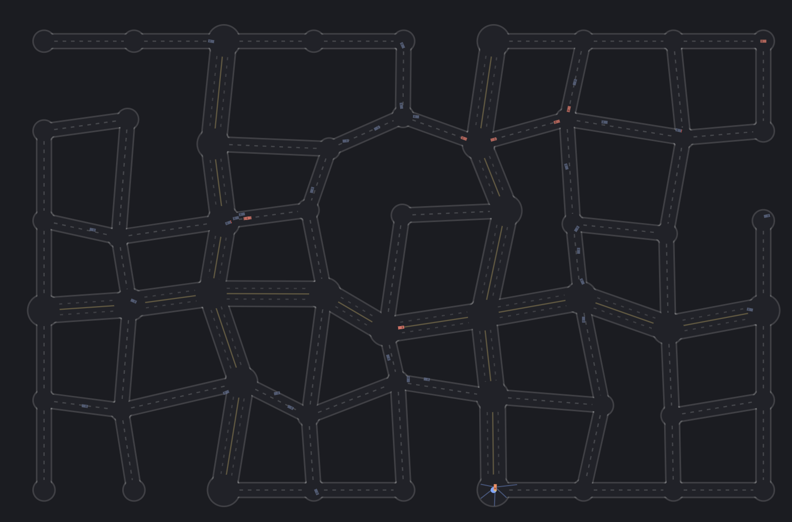
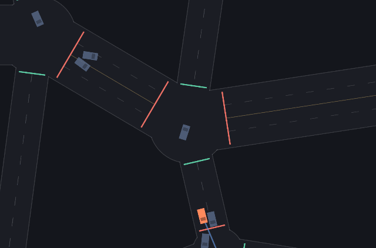
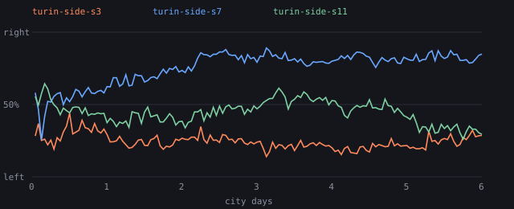
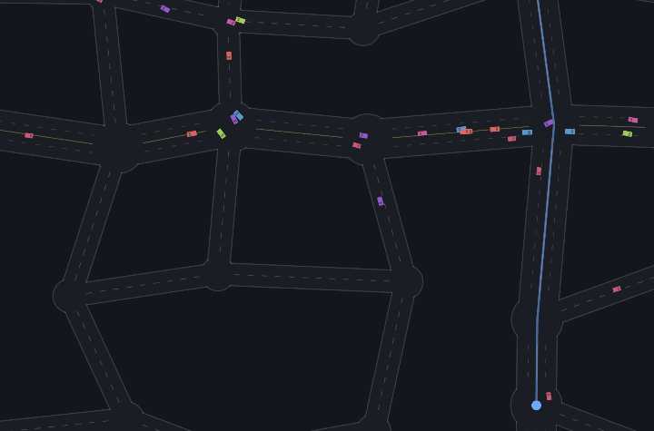
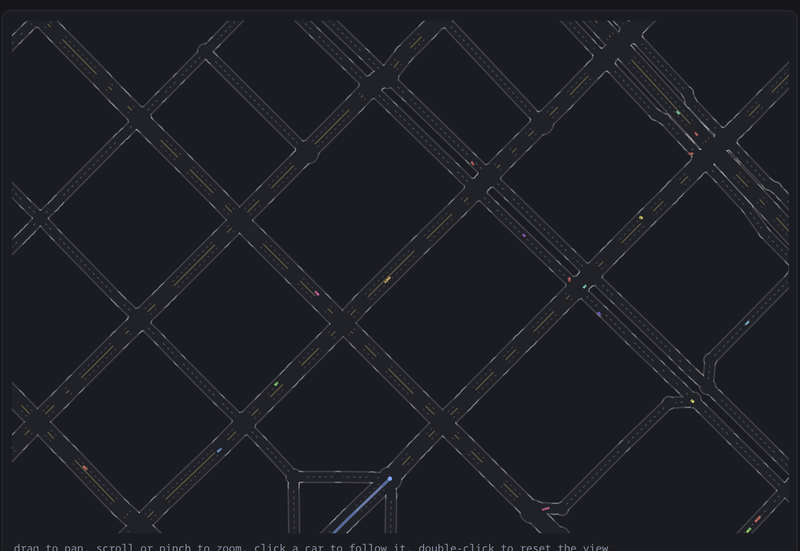
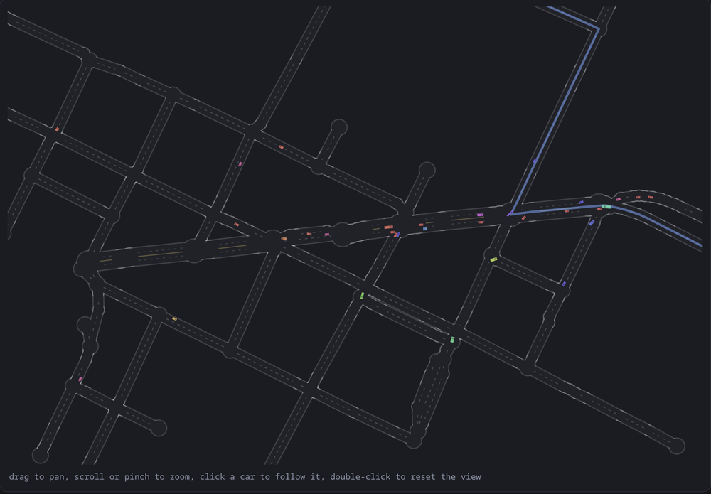
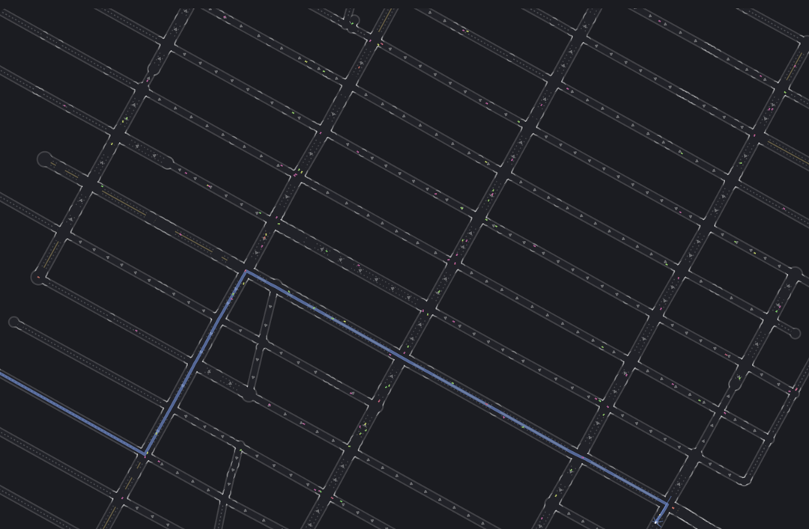
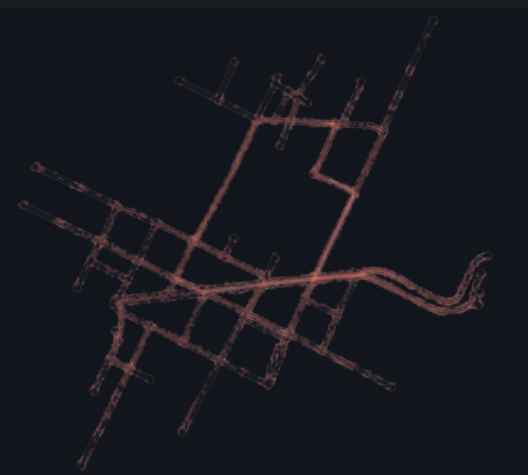

# Gridlock

A city where traffic evolves. There are no traffic laws anywhere in this code.

**[Run it in your browser](https://marcozorn.github.io/gridlock/)** ·
[the city with no fitness function](https://marcozorn.github.io/gridlock/eco.html) ·
[on Turin's streets](https://marcozorn.github.io/gridlock/eco.html?map=turin) ·
[on Barcelona's](https://marcozorn.github.io/gridlock/eco.html?map=barcelona) ·
[on Manhattan's](https://marcozorn.github.io/gridlock/eco.html?map=manhattan)



Every car is a NEAT brain. The roads, the physics, collisions and route finding
are written by hand; how to drive the route is not. The question this project
is building towards is whether, once everyone shares the streets, drivers invent
yielding, queueing and lane discipline on their own, or split into species like
couriers and trucks, or just gridlock.

It grew out of [neat-from-scratch](docs/neat.md), whose NEAT engine it still
runs on, and borrows its later ideas from
[primordial](https://github.com/MarcoZorn/primordial). No libraries, no build
step: serve the folder and open it.

- `index.html`: the generation-based city. Ghosts or traffic, density, no
  signals / traffic lights / roundabouts, heatmaps, any car's senses and brain.
- `eco.html`: the city with no fitness function. Wallets, births, deaths, two
  markets, evolved bodies, a road editor, fast-forward by the day.
- `LIVE.md`: tables and charts from the long headless runs.
- URL options: `?seed=7`, `?size=small|medium|large`, `?control=none|lights|roundabouts`,
  `?map=crossroads|turin|barcelona|manhattan`, and on the generation page `?traffic=1&density=20`.

```
python3 -m http.server                     # then http://localhost:8000
node test.mjs                              # headless checks, including "does evolution work"
node headless.mjs --run runs/x --gens 3000 --control lights --density 40
node headless.mjs --run runs/x2 --map crossroads --from runs/x/state.json --gens 4000
node headless.mjs --eco --run runs/e --days 40 --founders docs/trained.json [--pedestrians 40] [--map turin]
#   any run: --body k=v,... and --econ k=v,... override the car's and the economy's constants,
#   --no-sharing (with --from) turns NEAT fitness sharing off for an older population
node report.mjs                            # LIVE.md from every run's telemetry
node tools/sidechart.mjs out.svg runs/e1 runs/e2   # which side of the road an economy keeps to
node tools/osm.mjs extract.json maps/name.json "Place"   # an OpenStreetMap extract as a map
```

## What it found, so far

- **Drivers learn to drive a city they have never seen.** After 300
  generations the evolved champion out-drove my hand-written controller on
  twelve unseen cities.
- **They drive by the route, but learn by the traffic.** Blindfolded to
  other cars, grown drivers barely notice; raised blind, they come out a
  quarter worse. Their position on the road and the route's direction are
  what they steer by; the inputs meant for waiting at a junction go unused.
- **Junction manners plateau early.** Drivers raised on a crossroads learn
  to avoid about ten more points of crossing conflicts than at first contact
  (roughly 52% to 63%), then stop improving. Junction crashes are under 5%
  of the damage a driver takes, but making every other kind of damage free
  did not help either: drivers learned to dodge, not to wait.
- **A memory helps, a little, and only early.** Brains with a memory wait in
  junctions about twice as much and start out resolving more conflicts, but
  longer runs and more memory channels do not climb past the same plateau,
  and in the full city it makes no difference at all.
- **Right of way does not pay here.** A hand-written yield rule bolted onto
  the evolved drivers costs them 7% of their trips and saves no crashes at
  all; junction collisions are too rare to be worth stopping for.
- **Right of way did not evolve beyond that.** Not in a whole city, not in an arena that
  is nothing but one crossroads, not with crashes priced three or six times
  higher, not with better eyesight, and not when both cars pay for a
  crossing crash (that cut collisions 8%, but did not make anyone yield). About 60% of junction conflicts end
  without a collision, the same as for drivers that have never met traffic.
- **Without a fitness function, a side of the road evolves.** In the
  generation city which side cars keep to is inherited (autocorrelation
  0.71) but never locks in, even with 120 cars on the road. In the economy,
  once there are about a hundred cars, within four days usually three in
  four to nine in ten keep to one side. Which side is chance: one Turin run
  drives on the left, its twin on the right.
- **Lights teach easing off.** Drivers raised under traffic lights approach
  a red at little more than half the speed of a green, by lifting off the
  throttle rather than braking; drivers raised without signals ignore them.
- **Fines teach, and cost.** Raising the price of a red light cuts
  red-running and car-on-car crashes within a hundred generations, and the
  city moves a third as many people.
- **With no fitness function, the cheapest car wins.** Every forty-day
  economy bred small, underpowered, short-sighted cars.
- **In a crowded city the danger is the queue, not the crossing.** In the
  economy on Turin and Barcelona over 80% of crashes are car-on-car, and
  over 80% of those happen between junctions, in the traffic, not at the
  crossings.
- **One-way streets do not pay here.** Barcelona's Eixample and Midtown
  Manhattan with their real arrows carry a sixth to a fifth fewer fares than
  the same streets two-way, and are no safer: a fare across the block has to
  go round it.
- **A congestion charge prices cars out, it does not teach detours.** After
  two weeks the city moves nearly as many people (7% fewer) with 40% fewer
  cars, faster and safer; the gene for avoiding busy roads never moves.
- **A speed limit is obeyed, and costs a third of the fares.** Drivers
  settle a third slower; the fines while they learn crash the fleet, and
  once it has regrown, trips take 40% longer for 13% fewer crashes.
- **Cars and pedestrians cycle.** Once both populations can replace
  themselves they oscillate like predator and prey.
- **Fitness sharing costs here.** Raised without it, drivers made 35% more
  trips in cities they had never seen (six seeds), and switching it off late
  in two long runs helped too. It is now off.
- **Two bugs mattered more than any tuning.** A four-second "lost" rule that
  killed every car waiting at a red light, and a stagnation rule that culled
  species for drawing hard cities.

## What the drivers actually look at

Twenty-one inputs go into every brain. Which ones matter? The shipped
drivers (`docs/trained.json`), in twelve cities they never saw, with one
group of inputs at a time held at a neutral value (clear road, no car,
centred, cruising, nothing ahead):

| silenced | trips per car | crashes per 1000 units driven |
|---|---|---|
| nothing | 1.48 | 3.60 |
| how sharp the next turn is | 1.63 | 3.56 |
| distance to other cars | 1.56 | 4.09 |
| distance to the junction | 1.44 | 3.45 |
| how fast the gap to a car is closing | 1.44 | 3.65 |
| distance to the walls | 1.23 | 5.83 |
| heading error to the route | 0.68 | 6.26 |
| own speed | 0.61 | 5.20 |
| sideways position in the road | 0.38 | 13.65 |

They drive by the route and the road: where they are across it, which way
the route goes and how fast they are going. Walls matter a little. Other
cars barely: blind to them, the drivers make more trips and only 14% more
crashes, so what that sense mostly does is slow them down. Closing speed and
the distance to the next junction, inputs added for the very behaviours the
project hoped for (braking for a stopped car, waiting at a junction), are
not used at all, which is the right-of-way plateau seen from the inside. And
the turn input does harm: without it they make 10% more trips at the same
crash rate. Raised without it from the start, though (300 generations, three
seeds, tested in the same unseen cities), drivers come out the same as with
it: 1.63 trips per car against 1.58, 3.41 crashes per 1000 units against
3.62, split both ways by seed. It is not needed, and the harm is a habit of
this one population, not something the input does to everyone.

So is the sense of other cars useless too? I expected drivers raised blind
to them from the start to come out the same. They do not, in any seed (300
generations, the last 100 with traffic, then the same unseen cities):

| raised | trips per car, six seeds | crashes per 1000 units |
|---|---|---|
| seeing other cars | 1.39 / 1.71 / 1.64 / 1.47 / 2.00 / 1.80 | 3.35 on average |
| blind to them | 1.25 / 1.24 / 1.12 / 1.43 / 1.14 / 1.16 | 4.52 on average |

A quarter fewer trips and a third more crashes, every seed. Blindfolding a grown
driver costs it almost nothing, but growing one blind costs a lot: the sense
matters while a population learns to drive in traffic, and what it learns
then (a speed, a line, a way of taking corners that leaves room) keeps
working once the sense is gone. The same three sighted populations,
blindfolded only for the test: 1.38 / 1.73 / 1.75 trips per car, 4.44 / 3.85
/ 3.68 crashes, as many trips as with their eyes open and 10% more crashes.
It is not that old drivers have learned to do without: at 300 generations as
at 1025, the sense is something to learn with, not something to drive by.

`node tools/ablate.mjs turn` (or any other group) repeats a row. On the
generation page "Blind to cars" and "Blind to walls" do it live, and
evolution carries on with the sense gone.

## The city that cannot gridlock

Real traffic has a fundamental diagram: as cars are added, flow rises, peaks
at a critical density, and then falls, because past that point every new car
slows everyone else by more than it adds. That fall is gridlock. Here are the
shipped drivers in two unseen small cities (about 80 roads) with more and
more cars on the road at once:

| cars at once | flow (distance per tick, all cars) | mean speed | trips a minute | crashes per 1000 units | cars being towed |
|---|---|---|---|---|---|
| 10 | 5.3 | 35.4 | 17 | 2.2 | 15% |
| 40 | 18.6 | 30.3 | 59 | 3.5 | 21% |
| 120 | 43.4 | 24.2 | 130 | 6.5 | 30% |
| 480 | 101.1 | 16.4 | 260 | 14.3 | 44% |
| 1440 | 181.0 | 11.7 | 326 | 25.3 | 55% |

No peak, even at eighteen cars a road. Speed falls, crashes climb, but flow
keeps rising. My first explanation was the last column: a crashed car is
towed, and while it is towed it is a ghost that nothing can hit. At 1440 cars
more than half are ghosts at any moment, so a jam dissolves into crashes and
the crashes clear the road. Testing that, with the tow cut from 120 ticks to
10 (`TOW=10`):

| cars at once, short tow | flow | mean speed | trips a minute | cars being towed |
|---|---|---|---|---|
| 40 | 21.2 | 38.0 | 68 | 2% |
| 120 | 44.7 | 32.1 | 135 | 4% |
| 480 | 83.8 | 25.0 | 196 | 7% |
| 1440 | 141.8 | 20.5 | 202 | 10% |

Part of it, then: trips a minute now level off at about two hundred instead
of climbing past three hundred. But flow still never turns down. A car that
has just been put back is also untouchable for a grace period, and every
crash takes a car out of the queue it was in, however briefly; the city has
a ceiling but no collapse.

So make crashes stay. With `BODY.wrecks` a crashed car is no ghost: it sits
where it crashed, solid, until it is towed (`WRECKS=1`). With the usual
two-second tow that lowers the ceiling (125 trips a minute at 1440 cars
instead of 326) and still never turns it down. With wrecks that block the
road for ten seconds (`WRECKS=1 TOW=600`), it finally happens:

| cars at once, wrecks stay 10 s | mean speed | trips a minute | cars wrecked |
|---|---|---|---|
| 40 | 13.6 | 21.6 | 57% |
| 120 | 7.8 | 29.5 | 69% |
| 240 | 5.2 | 24.7 | 75% |
| 480 | 3.7 | 25.8 | 80% |
| 1440 | 2.4 | 21.3 | 88% |

Trips peak at about 120 cars and fall after it: more cars, fewer people
delivered. That is gridlock, and what it took was crashes that leave
something in the road long enough for the queue behind to reach the junction
before. These drivers, raised where a crash is a fine and a short tow, crash
their way through traffic rather than queue in it, and only stop being able
to once crashing stops clearing the road.

Which raises the question this project started with. If crashing through is
why right of way never evolved, drivers raised with wrecks in the road should
learn to wait. The shipped drivers, 300 more generations with `wrecks=1`
(the normal two-second tow) and without, 40 cars at once:

| | waiting in junctions, first 50 gens | last 100 gens | trips per car, last 100 |
|---|---|---|---|
| no wrecks | 7.6% | 7.6% | 1.03 |
| wrecks | 7.7% | 9.7% | 0.84 |

They do wait more, a quarter more, where the control does not move at all.
It is small, one run each, and both runs drift down in trips (the shipped
drivers were raised under older settings), so it is a hint, not a result.
From scratch with today's settings (400 generations, the last 200 in traffic,
three seeds each), the hint mostly goes: waiting over the last 50 generations
5.0% with wrecks against 4.3% without, one seed of three the other way, and a
fifth fewer trips. My reading: a wreck costs the cars behind it, not the one
that crashed, and selection only ever counts what a driver's own choices
cost that driver. The jam is somebody else's problem.

So make it theirs: with `wreckBlame`, a wreck is charged for every car that
runs into it, at that car's speed. Same three seeds: waiting 4.1%, 4.2%, 5.3%
(4.5% on average, against 5.0% for wrecks alone and 4.3% for none), trips the
same as with wrecks alone. Paying for the jam you cause does not teach
waiting either. Whatever holds right of way back, it is not who gets the
bill.

Then does waiting pay at all? A rule written by hand and bolted onto the
shipped drivers: near a junction, if a ray to either side sees a car closing
in, brake hard. Three unseen cities, 40 cars at once:

| | fitness | trips per car | crashes per car | rule in force |
|---|---|---|---|---|
| drivers as evolved | 150 | 1.49 | 5.96 | |
| with the yield rule | 143 | 1.38 | 5.96 | 1.9% of the time |
| with it from further out | 142 | 1.35 | 5.90 | 2.6% of the time |

Yielding costs trips and saves no crashes, so fitness falls. Evolution never
found right of way because, in this city, there is nothing in it to find:
junction collisions are a few percent of all crashes, and a driver that
stops for one of them loses more time than the crash would have cost. Every
experiment above that tried to make drivers wait was pushing against a
behaviour that does not pay.
(The conflict and
car-on-car counters are no use here: a wreck in a junction counts as an
unresolved conflict, and touching one counts as a collision every tick.)
(`node tools/fundamental.mjs 480` for any row.)

## What is coded and what is evolved

| coded | evolved |
|---|---|
| the road graph, lanes, junctions | speed |
| car physics and collisions | steering along the route |
| A* route from origin to destination | when to brake for a corner |
| the spatial hash for "who is near me" | what to do when someone is in the way |
| traffic lights and roundabouts, when switched on | whether to respect them |
| the economy: fares, fuel, wear, damage (week 3) | the body: size, engine, brakes, sensors, cargo room |
| | how much to let traffic change the route |

A car senses, and nothing more:

- five rays, each reporting distance to a wall, distance to a car, and how fast
  that car is closing
- its own speed
- the heading error to a point 35 units further along its route
- how far it is from the centreline of the road it should be on
- distance to the next junction, and how sharply the route turns there
- the state of the light at that junction, if there is one

It never sees its position, the map, or other cars as anything but ray hits.

## Devlog

### Week 1: streets

**The city.** A jittered grid, so no corner is exactly 90 degrees. One or two
rows and columns become arterials with two lanes each way. Then side streets
are knocked out at random, but only if the city stays connected; that is where
dead ends come from, nobody places them. Roads are baked into a grid mask once
(the same trick as the drawn tracks in neat-from-scratch), so "am I on tarmac"
is a single array read and hundreds of rays a frame are cheap.

**Routes.** A* with straight-line distance as the heuristic, which is admissible
on a road map, so the first path found is the shortest. The test checks it
against Bellman-Ford on every seed. It is a linear scan of the open set, not a
heap: at fifty junctions that is faster to read and fast enough to run.

**Fitness.** Distance driven along the route, a bonus per delivered trip, and a
penalty for crash damage. Every car in a generation drives the same chain of
fares, so a better score means better driving, not an easier route. The city
rotates every generation so nobody can memorise one.

**What broke, in order:**

1. *Nothing learned.* A hand-written controller crashed at exactly the same
   tick whatever its settings, which meant a bug, not a hard problem. Arriving
   at a destination at full speed and being handed a new trip that turns
   sharply straight away is unsurvivable. Taxis stop to drop off, so now you
   have to: a fare is delivered only below 40 units/s inside the junction, and
   the final leg reads as the sharpest turn there is.
2. *Next trip starts with a U-turn.* A* happily routed back the way you came.
   Leaving a junction by the road you entered is now banned unless it is the
   only way out.
3. *Corner cutting.* Steering at the next junction means the target flips to
   the one after while you are still on the approach, so the obvious move cuts
   the corner into the kerb. The target is now a point a fixed distance down
   the route (pure pursuit).
4. *The corner cliff.* With crash meaning death, every early brain died at
   the first corner whether it braked or not. The landscape was flat exactly
   where braking had to be discovered. Now a crash tows you back onto the road
   and costs damage instead.
5. *Crashing as a strategy.* A fixed cost per crash had no good setting: high,
   and everyone scored zero; low, and smashing through corners beat braking.
   Damage now scales with impact speed squared, so braking from 110 to 80
   already pays, and full braking is reachable one small step at a time.
6. *Some seeds never started.* Full damage cost from generation zero priced
   every early brain at almost nothing. It is now phased in over the first
   hundred generations.

**Result.** After 300 generations the evolved champion was scored on twelve
cities it had never seen, against my own hand-written controller on the same
fares: 4.4 trips per minute against 4.3. It crashes more than mine and makes up
for it in speed. Four seeds out of four learn.

### Week 2: traffic

Everyone drives at once now. Each car has its own fares from its own corner of
town, cars collide (two discs per car, front and back, so neighbours in
adjacent lanes do not touch), and a crashed car is a ghost while it is towed
and for a moment after, so it is not dropped on top of whoever is passing.
The population drives in waves, and the wave size is the density control.

The city gets instruments: trips per car-minute, mean trip time, crashes per
km (a world unit is 0.4 m, so a car is 4 m), share of time stopped in
junctions, and crash and congestion heatmaps that build up over every
generation that drives that city. Click any car to see its route, its rays and
every input to its network, live.

Junctions can be left alone, run by two-phase traffic lights, or turned into
roundabouts, all on the same population. A light is an input to the brain and
a fine for running it, not a wall: it is a convention, and whether it is worth
respecting is for the population to find out. Roundabouts are a solid island
in every big junction; the route is bent round it the short way, so two cars
with different exits can be sent round in opposite directions, and nothing in
the code decides which way traffic should flow.

**What broke:**

1. *Traffic from scratch learns nothing.* A city full of random drivers is
   pure noise. Drivers learn alone first, as ghosts, and the streets fill up
   later: traffic is a switch on the same population. (Months of fixes
   later this no longer holds: with the current code, 300 generations in
   traffic from the very first came out about as good in unseen cities as
   200 alone and 100 in traffic, 1.60 trips per car against 1.67 over six
   seeds, 3.69 crashes per 1000 units against 3.35. Whatever made the first generations pure
   noise was fixed along the way, probably the shared crash damage below.
   The switch stays, because a generation without traffic is much
   cheaper to run.)
2. *Shared crash damage.* Two cars in a collision both paid in full, so a car
   rear-ended at a standstill paid as much as the one that hit it. Selection
   was punishing the careful driver for someone else's mistake. Now each car
   pays for its own speed towards the other.
3. *Harsh mutation.* In a shared city a broken mutant is everyone's problem.
   Gentler weight mutation (half the weights, a third of the step) nearly
   doubled how far drivers got.
4. *The centreline bias.* The steering target sat on the centreline, so the
   coded part of every car pulled it to the middle of the road and lane
   discipline would have had to fight the route itself. The target now keeps
   the car's own line.
5. *The four-second rule.* The worst one, and found late: a
   car that made no route progress for four seconds was declared lost. A red
   light lasts eight. Stopping at a red, or waiting in a queue, was death, and
   evolution had faithfully selected for drivers that never stop. Every
   traffic-light result up to then was measuring that bug. Lost now means
   moving without getting anywhere; standing still is waiting, and only
   counts as stuck after thirty seconds. Fixing it also roughly quadrupled how
   well plain ghost drivers learned, because a car that slowed down for a hard
   corner had been dying too. All long runs were restarted.
6. *Runs that would not stop.* The headless runner ignored SIGTERM: Node
   delivers signals on the event loop, and a simulation loop never yields to
   it. It now yields once a generation.

**Three thousand generations.** With every bug above fixed, four
populations ran 3000 generations each in traffic, one seed per junction
control plus a quieter city. Averages over the last hundred:

| | no signals, 40 at once | no signals, 20 at once | traffic lights | roundabouts |
|---|---|---|---|---|
| trips per car-minute | 1.24 | 1.67 | 0.84 | 1.05 |
| crashes per km | 12.3 | 7.8 | 14.4 | 21.8 |
| car-on-car crashes per car | 1.6 | 1.1 | 1.3 | 1.2 |
| mean trip | 26 s | 19 s | 29 s | 27 s |
| red lights run per car | | | 2.9 | |

Leaving junctions alone moves the most people. Lights cut collisions
between cars a little and throughput by a third; roundabouts trade
throughput for kerb strikes on the islands. Halving the density does more
for safety than any junction control. One caveat: the shipped drivers raised
without signals score better under lights (1.4 trips a minute) than the
lights-raised ones (0.6), and run 6.5 reds each against 2.6. They are not
better drivers, they just never learned that red means anything.



**The price of a red light.** With the four-second bug fixed, drivers under
lights still ran about 2.4 reds each per generation. That turned out to be
rational: the fine was cheaper than the wait. Starting from the same
lights-trained checkpoint, 100 generations at three fine levels:

| fine (damage-equivalent) | reds run / car | waiting in junctions | trips / car | car-on-car crashes, 10 gens |
|---|---|---|---|---|
| 0.2 | 2.44 | 6.4% | 0.68 | 1858 |
| 0.6 | 0.97 | 12.1% | 0.36 | |
| 1.5 | 0.73 | 12.4% | 0.27 | 681 |

Fines work on behaviour within a hundred generations, and collisions between
cars fall by almost two thirds. The price is throughput: a city that waits at
its lights moves a third as many people. Crashes per km actually rose, but only
because the km fell faster; I suspected cars that stop being rear-ended by cars
that do not, and the collision mix says otherwise (rear-ending a stopped car is
16% of collisions at the low fine and 19% at the high one).

**A green wave.** If the lights matter, their timing should too. Three
schemes for the same lights-raised drivers in three unseen cities: each
light's own random offset (the default), every light switching at once, and
a green wave, east-west roads turning green just as a car at 40 units a
second arrives from the junction before:

| lights | trips per car | crashes per 1000 units | reds run per car | waiting |
|---|---|---|---|---|
| random offsets | 0.66 | 5.75 | 2.69 | 9.7% |
| all together | 0.67 | 5.63 | 2.61 | 9.6% |
| green wave | 0.67 | 5.63 | 2.66 | 9.5% |

Nothing. My first thought was that drivers who run two or three reds a
generation are not really governed by the lights, so their timing cannot
matter. So I raised the high-fine population again (100 generations from the
same checkpoint at a fine of 1.5) and tested it the same way:

| fine 1.5 | trips per car | crashes per 1000 units | reds run per car | waiting |
|---|---|---|---|---|
| random offsets | 0.40 | 9.49 | 0.86 | 12.3% |
| all together | 0.40 | 9.55 | 0.85 | 10.9% |
| green wave | 0.41 | 9.69 | 0.85 | 12.1% |

They run a third as many reds, and the timing still does nothing. Not the red
running, then. A wave helps a car that drives straight along an avenue at a
steady speed; these routes cross a jittered grid a few blocks at a time and
turn at most junctions, and the wave only runs one way. That is my guess at
why, not something I have tested.

**The crossroads.** Junction conflicts are diluted in a whole city, so I
built an arena that is nothing but the question: one junction, four arms, a
ring road joining their ends so there are no dead ends, and every fare
routed through the middle. The no-signals population from generation 2800
was moved in, once with lights and once without, and ran a thousand
generations each:

| | first 100 generations | last 100 |
|---|---|---|
| no signals: conflicts resolved | 60% | 59% |
| no signals: car-on-car crashes / car | 3.1 | 3.5 |
| lights: conflicts resolved | 58% | 52% |
| lights: car-on-car crashes / car | 2.9 | 3.6 |

Nothing. Trips went up a little and the waiting went down: the drivers got
pushier, not more polite. Making crashes three or six times as expensive
from the same start only made everyone slower. Right of way did not evolve
here, under any price I tried.

My next suspect was perception: five thin rays fifty degrees apart, and a car
seventy units away spans eight degrees, so two cars closing on a junction
from different arms mostly fall between each other's rays. So I tried seeing
cars by sector instead, each of the five car inputs reporting the nearest car
anywhere in its slice, and raised two populations from scratch on the
crossroads, identical but for that. After 550 generations in traffic the
thin rays resolved 67% of conflicts and the sectors 61%, with more crashes.
Seeing the other car was not what was missing. Dropped.

The last suspect was who pays. Each car is charged for its own speed towards
the other, which is right for a rear-end, but in a junction it means the car
that pulls out in front of crossing traffic pays almost nothing when it is
hit side-on: entering was free. So: an option where a crossing collision
inside a junction costs both cars the full closing speed, and the same
from-scratch crossroads protocol on three seeds, 550 generations in traffic,
last 150 compared:

| seed | conflicts resolved, own speed / shared | car-on-car crashes per car |
|---|---|---|
| 3 | 61% / 72% | 3.16 / 2.82 |
| 7 | 59% / 60% | 3.24 / 2.96 |
| 11 | 70% / 70% | 2.86 / 2.77 |

The first seed looked like a breakthrough and the next two did not repeat
it. What did repeat is a small drop in collisions, 8% on average, in all
three. Shared blame makes drivers a little more careful, not polite; it is
`--shared-crossing`, off by default.

What finally explained all of it was counting. In the crossroads arena, over
the last 150 generations of a run, there were 168,404 crashes. A third were
between cars, and of those, 7.9% were crossing collisions inside the
junction. Right of way governs less than 3% of the damage a driver takes,
even in an arena built around one junction. The rest is kerbs, head-ons on
the arms and rear-ends. Evolution spends its effort where the damage is, and
the damage is not at the junction. For yielding to evolve, everything else
would have to be mostly solved first, and these drivers are still hitting
walls.

Two last runs put a number on what does evolve. Raised from scratch on the
crossroads, three seeds each, junction conflicts resolved at first contact
with traffic and over the last 150 generations:

| seed | narrow roads | wide roads (two lanes each way) |
|---|---|---|
| 3 | 52% to 61% | 79% to 80% |
| 7 | 54% to 59% | 76% to 81% |
| 11 | 51% to 70% | 78% to 79% |

So there is a learned part, about ten points on narrow roads, gained early
and then flat; the population moved in from the city had already learned it,
which is why that run looked flat from the start. Wide roads start far higher
simply because there is room to miss, and cut crashes per km from about 26 to
16, but junction crashes stay at 3 to 4.5% of all the damage, so the pressure
to do better there stays small. Even with two lanes each way, no side of the
road was chosen.

That explanation made a prediction I could test: make kerb strikes free (a
crash into a wall still costs the tow, but no damage) and collisions with
other cars become the only damage there is, so junction manners should
improve. Same three seeds, narrow crossroads, last 150 generations:

| seed | conflicts resolved, normal / free kerbs | car-on-car crashes per car | trips per car-minute |
|---|---|---|---|
| 3 | 61% / 69% | 3.16 / 2.02 | 0.96 / 1.52 |
| 7 | 59% / 61% | 3.24 / 1.46 | 1.00 / 1.49 |
| 11 | 70% / 63% | 2.86 / 1.88 | 1.04 / 1.56 |

The prediction failed. Junction manners stayed where they were, 64% against
63%. What changed was how drivers avoid each other: with the kerb free, they
swerve into it, collisions between cars fall by 40% and throughput rises by
half. So the share of the damage is not the whole story either. When a
collision is the only thing that hurts, these drivers learn to dodge, not to
wait. A feed-forward brain with no memory, seeing five slices of the world,
finds dodging easy and taking turns hard, and I think that is the honest
place to leave it until the brains can remember.

So I gave them a memory: one extra output whose value comes back as an extra
input on the next tick (`--memory`). One number of state is enough, in
principle, to mean "I am waiting for that car". Same protocol, three seeds:

| seed | conflicts resolved, plain / memory | time waiting in junctions |
|---|---|---|
| 3 | 61% / 67% | 2.6% / 4.7% |
| 7 | 59% / 69% | 2.1% / 4.7% |
| 11 | 70% / 64% | 3.9% / 5.9% |

Brains with a memory wait more in every seed, and resolve more conflicts in
two of three (67% against 63% on average). Part of that is there from the
first contact with traffic (63 to 69% against 51 to 54%), so some of what
the memory buys is inertia, smoother and more cautious driving, rather than
learned turn-taking. It is the first change that moved waiting in the right
direction on every seed, so I pulled on it: the same three seeds run twice as
long, and three more with three memory channels instead of one.

| conflicts resolved | traffic gens 400-550 | last 150 of 1050 |
|---|---|---|
| no memory | 63% | (ran to 550) |
| one channel | 67% | 63% |
| three channels | 65% | 64% |

Longer training did not build on it, and more memory did not add to it. The
memory buys a small early edge and a habit of waiting, and the plateau is
still there. Whatever taking turns needs, it is more than a scratchpad.

And in the whole city, where junctions are a small part of the job, the
memory makes no difference at all: three seeds each, 400 generations in
traffic, mean fitness 112 without and 105 with, junction conflicts resolved
about 80% either way, the seeds split both directions.

**Which side of the road?** Nothing in the code prefers a side, and over
thousands of generations no permanent convention appears: the average lateral
offset of moving cars hovers near zero. But it is not noise. In a run with all
120 cars on the road at once, the side the population keeps to in one
generation predicts the next (autocorrelation 0.71 at lag 1, 0.53 at lag 6,
against zero for the same numbers shuffled), and leanings last for a hundred
generations or more before drifting the other way: one stretch of 133
generations kept a clear lean. Keeping to a side is inherited and shared, which
is what a convention is made of; it just never gets locked in.

In the economy it does. Measured on two-way roads outside junctions, as a
share of the cars on the right half of the road (relative to where they are
going), after four to six days from the same founders:

| economy | on the right half |
|---|---|
| founders, first hours | 43-49% |
| Turin, seeds 7 and 11 | 2% / 87% |
| Barcelona two-way, seeds 7 and 11 | 75% / 88% |
| Barcelona one-way (few two-way roads left) | 51% / 32% |
| generated grid, 40 days, four runs (thin traffic) | 23-62% |

Turin seed 7 is a left-hand city, 98% of its cars on the left, and its twin
a right-hand one. What does it take? Four days each from the same founders,
three seeds, share of cars on the right half:

| city | cars | on the right half |
|---|---|---|
| small grid | 44-71 | 25% / 41% / 61% |
| Turin, 40% demand | about 100 | 21% / 88% / 85% |
| Turin, full demand | 190-232 | 17% / 83% / 54% |
| large grid | 273-368 | 90% / 32% / 25% |

My first guess was crowding, and between a hundred cars and three hundred
it makes no difference. The line is lower down: a small grid with fifty or
seventy cars leans but does not settle, and neither do the 40-day runs on it
(23-62%); a hundred cars on Turin settle every time. A grid is no obstacle
either, the large one settles like the real maps. A convention needs enough
traffic to meet often, and not very much more than that.

Hour by hour, three seeds on Turin (`node tools/sidechart.mjs`, from the
`sideAll` / `sideRight` counts every telemetry row now carries; the eco page
shows the same number live):



Why the economy settles it in fifteen generations when the generation city,
with 120 cars on the road, has not in thousands, I do not know yet. One
difference is that a child here is born into the same traffic its parent
just survived, and one city of cars evolves continuously; in the generation
city every car is scored against a fresh shuffle of everyone else.

Another is fitness sharing. NEAT divides each species' fitness by its size so
that new ideas get time to pay off, which also means a minority lineage
driving on the other side is protected. The economy has nothing like it. So I
took the dense generation run (120 cars on the road, generation 2500) on for
1000 more generations with sharing (`--no-sharing`) off and on:

| from generation 2500 | mean lateral offset, per 100 generations | trips per car |
|---|---|---|
| sharing on | -0.00 0.02 0.04 -0.05 -0.05 -0.02 0.09 -0.01 0.11 -0.02 | 0.72 |
| sharing off | 0.02 0.15 0.17 0.07 -0.11 0.15 0.17 0.19 0.20 0.17 | 0.85 |

With sharing the population never leans by more than a tenth; without it,
it keeps to the right for most of a thousand generations, though at half
the strength the economies reach (0.35 to 0.43). One run each, so a hint,
not an answer. The surprise is the other column: without sharing the city
moved 18% more trips per car, with as many crashes (21.5 against 22.7 per
km over the last 500 generations).

And the code can not impose it. With `BODY.lane` the
steering target sits in the middle of the right half of every two-way road,
and one of the two Barcelona runs evolved to drive on the left anyway, 88% of
it, against its own target.

### Week 3: no fitness function

`EcoWorld` takes the score away. Every car has a wallet. Passengers pay by
distance and tip for a quick ride; freight pays by distance and load, needs
cargo room, and does not care how long it takes. Fuel goes with mass and
engine, upkeep with sensors and size and with the odometer, so every car wears
out, and crash damage with mass and impact speed. A car that saves enough has
a child, a mutated copy of its brain and its body; a car that goes broke is
gone. Species are labels only, clustered on brain distance plus body distance.

The body is a second genome: length, width, engine, brakes, sensor range,
three or five rays, cargo room. Physics is derived from it, so nothing is
free: room for freight makes you heavy, a big engine burns, long sensors cost
upkeep.

**What broke:**

1. *Random brains never get going.* A car that cannot finish a trip never
   earns and never breeds, so nothing is ever selected. The founders are
   drivers evolved the old way in the generation city; from then on, only the
   economy.
2. *A full city froze.* With no scarcity, every car got rich, the population
   hit the cap, and births and deaths stopped. Two fixes: wear, so every car
   eventually costs more to run than it earns, and finite demand, with a
   morning and an evening rush, so the more cars chase the same fares the less
   each earns.
3. *No trucks, ever.* With freight paid as a bonus on every trip, small fast
   cars always won. Separate markets fixed half of it. The other half: a
   truck is many mutations away from a stock car, and every step in between
   earns nothing extra. Half the founders now get random bodies, so the
   options exist and the economy picks.



**What came out:** a city whose population follows the clock, from about 24
cars at night to 60-70 in the evening rush. In the runs with vans, they rise
to about twenty during business hours and collapse to one or two at night,
every day, while small fast taxis own the evening. Lineages were close
to thirty generations deep within ten city days. Bodies shrink over the days: short, light
cars are cheaper to run.

**Forty days.** Three ecosystems ran forty city days each (two seeds without
signals, one with traffic lights and lights-trained founders):

| | no signals, seed 3 | no signals, seed 7 | lights |
|---|---|---|---|
| cars | 70 | 73 | 41 |
| paid trips / hour | 37 | 37 | 25 |
| mean paid trip | 31 s | 32 s | 63 s |
| deepest lineage | 96 generations | 93 | 36 |
| engine gene (started 0.47) | 0.03 | 0.01 | 0.14 |
| sensor range gene (started 0.43) | 0.02 | 0.14 | 0.08 |
| jam-avoidance gene (started 0) | 0.37 | 0.84 | 0.87 |

Every one of them bred the cheapest car it could: the engine gene went to the
floor, sensors got short, bodies small, cargo room nil. In this economy a fare
pays the same whether you took it fast or slowly, give or take the tip, while
fuel and upkeep are paid every second, so a frugal crawler outlives a quick
taxi. Minding traffic when routing rose in two runs out of three and drifted
back in the third, so I would not call it a law. The lights city carried 40%
fewer cars and took twice as long per trip, and its lineages turned over a
third as often.

The ecosystem page can load the first of these cities as it was on day 40
("Load a 40-day-old city"), lineages ninety-six generations deep and all.

### Week 4: your city, long runs

- **Editor.** On the ecosystem page, click a road to close it (it becomes a
  roadblock for routing, so nobody on it is dropped into the void), drag from
  one junction to another to build one. Junctions grow aprons, lights and
  islands to match, and anyone whose route ran through a closure is re-routed
  from their next junction.
- **Bigger cities, and growing ones.** Small (9 x 6 junctions), medium
  (13 x 9) or large (18 x 12), with an arterial for roughly every five streets.
  On the ecosystem page the city can also grow mid-run, a row of blocks at a
  time to the east or south: the old edge becomes the inside of town, the
  arterials carry on, and because fare demand scales with the number of roads,
  every expansion is a boom until the population catches up. Growth is part of
  the save, replayed in order with any roads built by hand.
- **Closing a main road.** From one five-day-old ecosystem, five more days
  twice: untouched, and with the east-west arterial (eight roads) closed.
  Paid trips per hour stayed at 37 either way, because what limits a city
  like this is demand, not road space; trips just took about a fifth longer
  (30 to 32 seconds against 24 to 29). The gene for minding traffic did not
  move in five days. The city routed round the closure the way A* does, and
  the population had no reason to change.
- **Fast-forward.** A Web Worker runs a full city day (86,400 ticks) in about
  twelve seconds while the page keeps drawing, then hands the world back.
- **Save, load, share, replay.** Generation runs and ecosystems save to
  JSON; the city is rebuilt from its seed, so a population of 120 is about a
  megabyte. Seed, size, map and junction control live in the URL. A save
  stores the random state from the start of its generation, so loading one
  replays that generation exactly, and "Replay generation" is just that: the
  same fares, the same drivers, the same crash, as many times as you like.
- **Long runs.** `headless.mjs` runs either world for thousands of
  generations or dozens of city days, checkpointing atomically, and
  `report.mjs` turns the telemetry into `LIVE.md`.
- **Family tree.** The ecosystem keeps the ancestry of everyone alive (and
  forgets lineages as they die out), and draws it: every birth a line from
  parent to child, across by time, up by generation. Within a city day or two
  it usually shows the same thing: everyone alive descends from one founder.
- **Night.** The ecosystem's 24-minute day now gets dark: a wash from
  evening to dawn and soft headlights, so the quiet small hours, when demand
  and the population drop, are visible at a glance.
- **Brake lights.** Cars show red at the back while their brain is braking,
  which turned up a small fact worth measuring: over a minute of traffic
  the trained drivers brake 10% of the time they are moving, coast 32% and
  accelerate 58%, and they brake no more when approaching a junction (9.6%)
  than anywhere else. Their speed control is mostly easing off, and it does
  not know about junctions, which is the right-of-way story above seen from
  the driver's seat. Drivers raised under traffic lights are different, just
  not in the way the brake lights would suggest: they brake no more on a red
  either, but they come up to one at 16 units/s against 28 on a green,
  easing off the throttle (0.14 against 0.22). The drivers raised without
  signals approach a red at 45 and a green at 40: the light means nothing to
  them. So a light does teach a junction-aware habit; it is easing off, not
  stopping.
- **Director.** A toggle on both pages that, every few seconds, cuts to
  whichever car has the most traffic around it and follows it, brain and
  senses on screen. Left alone, it is the quickest way to see what drivers
  actually do when they meet.
- **Drawing big cities.** The roads are rendered once into an offscreen
  canvas and only redrawn when the view or the map changes; a large city went
  from 40 frames a second to the display's full rate.
- **Speed.** Evaluating a network through a `Map` was 38% of a traffic run.
  Compiling each genome to typed arrays, same arithmetic in the same order,
  made runs 37% faster with bit-identical results. Sphere-tracing rays
  through a distance field sounded like the next win and was 40% slower:
  roads are narrow, so a ray's clearance is set by the kerb beside it, not
  the wall ahead, and it ends up taking smaller steps than a plain march.
  Reverted.
  After that, `Math.tanh` itself was a fifth of the time. A Padé
  approximant, within 1e-4 of it and clamped at ±4.97, runs the networks
  1.8 times as fast, and since it is nothing but multiplication and
  division it gives the same bits in every browser, which `Math.tanh` does
  not promise. Trained drivers drive the same within the noise (over ten
  generations, trips and crashes within 4%).

**Stagnation in a rotating world.** Working on the Python
[cars](https://github.com/MarcoZorn/cars) project in parallel turned up a
general point: when every generation races a different map, a species' best
score is compared across maps, and a run of hard maps looks exactly like
stagnation. Here NEAT's default (cull a species after 18 generations without
a new best) was doing just that. Over five seeds and 300 generations, mean
fitness at full crash price was 182 with the default, 212 with stagnation
counted over 60 generations (ten trips round the six cities), and 219 with no
culling at all. It is 60 now.

**Is the fitness just noise?** Traffic-mode fitness plateaus, so I checked
whether selection was simply blind: the same 120 genomes scored twice on
different random fares and neighbours correlate at 0.86 as ghosts and 0.78 in
traffic. The evaluation is sound; the plateau is the task.

**Mutation size, two projects, opposite answers.** In the Python cars
project a bigger weight step (0.6 against 0.35) measurably helped drivers
generalise to unseen tracks. Here the same question, three seeds and 300
generations in the rotating cities, gave the opposite: mean fitness 213 with
the gentle step (0.15), 210 at 0.3, 189 at 0.6. A car with eight inputs on an
empty loop can afford big jumps; a city driver with twenty-one inputs, routes,
junctions and other cars has more to break with each one. There is no right
mutation size, only a right one for the task.

Ray count went the same way. In cars, a ring of 16 rays instead of 8 was the
biggest gain that project ever measured, nearly a lap more on unseen tracks.
Here, 9 rays instead of 5 (`GRIDLOCK_RAYS=9`, 300 generations, three seeds,
tested in unseen cities) came out worse: over six seeds 1.32 trips per car
against 1.67, five seeds of six worse. A car alone on a track drives by
its rays, so more of them is more to drive by. These drivers steer by the
route and their place on the road (see "What the drivers actually look
at"), so twelve more inputs are mostly twelve more things to learn to ignore.

Then fewer should be better? Three rays against five, seeds 1-3: 1.80 trips
per car against 1.58, every seed better, a clean win. Seeds 4-6: 1.44 against
1.76, every seed worse. All six together: 1.62 against 1.67, nothing. Three
seeds can show a 14% difference that is not there, which is a warning for
every three-seed result on this page. So the ones from the same night were
re-run on seeds 4-6: sharing, nine rays and raising drivers blind all held
(the numbers in their sections are now six-seed ones), and traffic from the
start stayed a draw.

Population size is not the bottleneck either. For the same compute, 120
drivers for 300 generations ended at a mean of 213 and 240 drivers for 150
generations at 119; and 240 drivers for the full 300 generations, twice the
compute, ended at 210. What these drivers need is more generations, not more
of them per generation.

The steering target's distance down the route is a coded choice worth
checking too: at 25 units ahead the drivers did worse (mean 184 over three
seeds), at 35, the value everything here was raised on, 213, and at 55, 225,
which is inside the noise. It stays at 35.

**Fitness sharing costs here.** NEAT shares a species' fitness among its
members so that a new structure gets a few generations to pay off before a
bigger species crowds it out. Two long runs, each branched at its last
checkpoint with sharing on and off (`--no-sharing`), same cities:

| | best fitness | mean fitness | trips per car | crashes per km |
|---|---|---|---|---|
| 40 cars, 800 gens, sharing on | 368 | 122 | 1.13 | 12.4 |
| 40 cars, 800 gens, sharing off | 419 | 148 | 1.34 | 10.2 |
| 120 cars, 1000 gens, sharing on | 273 | 79 | 0.72 | 22.7 |
| 120 cars, 1000 gens, sharing off | 305 | 86 | 0.85 | 21.5 |

Better on every count, and not only on average: the best driver of each
generation is 12-14% fitter too. By generation 2500 these populations are
not inventing new structure, they are polishing weights, and protecting
minorities only spends offspring on the lineages that are behind. So is it only
for the start of a run? No. From scratch, 300 generations, three seeds:

| from scratch | mean fitness | best | trips per car | crashes per km |
|---|---|---|---|---|
| sharing on | 226 / 255 / 169 | 719 / 742 / 607 | 2.00 | 4.9 |
| sharing off | 291 / 401 / 288 | 740 / 822 / 727 | 2.71 | 3.1 |

Half as fit again on average, every seed. But that is fitness in the six
cities they were raised in, which could just as well be a population that has
specialised harder. So the same six populations, as they were, in twelve
cities none of them had seen, with traffic:

| unseen cities | trips per car | crashes per 1000 units driven |
|---|---|---|
| sharing on, seeds 1-3 | 2.06 / 1.75 / 0.94 | 4.01 / 3.80 / 6.08 |
| sharing off, seeds 1-3 | 1.99 / 2.09 / 2.05 | 3.75 / 3.46 / 3.88 |
| sharing on, seeds 4-6 | 1.67 / 2.11 / 1.49 | 4.23 / 3.06 / 4.45 |
| sharing off, seeds 4-6 | 2.47 / 2.68 / 2.26 | 3.18 / 2.91 / 3.48 |

It holds: over six seeds, 2.26 trips per car without sharing against 1.67
with it, and 3.44 crashes per 1000 units against 4.27. Five seeds of six are
better without, and the sixth is a tie. One check went
the other way: a population raised for 1025 generations without sharing came
out at 1.35 trips per car in the unseen cities against 1.48 for the drivers
the site ships (`docs/trained.json`), at the same crash rate. One run each,
and those were raised under older settings (stagnation 18 among them), so it
is not a clean comparison, but it is a reason not to oversell this. In neat-from-scratch, on tracks
easy enough to solve in a few generations, it made no difference either way;
in this city it is a handicap from the first generation to the three
thousandth. New populations here now evolve without it (checkpoints saved
before keep the setting they had, so the long runs carry on as they were).

### Extensions

**Route choice.** A body gene, `jam`, sets how much a driver lets current
traffic push its route away from the shortest one (each road costs its length
times one plus `jam` times how full it is). A* is still the coded part; how
much to mind traffic is evolved.

**Braess's paradox, inconclusive.** I added single shortcuts to a city one at
a time and ran a day with each, against the same day without. Six of eight
shortcuts made trips slower and rarer, which looked like Braess until I re-ran
the control with only the random stream changed: the controls alone span 785
to 1018 trips and 24.9 to 27.3 seconds a trip. Every shortcut's effect is
inside that. In a living population the churn swamps it; a proper test needs
a fixed population on a network built for it.

**Pedestrians.** A second population, run inside the ecosystem: people who
need to get across the road. Each one waits at a kerb with a tiny NEAT brain
that sees the nearest car coming from each side (distance and closing speed)
and how long it has waited, and decides when to step out. Crossing feeds it,
waiting starves it, being hit kills it, and enough crossings buys a child. The
cars see people through the same rays that see other cars, so no brain had to
change shape, and hitting someone costs the driver a fine on top of the
crash.

The first version ran fifteen city days and nothing evolved: about one
crossing in eight ended in a hit, the whole time, and the crowd sat at its
floor living on immigrants. The reason was arithmetic, not behaviour. A
pedestrian needed about eight crossings to afford a child, and at those odds
only a third live that long, so the crowd never replaced itself and there was
nothing for selection to accumulate. Make children cheaper and the crowd fills
the city within a day, and the hit rate halves, from about 12 to about 6 per
hundred crossings, in that same first day. Caution was always easy to evolve;
it just needed a population that survives long enough to evolve it.

That version, though, starved the cars: a full crowd crossing fourteen
thousand times a day meant so many fines that no car lived long enough to
have children. With a smaller crowd and a smaller fine the two populations
finally live together, and they do what predator and prey do. Over twenty
days, every two days:

| day | 0 | 2 | 4 | 6 | 8 | 10 | 12 | 14 | 16 | 18 |
|---|---|---|---|---|---|---|---|---|---|---|
| cars | 30 | 41 | 49 | 47 | 44 | 51 | 51 | 50 | 49 | 50 |
| people | 55 | 49 | 27 | 43 | 49 | 36 | 30 | 35 | 35 | 35 |
| hit per 100 crossings | 12 | 14 | 21 | 16 | 15 | 18 | 20 | 17 | 17 | 17 |

The cars multiply, crossings get deadlier, the crowd thins; with fewer people
around fewer are hit, the crowd recovers, and round it goes, damping towards
about fifty cars and thirty-five people.

**Real streets.** `tools/osm.mjs` turns an OpenStreetMap extract (Overpass
JSON) into a road graph: every way node becomes a junction, points closer than
5 m are welded together, lanes come from the `lanes` tag or the road class,
and only the largest connected piece is kept. On an imported map a node that
is only a bend in the road gets an apron as big as the bend is sharp, so a
curving street is not strung with beads. `eco.html?map=turin` runs the
ecosystem on the main streets of central Turin, and `eco.html?map=barcelona`
on Barcelona's Eixample, chamfered corners and all, and `?map=manhattan` on
Midtown Manhattan. A map past four times the size of a small city keeps
the economy of a city four times the size, so a real map never asks a
browser to draw a thousand cars.







Map data © [OpenStreetMap](https://www.openstreetmap.org/copyright) contributors, ODbL.

**One-way streets.** Most of these streets are one-way: 184 of the 196
Eixample ways in the extract, 110 of Turin's 128. The importer keeps the
arrows (an edge `[a, b, lanes, 1]` runs from a to b only), A* never follows
one backwards, and the renderer draws a chevron on them instead of a centre
line. The catch is the edge of the map. A one-way street that runs out of
the extract is a trap: cars go in and the way back is somewhere outside.
Keeping only the piece of the network where every junction can reach every
other cost Turin 60% of its junctions. So instead the importer opens a
one-way road to two-way traffic wherever it joins that piece to a street
that cannot get back, a layer at a time, until every street is in: all
junctions kept, 98 of Turin's 342 roads one-way and 420 of Barcelona's 643.
Nothing in the drivers changed, and the crash table below barely moved.

The editor can do it too. In "Edit roads" a click on a street makes it
one-way, a second click turns it round, a third closes it and a fourth opens
it both ways again. A direction that would leave some junction with no way
back is skipped (the same check as the importer's), the change goes into the
city's edit log so a save replays it, and anyone whose route now runs against
an arrow is re-routed at the next junction.

Do they help? Real cities make streets one-way to remove conflicts at
crossings and to fit more cars through. The same founders on the Eixample
with and without its arrows, four days, two seeds, days two to four:

| Barcelona | trips a day | mean trip | crashes per car per day |
|---|---|---|---|
| one-way | 2199 / 2284 | 58 s / 49 s | 140 / 139 |
| two-way | 2567 / 2792 | 47 s / 48 s | 159 / 129 |

And again on Midtown Manhattan (`?map=manhattan`, 136 of its 149 ways
one-way in the extract), same settings:

| Manhattan | trips a day | mean trip | crashes per car per day |
|---|---|---|---|
| one-way | 2014 / 1981 | 53 s / 57 s | 128 / 123 |
| two-way | 2540 / 2557 | 48 s / 51 s | 135 / 124 |

With its arrows Barcelona moves about a sixth fewer fares and Manhattan a
fifth, and neither is meaningfully safer for it: what the arrows add is distance, a fare across the block now goes
round it. I guessed this was because the cars had no lane discipline, so a
two-way street cost them nothing a one-way street could give back. That was
wrong. The two-way populations had evolved a side of the road by then (75%
and 88% of cars on the right half, see "Which side of the road?"), and with
the steering pulled to the right half of every two-way road (`--body
lane=1`) the one-way city still moved 18% fewer fares (2139 and 2062 a day,
against 2499 and 2632).

**A congestion charge.** London and Stockholm charge drivers for using
busy streets. Here (`--econ congestion=0.1`) every car pays, each second, 0.1
times how full the road it is on is: about as much as its upkeep on a road
with a car every thirty units, more in a real jam. Turin, four days, two
seeds, days two to four:

| Turin | cars | trips a day | mean trip | crashes per car per day | `jam` gene |
|---|---|---|---|---|---|
| no charge | 232 / 190 | 2584 / 2219 | 56 s / 58 s | 185 / 204 | 0.04 |
| charge | 126 / 89 | 2041 / 1611 | 43 s / 40 s | 139 / 158 | 0.04 |

Nobody learned to drive round the traffic: the `jam` gene, which makes a
driver's routes avoid full roads, did not move. What the charge did was the
thing real ones are for, only more so. It priced out almost half the cars,
the ones left make their trips a quarter faster, crash a quarter less, and
each earns half as many fares again (16 a day against 11). The city as a
whole moved a quarter fewer people, because a fare still waiting when the
queue is full goes to another firm.

Four days is not long for a gene to move, so I ran all four on to day 15.
The `jam` gene still sat at 0.04-0.08 in every run, charged or not. But the
charged cities caught up: on day 15 they moved 2691 and 2398 fares with 176
and 158 cars, against 2781 and 2726 with 287 and 285 uncharged. Nearly the
same service from 40% fewer cars. The eco page has it as a button, saved with the city.

Why does nobody learn to avoid the charge? Because it does not pay to. I took
both charged cities at day 15 and ran each for six hours with every car's
`jam` gene forced to the top, and again forced to zero: the same number of
trips either way (329 against 326, 313 against 318), as long, and cash that
came out better with avoidance in one city and worse in the other. So there
is nothing for selection to find. My first guess was the one-way streets,
where a detour costs about as much in distance as it saves in charge. But
the same test on two-way Barcelona, charged for four days, came out the same
(309 trips against 320, 313 against 305, cash again split). A route is picked
once, at the start of a trip, from a picture of the traffic that is out of
date within seconds, and a trip lasts half a minute; that may be why
foresight is worth so little here.

So I tested it, with `ECON.replan`: every car plans the rest of its trip
again at every junction, on the traffic as it is right then. Same probe, four
cities: still nothing, trips and cash split both ways. Not stale information,
then. What about the arithmetic? With the traffic of a charged Turin, a
fully avoiding driver's route is 8% longer than the shortest and only a
little emptier (mean load 0.18 against 0.24), so it saves about a quarter of
a unit of charge per trip and pays about a third of one in fuel, upkeep and
lost tips. Avoiding traffic roughly breaks even, which is why nothing
selects for it.

That predicts a big enough charge should change it. At five times the
charge (0.5) the six-hour probe tilts the right way (avoiders lost less cash
in three cities of four), and living under it for six more days:

| jam gene, day by day under a charge of 0.5 | |
|---|---|
| Turin, seed 7 | 0.05 0.06 0.10 0.12 0.15 0.20 |
| Turin, seed 11 | 0.05 0.05 0.02 0.03 0.04 0.05 |
| Barcelona two-way, seed 7 | 0.06 0.07 0.12 0.13 0.14 0.09 |
| Barcelona two-way, seed 11 | 0.23 0.21 0.15 0.16 0.15 0.12 |

One climb in four, and a gene that mutates as gently as this one drifts by
about that much on its own in 25 generations. Even a charge that bankrupts
most of the city puts only a faint pull on route choice. My reading: driving round the
jam is a strategy for a city where jams are local; in these ones, the
traffic is everywhere the fares are.

**A speed camera.** `--econ speedLimit=35` fines every car, each second it
is over 35, in proportion to how far over (0.3 a second at double). Moving
cars on Turin had been doing 41 to 46. Does a city whose passengers tip for
speed decide the fines are worth paying? Four days, two seeds:

| Turin, days 2-4 | cars | trips a day | mean trip | crashes per car per day | speed when moving |
|---|---|---|---|---|---|
| no camera | 232 / 190 | 2584 / 2219 | 56 s / 58 s | 185 / 204 | 43 / 44 |
| limit 35 | 101 / 69 | 1343 / 870 | 61 s / 61 s | 152 / 108 | 30 / 30 |
| no camera, days 9-12 | 266 / 277 | 2730 / 2716 | 53 s / 62 s | 203 / 201 | |
| limit 35, days 9-12 | 161 / 231 | 1686 / 2038 | 76 s / 86 s | 171 / 180 | |

They obey, and overdo it: cars settle at 30, comfortably under the limit,
and brake less (9% of the time against 13%). At first it seemed to cost a
trip almost nothing, 7% longer for driving a third slower. What it costs
first is the city: the share of driving time over the limit falls from 45%
on the first day to 27% on the fourth, and the fines paid while it falls
drive the fleet down to the immigrant floor of 25 cars before it regrows.
Run on to day 12, the fleets come most of the way back, and then the price
shows up where I expected it in the first place: with as many cars on the
road again, trips take 40% longer than without the camera, and the city
moves 30% fewer fares for 13% fewer crashes per car.

**Where they crash.** The ecosystem page has the same heatmaps as the
generation page (H): crashes, or cars crawling at walking pace. On a real map
the crash layer is not a set of hot junctions but whole streets glowing, and
counting says the same. Over two days from the same founders (only nodes
where three or more roads meet count as junctions; one-way streets on):

| city | crashes into walls | car-on-car | of those, at a junction |
|---|---|---|---|
| grid (small) | 25% | 75% | 27% |
| Turin | 19% | 81% | 14% |
| Barcelona | 17% | 83% | 18% |



In the generation city with traffic on, the same trained drivers crash into
a kerb a little more often than into each other (57% walls over three
generations). On the real maps, with 150 to 160 cars on streets that funnel
them into a few long corridors, they mostly crash into the one in front. Nothing in
the economy pays a car to keep its distance except the repair bill, and the
repair bill is not enough.

So I made it bigger. Six days on Turin (before one-way streets) from the same founders, two seeds,
with the crash bill at its default and at three times that
(`node headless.mjs --eco --map turin --econ crashCost=27`):

| repair bill | cars, days 3-6 | trips a day | crashes per car per day | `brakes` gene |
|---|---|---|---|---|
| default | 222 / 232 | 2770 / 2954 | 197 / 201 | 0.56 / 0.45 |
| tripled | 112 / 164 | 1901 / 2492 | 161 / 144 | 0.63 / 0.50 |

Fewer crashes per car, a little more brake in the genes, but the city also
lost a third to a half of its cars, and fewer cars on the same streets crash
less whatever their brains are like. Comparing only stretches with the same
number of cars on the road, the difference goes away: one seed crashes less
than the default economy, the other more. A dearer repair bill buys a
smaller city, not a more careful one.

What does make them more careful is time. In the default economy, at the same
number of cars, a car crashes about a quarter less often in days four to six
than in the first two (1.36 and 1.26 crashes per car per ten minutes with
100-150 cars on the road, down to 1.01 and 0.99). Every crash is paid for in
cash, and the ones who pay least are the ones who get to have children.

Part of that is not care but size. Over the same days the cars shrink, in
every run: the length gene falls from about 0.17 to 0.02 and width and cargo
fall too, a footprint about a quarter smaller. To split the two, I took
three six-day Turin populations and ran each for half a day as evolved, and
again with every car stretched back to the founders' size, same brains:

| Turin, day 6 | crashes per car per ten minutes, as evolved | at the founders' size |
|---|---|---|
| seed 3 | 1.19 | 1.24 |
| seed 7 | 1.16 | 1.26 |
| seed 11 | 1.17 | 1.32 |

Size is worth about 8%, roughly a third of the fall (which was measured
before Turin had its one-way streets, these runs are after). The rest is the
driving. Measured on moving cars, the founders a few hours in against the
same three seeds at day six:

| Turin | speed | braking | a car ahead within 60 units | closing speed on it |
|---|---|---|---|---|
| founders | 46.3 | 10.9% of the time | 14% of the time | 0.25 |
| day six | 41.1 | 13.4% of the time | 24% of the time | 0.18 |

The later streets are busier, which alone would slow everyone down. But they
come up on the car in front about 30% more gently, and brake more often to do
it, which slower traffic explains less easily: closing speed is relative to
the car ahead, and that car is slower too. Nobody taught them to keep their
distance; if they learned it, the repair bill did.

## Files

| file | what is in it |
|---|---|
| `src/city.js` | road graph generation, the road mask, A* |
| `src/driver.js` | a car in the city: physics, sensors, route following, fitness |
| `src/spatial.js` | uniform-grid spatial hash |
| `src/cityworld.js` | trips, generations, evolution |
| `src/citysim.js` | the generation page |
| `src/ecoworld.js` | the economy: wallets, markets, births, deaths, species labels |
| `src/body.js` | the body genome and the physics it implies |
| `src/pedestrians.js` | people crossing the road, the second population |
| `src/ecosim.js`, `src/ffworker.js` | the ecosystem page and its fast-forward worker |
| `src/render.js` | drawing shared by both pages, pan/zoom, picking |
| `headless.mjs`, `src/waveworker.mjs`, `report.mjs` | long runs (traffic waves on worker threads) and `LIVE.md` |
| `tools/osm.mjs`, `maps/` | OpenStreetMap import; Turin, Barcelona, and the crossroads arenas |
| `src/genome.js`, `src/neat.js` | NEAT from neat-from-scratch, plus networks compiled to typed arrays and save/load |
| `test.mjs` | `node test.mjs`: everything above, checked headlessly |
| `track.html`, `src/track.js`, `src/car.js`, ... | the original single-track demo |

## Reading

- Stanley and Miikkulainen, [Evolving Neural Networks through Augmenting Topologies](https://nn.cs.utexas.edu/downloads/papers/stanley.ec02.pdf) (2002)
- Amit Patel, [Introduction to A*](https://www.redblobgames.com/pathfinding/a-star/introduction.html), Red Blob Games
- Craig Reynolds, [Steering Behaviors For Autonomous Characters](https://www.red3d.com/cwr/steer/) (1999), where pure pursuit comes from in games
- Dietrich Braess, [On a paradox of traffic planning](https://doi.org/10.1287/trsc.1050.0127) (1968, English translation 2005)
- [primordial](https://github.com/MarcoZorn/primordial), for "stay solvent" as the only rule

MIT.
